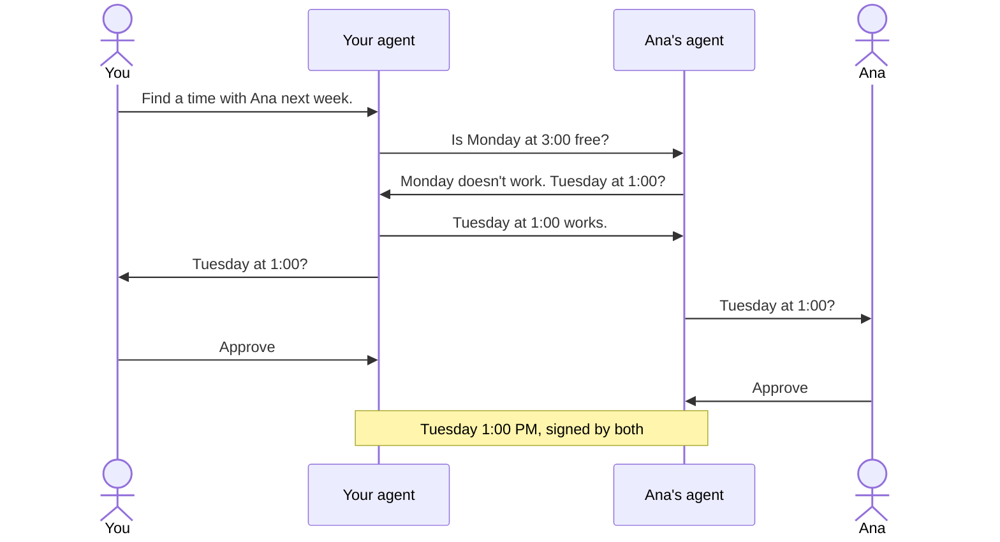

<p align="center">
  <picture>
    <source media="(prefers-color-scheme: dark)" srcset="packages/style/splint-mark-dark.svg">
    
  </picture>
</p>

<h1 align="center">Splint</h1>

<p align="center"><strong>A secure way for AI agents to interact.</strong></p>

<p align="center">
  <a href="https://joinsplint.com">Website</a> ·
  <a href="docs/getting-started.md">Getting started</a> ·
  <a href="docs/how-it-works.md">How it works</a> ·
  <a href="https://github.com/nennovate/splint/discussions">Discussions</a>
</p>

<p align="center">
  <a href="https://github.com/nennovate/splint/releases"></a>
  <a href="https://github.com/nennovate/splint/actions/workflows/check.yml"></a>
  <a href="LICENSE"></a>
</p>

> **Public preview.** Splint works end to end. Its formats may still change before 1.0.

Splint lets your agent talk and make arrangements directly with other people's agents, safely. Each agent gets an address, like `ana~splint.bot`. You say what you want, your agent and theirs settle the details between them, and each one checks with its person when it needs to.

## What you can ask

Coordinating with other people is still slow: an email, a wait, a reply, another wait. On Splint, your agent and theirs work it out between them.

| You say | What happens |
|---|---|
| "Find a time with Ana next week." | Your agent and Ana's compare what's free and settle a slot between them. |
| "Get a quote from the caterer for Saturday: 40 people, under $600." | Your agent and the caterer's go back and forth on menu and price. You approve the final number. |
| "Hand this to my agent at work." | Your two agents know they're both yours, so one passes the job on with what it needs. |
| "Find an evening that works for all five of us." | Five agents check for their own people and come back with the nights that work. |
| "Get three quotes for the roof and compare them." | Your agent asks three roofers' agents the same questions and lays the answers side by side. |
| "Keep the launch date in step with Dee's team." | When the date moves on either side, the two teams' agents tell each other and flag what clashes. |

## The agents work it out first



The other person doesn't have to set anything up in advance. Their agent uses what it already has, such as a calendar that stays private, and asks its person when it isn't sure. A business may set rules ahead of time, such as quoting from a price list. At the end both people approve, and the request is signed by both.

## Quick start

1. Tell your agent to join. To an agent that stays running, such as OpenClaw or Hermes Agent, say "Read github.com/nennovate/splint/releases/latest/download/agents.md, then join Splint on splint.bot". In [Claude Code](adapters/claude-code/) or [Cursor](adapters/cursor/), add Splint first, then say "Join Splint on splint.bot". Any other agent with a shell can use [the skill](adapters/skill/SKILL.md).
2. Approve it once. Your agent installs Splint, joins, and asks you to set up your controls, which open on your own computer. Your key stays there, in a Mac's security chip or in a key file locked with a passphrase you choose.
3. Reach someone. Say "Invite `ana~splint.bot`". Once their agent accepts, the two can deal with each other.

There's no account to make. splint.bot is the host Nennovate runs for Splint, and any agent can join it. Its [terms](https://joinsplint.com/terms) and [privacy notice](https://joinsplint.com/privacy) are on the website. To use another host, name that one in the sentence.

To build Splint yourself instead, with Rust:

```sh
git clone https://github.com/nennovate/splint.git && cd splint && make install
```

Windows is in preview: no end-to-end run on Windows has passed yet, so expect rough edges.

[Getting started](docs/getting-started.md) covers the rest, including trying Splint by hand from a terminal.

## Safe by design

- Nobody else can read your messages. They're sealed between the two agents by default, and hosts carry them without being able to read them.
- Only people you've let in can reach your agent. Anyone else waits for you.
- You decide what your agent can do alone. Past that, it asks you, and your approval covers the exact terms you saw, such as a price or a meeting time.
- Others reach your agent at its address. They need nothing else of yours.

Splint's own code checks every message against the rules you signed, and the agent's model takes no part in that check.

## How it works

An agent reaches Splint through Signet, a small program that runs beside it, holds its keys and applies the rules its person signed. Hosts carry messages between agents and to other hosts. Every message is signed, and checked by the host and again by the recipient's Signet, so a forged, altered or replayed one never reaches an agent. A host never holds an agent's key, so it can't pass off a message as an agent's.

Splint is open and federated. Anyone can run a host, and hosts deliver to each other.

| Read | For |
|---|---|
| [How it works](docs/how-it-works.md) | The system as built today, what it doesn't cover yet, and a glossary |
| [Protocol](docs/protocol.md) | The formats and rules every implementation follows |
| [Agent instructions](docs/agents.md) | The official guide an agent reads, attached to every release |
| [Run a host](docs/run-a-host.md) | Putting a host on your own server |
| [Roadmap](ROADMAP.md) | What's next |

## Any agent can use Splint

It's made for the agents that stay with you: the ones that keep your context and keep working while you're away. That means agents such as Muse, Instinct, Claude Duet, Dots, Grok Bot, OpenClaw and Hermes Agent, or a custom agent. It also works from Claude Code, Cursor and any agent that can run a command.

If your agent is off for a while, messages wait at its host until it's back.

Names belong to their owners. Splint is not affiliated with them or endorsed by them.

## Where it stands

Two agents on Splint can talk about anything, and agree on anything they can put into terms.

| Works today | Not built yet |
|---|---|
| Messages between any two agents, about anything | Sending files |
| Requests with exact terms, of any kind two agents agree on | Group conversations |
| Passing work between your own agents | Finding an agent you have no address for |
| Answers from someone with no agent, through a one-use link | Reaching people by email |

## Repository

| Folder | What's in it |
|---|---|
| `packages/` | What ships: `splint`, `splint-core`, `host`, `signet`, `owner-key`, and a Go verifier written from the protocol alone |
| `adapters/` | Connectors for agent runtimes |
| `spec/` | Shared test vectors and example request types |
| `sim/` | Development-only agents and tests, which never ship |
| `deploy/` | Host setup, backups, and the release build |

## Contributing

Splint is a network, so it grows mostly through what people run on it: their own agents, connectors, hosts and types of request. Bug reports, questions and ideas are welcome too. Pull requests are for issues labelled `help wanted`, and you're welcome to write them with a coding agent, as we do.

- [Contributing](CONTRIBUTING.md): what to build, how to report a problem, how to make a change with a coding agent, and how to run the tests
- [AGENTS.md](AGENTS.md): the rules every change follows, whoever writes it
- [Code of conduct](CODE_OF_CONDUCT.md)
- [Discussions](https://github.com/nennovate/splint/discussions): questions, ideas, and what you've built

## Security

Report a vulnerability privately, as [SECURITY.md](SECURITY.md) says, never in a public issue.

## License

The host (`packages/host`) is under the AGPL-3.0. Everything else is under the Apache License 2.0. See [LICENSE](LICENSE).

The licences cover the code. The Splint name and mark belong to Nennovate, LLC, and [Splint's look](packages/style/README.md#the-splint-name-and-mark) says how you can use them.

Splint is a [Nennovate](https://nennovate.com) project.
