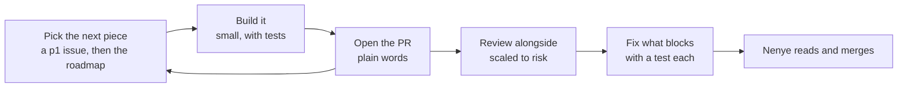

# How we build

What's worked, so anyone can pick this up and move quickly. `AGENTS.md` holds the rules, and this is how to apply them.

**Progress means working features on `main`.** Issues filed, docs written and reviews run don't count. A report says what landed first.

## The loop

The next piece starts when a PR opens, not when its review ends. A serious review finding comes back to the front of the queue.

## Order of work

1. **Fix before you add.** A `priority: p1` issue from a review is the next work, ahead of new features on that stack.
2. **Reach something usable early.** Build a thin version someone can try, then harden it. Security layers built with nothing to try take a long time to look like progress.
3. **Keep PRs small enough to read in one sitting.** A 14,000-line PR can't be reviewed well. Generated test data can go in its own PR.
4. **Show it working.** Each feature PR includes a short demo or results table.

## Issues

File every issue, even one you're fixing right away, and never file one and ignore it. Weigh each by scope and by importance. A fundamental problem is important even when it's small.

| Importance | What to do |
|---|---|
| Important, including anything fundamental | Solve it next, and keep going until none are left |
| Minor | File it and move on |

An issue says what happens, how to see it and the likely fix. A PR that fixes it says `Closes #N`. Keep an eye on open against closed: a pile that only grows means we're finding faster than we're fixing, so stop adding and clear some.

## Stacks

Stack PRs when one really depends on another. A failed review at the bottom holds up everything above it, so keep stacks short, and fix from the bottom up. Merge bottom-first, and retarget whatever sat on a merged branch.

## Decisions

Decide and keep going, using the most reversible option, and note it under Key decisions for Nenye to overturn. Ask only when a choice would be costly to reverse and the brief doesn't settle it. Normal use shouldn't need a person, and a model never decides a security check.

## Testing

| Command | Use it for | How long |
|---|---|---|
| `make rules rust deps verifier` | While you work, and before any PR. It's the fast half of `make check`, which CI runs on every PR: repo rules, format, lint, unit tests, the dependency check and the Go verifier, with no Docker | About 3 minutes on a 14-core Mac once it has built, and 2 to 6 in CI |
| `make check` | Before a PR changing product code is ready. It adds the end-to-end half, which CI runs on every ready PR that changes product code: `make e2e test-adapter test-install test-owner-page`, more than 40 runs of real hosts and Signets against Postgres in Docker, with the owner pages in a real Chrome | About 50 minutes on a 14-core Mac. The end-to-end half took 36 to 65 minutes in CI |
| `python3 sim/NAME.py` | One end-to-end run by itself, for the part you changed. `make/core.mk`, `make/install.mk` and `make/owner-page.mk` list them | About a minute each on average |
| `make trace` | Seeing scripted agents exchange messages | A minute, free |
| `make agents` | Real agents doing the job | A minute, about $0.20 to $0.30 |
| `make test-network` | Agents across a real network path on one machine | Under a minute |
| `make test-resilience` | Crashes, cut networks, full disks and bad clocks | About 10 minutes |
| `make test-hostile-input` | Attacking everything with bad data | About 25 minutes |
| `make test-load` | What a small server can carry | Up to about an hour |

Numbers from a busy machine are a rough guide. Real capacity needs a real server, and any limit we set ourselves isn't a measure of capacity.

## Review before going public, and after

Nenye decided there's no outside crypto review before the first public preview. A human review of the crypto comes later, before any format is frozen. What the preview had in its place is in [how it's been checked](how-it-works.md#how-its-been-checked): a security read attacking real hosts and Signets, a crypto read by a second model that didn't write the code, the Go verifier and Wycheproof's ECDSA vectors.

Before any outside owner's real data, the whole stack gets one read together, run with the fooled-agent suite.
