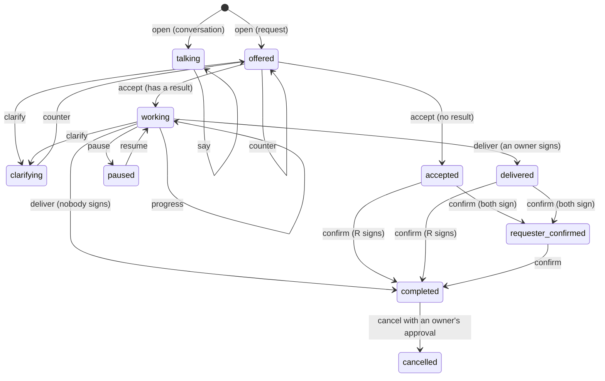
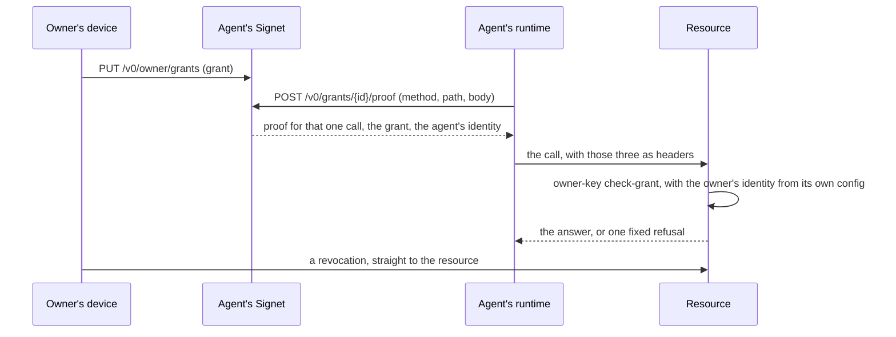

# Splint protocol

The formats and rules code must follow. For why it works this way, see [how it works](how-it-works.md). For what Splint is and isn't, see [`AGENTS.md`](../AGENTS.md).

**Every format here is provisional.** Nothing is frozen until Nenye approves it and a named person has reviewed the crypto. **Planned** marks what isn't built, with the issue that builds it. Everything else is built and checked by the [vectors](../spec/vectors/README.md) or `sim/`.

## Signing

- Compact JWS with ES256, or WA256 for an owner whose key is a [passkey](#owner-keys-in-a-passkey). The header is exactly the bytes `{"alg":"ES256","typ":"<type>"}` or `{"alg":"WA256","typ":"<type>"}`. It can't choose the algorithm or key: the signer's ID says which header its key signs with, and the other is refused as `bad_signature`. `typ` stops one kind of object being replayed as another.
- Base64url without padding. An ES256 signature is exactly 64 bytes, `r` then `s`. Both high and low `s` verify.
- An object's ID hashes its payload bytes as sent, never the signature. Verifiers never re-encode.
- Payloads are JSON. Unknown fields, duplicate keys and an unknown `v` are refused.
- A compact object is at most 256 KiB.

Each `typ` has one kind of signer. Owner keys sign authority, agent keys sign work, and host keys sign only "I relayed this" and, about their own [host ID](#host-ids), which key and which ID are the host's.

| `typ` | Signed by | Meaning | State |
|---|---|---|---|
| `splint-envelope` | Agent or guest key | A message, and every step of an interaction | Built |
| `splint-access` | Agent key | One call | Built |
| `splint-delivery` | Host key | I relayed this message to that host | Built |
| `splint-host-id` | Host key, the one its host ID counts now | This ID is the host at this domain | Built in core and hosts, provisional. The Go verifier checks no host object |
| `splint-binding` | Owner key | This agent acts for me, at this address | Built |
| `splint-binding-accept` | Agent key | I act for the owner in that exact binding | Built |
| `splint-binding-vouch` | The agent's backup key | This agent may act for this owner | Built |
| `splint-release` | Owner key | This agent no longer acts for me, and acts for this owner now, or for nobody | Built |
| `splint-recovery` | Backup key | This ID's next key and recovery rule | Built |
| `splint-key-add`, `splint-key-remove` | Owner key, or a host's key in its own [host ID](#host-ids), and an addition's added key too | This sign-in counts for my ID too, or no longer does | Built in core, the Go verifier, hosts and Signets, provisional. `owner-key` makes one for a [second computer](#splint-on-your-computer); the page making one is planned |
| `splint-ask` | Agent key | Ask my owner for exactly these changes, until then | Built in core, the Go verifier, Signet, `owner-key` and `splint`, provisional |
| `splint-recovery-rule` | Owner key | My recovery code is this one, set once, after an ID was made without one | Built in core, the Go verifier, hosts, Signets and `owner-key`, provisional |
| `splint-change` | Agent key | One material change, in this ID's history | Built |
| `splint-change-statement` | Owner key | Where this agent's Signet runs, or a change Splint can't see | Built |
| `splint-change-accept` | Owner key | Yes to a contact's history, as far as one exact head | Built |
| `splint-retirement` | Owner key | This agent is finished | Built |
| `splint-rules` | Owner key | The full rules for one agent | Built |
| `splint-invite-redeem` | Invitation key | The holder of this invitation names this agent | Built |
| `splint-invite` | Agent key | Be my contact: this invite, from me, to that agent at that address | Built |
| `splint-invite-accept` | Agent key | Yes to that exact invite | Built |
| `splint-approval` | Owner key, or their delegate key within its caps | Yes or no to exact terms. A delegate only says yes, to a `confirm` | Built |
| `splint-delegation` | Owner key | This key in this agent's Signet may say yes to a `confirm` within these caps | Built |
| `splint-pairing` | The owner's session key | Open a mailbox at this host for 15 minutes, for an agent given my code to answer | Dropped on 2026-11-21: nothing makes or takes one, and hosts serve no mailbox. The format stays below until it's removed |
| `splint-owner-session` | Owner key | This key reads what this host keeps for me, until then | Built |
| `splint-owner-access` | An owner's session key | One read, under that session | Built |
| `splint-owner-agents` | Owner key | My agents, sealed to me, for my page to find | Built |
| `splint-rules-renewal` | The owner's delegate key | These exact rules go on until then. Nothing signs one since 2026-11-15, as rules last until replaced, and a reader drops one it's handed | Retired |
| `splint-rules-applied` | Agent key | I'm running this version of the rules | Planned |
| `splint-person-text` | Owner key | A person wrote this, for this agent to carry to that one | Built |
| `splint-where-paid` | Owner key | Where I get paid: up to 4 places on rails I already use | Built, provisional |
| `splint-grant`, `splint-grant-revocation` | Owner key | This holder may do this at this resource, and that grant is over | Built |

Everything signed by an owner key in this table may be signed with WA256 by an owner whose key is a passkey, and nothing else may: a WA256 header on any other `typ` is malformed. A key that isn't an ID's, such as a backup, a host's, an invitation's, an owner's delegate or an owner's session key, always signs ES256.

### Owner keys in a passkey

**No new ones, decided by Nenye on 2026-11-21.** Hosts serve no page that makes or signs with a passkey, and owners sign only on their own computers, with [Splint on the computer](#splint-on-your-computer), as whoever serves the page a passkey signs on chooses what the touch signs (issue 635). Nothing migrates an existing passkey owner: every rule below stays, in every reader, so whatever such an owner signed still verifies. No host Splint ships serves a page that signs with their passkey, but every reader still takes a new signature by it, so their host could serve a page of its own at the passkey's site and have their touch sign what it didn't show. That stays open until they stop using the passkey, by moving to their computer with their recovery code, or becoming an owner there again. What follows is the format such owners' IDs and signatures already have.

An owner's key can be a [passkey](https://www.w3.org/TR/webauthn-3/), held in their device's passkey store, a password manager or a security key, which signs only through WebAuthn. Its ID says so, and names the RP ID the passkey was made for (see [IDs](#ids-and-addresses)). It signs with WA256: the header is `{"alg":"WA256","typ":"<type>"}`, and the signature segment is the base64url of exactly these bytes, each value base64url, in this order, with no spaces or other fields, or, for [one touch over several objects](#one-touch-for-several-objects), with `b` after `a`:

```json
{"a":"<authenticatorData>","c":"<clientDataJSON>","s":"<signature>"}
{"a":"<authenticatorData>","b":["<hex>","<hex>"],"c":"<clientDataJSON>","s":"<signature>"}
```

The segment is at most 2048 characters, and longer is malformed before anything else is read, as is a segment in any other shape or a value that isn't base64url. `s` is the ECDSA signature in ASN.1 DER, as WebAuthn returns it, and it has to be strict DER. Both high and low `s` verify, as with ES256. With `I` the signing input, the header and payload segments joined by `.`, a reader checks, under the ID's key and its `rp`:

1. `c` is a JSON object, in any spacing or escaping a browser writes, with no key twice at its top level. It starts with its `{`, so a byte-order mark before it is malformed, and no string in it, key or value, read or skipped, holds an escape for half a UTF-16 character, such as `"\ud800"` alone. Fields beyond these are allowed, as browsers add their own. `type`, `challenge` and `origin` are strings, and `crossOrigin`, if there, is `true` or `false`. One missing, or of another type, is malformed.
2. `type` is `webauthn.get`. `challenge` is exactly the base64url of SHA-256(`I`), so the passkey signed this exact header and payload, or with `b`, the batch challenge below. `origin` is exactly `https://` and the `rp`, with no port, so only a page served at the RP ID itself can have made it, not one on a subdomain or another port. Plain HTTP never is, for any `rp`. `crossOrigin` is absent or `false`.
3. `a` is at least 37 bytes. Its first 32 are SHA-256 of the `rp`. In byte 33, the flags, bit 0 (user present) and bit 2 (user verified) are both set: every passkey store checks who's there, and the owner's page asks it to. The rest, the sign counter and any extensions, is signed and ignored, since a synced passkey reports a counter of 0.
4. `s` verifies as ECDSA P-256 with SHA-256 over `a` followed by SHA-256(`c`).

A failure in 2 to 4 is `bad_signature`. An object's ID still hashes its payload bytes, so it's the same however it was signed.

#### One touch for several objects

An owner setting up their controls signs a binding, rules and a delegation together, and each touch is something a person does. So one assertion can sign up to 8 objects, each carrying the same segment with `b`, the list of every signed object's hash, in the order signed:

- Each entry of `b` is the hex SHA-256 of one object's signing input `I`, its header and payload segments joined by `.`, in lowercase, 64 characters. `b` has 2 to 8 entries and none twice. A list of one, more than 8, a repeat, or an entry in capitals or of another length is malformed, as is `b` that isn't an array of strings. One object alone is signed without `b`, as above.
- The challenge is the base64url of SHA-256 of the ASCII bytes `splint wa256 batch v1`, then each entry's 32 bytes, in the list's order. The tag keeps a batch's challenge from ever being one object's, since a signing input starts with base64url.
- A reader checks its own object's hash is in `b`, or it's `bad_signature`: the touch signed other things. It then checks the assertion as in 1 to 4 with the batch's challenge, so a list in another order is `bad_signature` too.
- Each object verifies alone, by its own signature segment, wherever it travels. What a reader of one learns about the others is only their hashes, never their contents.
- The page shows the person everything the touch covers before asking for it, as for one object. What a passkey doesn't protect, below, applies to all of them at once.

What a passkey protects: no agent or other program on the owner's machines can read the key or sign with it, each signature needs the owner's touch, face or PIN there and then, and a page at any other origin can't get a signature that verifies. What it doesn't: whatever page the owner signs on chooses what the passkey signs, and nothing in an assertion ties what was signed to what the owner was shown. So whoever serves pages at the RP ID can show the owner one thing and have them sign another, such as an approval on other terms, a broad grant or rules at `full_auto`, and every verifier accepts it. If the RP ID is a domain a host runs, that host can make the owner sign anything they touch for, which an owner signing with a file key on their own device isn't exposed to: for that owner, [invariants](../AGENTS.md#security-invariants) 2 and 6 hold only while the host is honest. That's why none are made now. The owner's own computer is the only place to sign: [`splint controls`](#your-controls-on-your-own-computer) opens the page [Splint on the computer](#splint-on-your-computer) serves at `localhost`, which signs with that computer's own sign-in and makes no passkey, so no host is part of it. No passkey is ever for `localhost` or a name under it: any program on the owner's machine, run by any user, can serve a page there on any port and have their touch sign what it likes, so an RP ID that's either is malformed, in an ID, an added key or a recovery, and everything such a passkey signs is refused with it.

**What stays open.** Until 2026-11-21 each host served the [owner page](#owner-api) at its own name, a risk Nenye accepted on 2026-11-14 for owners who signed in there, and every passkey made then names that host's name for good. Hosts no longer serve it, but a dishonest host could still serve its own page at that name and have such an owner touch for something, and every verifier still takes a new WA256 signature, so such an owner is safe from it only once they stop using the passkey. A passkey synced through an account is as safe as that account.

#### Keys an owner's page derives

An owner whose key is a passkey has no file for their backup or their sealing key, so the [owner page](#owner-api) derived both, and the backup's derivation is what every recovery code still uses, each as a P-256 private scalar from a secret: 48 bytes of HKDF-SHA256 ([RFC 5869](https://www.rfc-editor.org/rfc/rfc5869)) with the secret as input keying material, the salt below, and the info `p256 scalar` in ASCII; read as a big-endian number `okm`, the scalar is `okm mod (n - 1) + 1`, where `n` is P-256's order. So it's never zero or past the order, and the 128 extra bits leave no bias anyone could see. `owner-keys.json` in the vectors checks both.

- **The backup key, from a recovery code.** The page makes 16 random bytes, the recovery code, and derives the backup's scalar from them with the salt `splint backup v1`. The ID commits to that key's point, as any backup. The page shows the code once, as base32 ([RFC 4648](https://www.rfc-editor.org/rfc/rfc4648) alphabet) in lower case with no padding, 26 characters whose last character's 2 spare bits are zero, in groups of 4 joined by `-`, and asks the person to save it, with Copy and Download, or to skip with a reminder until they say they've saved it. A code is read back in either case with spaces, dashes and line breaks anywhere, and anything else is malformed. `owner-key recover --identity IDENTITY --code -` reads one from standard input, so it's in no command line, and recovers the ID to a new file key, as `--backup` does.
- **The sign-in's lock, from the passkey's PRF.** Legacy: no page makes a passkey or asks for its PRF since 2026-11-21, and the rule stays only as the format of what was made before. The page asked the passkey's [PRF extension](https://www.w3.org/TR/webauthn-3/#prf-extension) to evaluate the ASCII `splint owner sealing v1`, when it's made and on each signature, and derived from the 32 bytes it gave the lock its [copy of the reading key](#the-reading-key-with-many-sign-ins) is sealed to, with the salt `splint sign-in lock v1`. A passkey store with no PRF got a lock the page made on that device, which WebCrypto kept in the browser's IndexedDB. The reading key itself is made at random, with 32 random bytes and the salt `splint reading key v1`. The `prf.lock_key` vectors check the lock, and only the Go verifier runs them now.

Whatever sets up an agent's controls makes that agent's next backup, the one that vouches for its owner, at random, and keeps it in the owner's [list of agents](#owner-api), sealed to them twice: to their sealing key, and to their backup key, so the recovery code still reaches it once the sign-in is gone.

## IDs and addresses

There's one kind of ID, for people, businesses and agents. An identity event is exactly these bytes. `key` is the base64url of the 65-byte uncompressed P-256 point that signs, and `seal` the same for the [sealing key](#sealed-and-unsealed) others seal to, which has to be on the curve and isn't the signing key. Any other encoding is refused, so a pair of keys has one ID and an identity stays small.

```json
{"v":4,"alg":"ES256","key":"<point>","seal":"<point>","recovery":{"rule":"backup_key","commitment":"<hex SHA-256 of the backup key's 65 bytes>"}}
```

An owner whose key is a [passkey](#owner-keys-in-a-passkey) has a version 5 event, with `alg` `webauthn-es256` and `rp`, the RP ID the passkey was made for. `rp` is a hostname spelled as an address's domain is, lowercase with no trailing dot, and with no port, and isn't an IP address, `localhost` or a name ending `.localhost`, which any program on the owner's machine can serve a page at. A version 4 event has no `rp`, and any other mix of `v`, `alg` and `rp` is malformed.

```json
{"v":5,"alg":"webauthn-es256","key":"<point>","rp":"host.example","seal":"<point>","recovery":{"rule":"backup_key","commitment":"<hex>"}}
```

Only an owner's key may be a passkey. Nothing an agent signs verifies under one, and a binding naming an agent whose key is a passkey now, by its event or a recovery, is refused as `wrong_signer` before anything else is checked.

The ID commits to the sealing key, so a host that shows another one shows another ID, which no reader that pinned this one takes.

An ID is `splint1` plus the hex SHA-256 of its event. It names no role and no owner: who an agent acts for is a separate statement, the binding, so it can change.

**Recovery.** An ID commits to a recovery rule, which says who can name its next key. The one rule today is a backup key, made at setup and kept apart from the key it backs up. Setup proves the backup file matches the commitment. A new rule can be added later, and an ID moves to it by a recovery, so the ID never changes. A recovery is signed by the backup key, `typ` `splint-recovery`, and names the next key, the next sealing key and the next rule:

```json
{"v":2,"id":"splint1...","seq":1,"prev":"<hex SHA-256>","backup":"<point>","key":"<next point>","seal":"<next point>","recovery":{"rule":"backup_key","commitment":"<hex>"},"issued_at":1793750400}
```

- `backup` must hash to the current rule's commitment, and its signature must verify. A stolen key can't sign one.
- `seq` counts from 1, and `prev` is the hash of the event for the first, or of the last statement's signing input, header and payload, for the rest. Both count every statement, recoveries and an owner's [key statements](#an-owners-keys) alike. So a statement fits one place in one history, and a respelled signature doesn't make a second one.
- The next rule must be one this ID has never had, since this backup has now shown its public half, and the next key can't also be the next backup. Nor can the next rule commit to, or the next sealing key be, any key this ID has had, [added keys](#an-owners-keys) included, so a device that held a key never holds the backup or the sealing key.
- `issued_at` is at most 2^63 − 1, as for a key statement, so every reader holds it the same way.
- A next key that isn't the current one needs a sealing key this ID has never had, as whoever took a key may hold the sealing key beside it. A transfer that keeps the key may keep the sealing key. A Signet that makes a new key makes a new sealing key with it.
- An encoded identity is the event's base64url, then `~` and each statement in turn. At most 8 recoveries, after which an ID can't be recovered again. A recovery names one key, and only it counts after, whatever [keys an owner added](#an-owners-keys) before.
- Version 2 names a next key that signs ES256. Version 3 names a [passkey](#owner-keys-in-a-passkey), with `alg` `webauthn-es256` after `backup` and `rp` after `key`, so an owner moves from a file key to a passkey with a version 3, and back with a version 2. Version 2 has neither field. A recovery that keeps the same key has to keep it the same kind. A backup is always a plain P-256 key that signs ES256.

```json
{"v":3,"id":"splint1...","seq":1,"prev":"<hex>","backup":"<point>","alg":"webauthn-es256","key":"<next point>","rp":"host.example","seal":"<next point>","recovery":{"rule":"backup_key","commitment":"<hex>"},"issued_at":1793750400}
```

The key that counts is the newest, or for an owner who [added keys](#an-owners-keys), each that counts. Anything arriving now must be signed by it, so a key given up stops working everywhere a reader has heard. What was signed before stays part of history: a chain or a bundle is read back under any key the ID has had, because its steps were taken in when they were signed. A reader keeps the newest identity it has seen of each contact, and a copy with fewer recoveries changes nothing, so a host can't bring a stolen key back. Two different recoveries of one ID are refused as `forked`, because only the backup could make both, and a Signet seals nothing to a copy that parts ways with the one it holds.

Recovering a lost or stolen owner key: `owner-key recover` on a new device makes a new key and backup and signs the recovery. Each Signet takes it at `PUT /v0/owner/recovery` and tells its host. What the old key signed stops counting, including whatever a thief signed with it: rules, bindings, revocations and approvals. Until the owner signs a new binding and rules, the agent can't send, and what arrives waits at its host. Contacts keep their rules, since they name the agent's ID.

Recovering an agent: the owner's device holds its backup, from `owner-key agent-backup`, and its Signet only the commitment. A Signet started with `SPLINT_RECOVERING`, naming the ID to take up, makes new keys only if it no longer holds the signing key that ID names, keeps them apart from the old files until the ID names them, and waits, signing nothing. A setting that names another ID, or a copy the ID has gone past, counts for nothing. Without that setting, a Signet whose ID is saved refuses to start on keys that are missing or aren't the ones that ID names, and makes none. `SPLINT_JOINED` says an agent has joined, so a Signet that finds no saved ID refuses to start as a new agent. `owner-key recover-agent` names its key, and that Signet takes the recovery, signs its half of the binding again and registers. Its host ends what the old key had queued. A step signed with the old key and not yet sent is dropped, so an interaction it left hanging runs out at its deadline.

<a id="unconfirmed-owners"></a>**An owner who hasn't confirmed.** Splint can't see who an agent acts for, which is between its owner and its runtime, but it can tell whether the owner has set up controls. An agent that joins on its own, without them, has a stand-in sign in its owner's place until the owner confirms it by setting them up: an owner ID whose rule commits to the hex SHA-256 of `splint-unconfirmed-owner` followed by the stand-in's 65-byte key. That's 24 bytes longer than any key, so no backup can satisfy it, and anyone can work it out from the event alone. `Identity::is_unconfirmed_owner` is that test, on an ID with no recoveries. `owner-key init --unconfirmed yes` makes one, with no backup. No owner has signed for such an agent yet, so everywhere:

- No approval or person's words it signs verify, here or read back (`owner_unconfirmed`). A sending host refuses a sealed step from its agent whose outside claims either.
- A reader's chain refuses a step from its agent naming a field the type's schema lists in `values`, and its own Signet refuses to make one, with `ask_your_owner` saying what to run.
- Nothing that would commit the other side's owner to a value is signed toward it either: a step from a contact's agent that would, an `open`, `counter`, `accept` or `deliver` whose terms as its owner would sign them carry a value, waits, unsigned, in that agent's Signet until this owner has confirmed. Every yes names both parties' owners, so one naming the stand-in would no longer match the parties once its owner confirmed, and neither side could read the interaction. `Chain` gives no draft for an owner to sign while the other side is a stand-in and the terms carry a value (`their_owner_unconfirmed`), whether for a held move, an `open` or a `confirm`. The agent is told (`held_for_their_controls`, with fixed words in `why_held`), as are its owner's page and `splint waiting`. Once the counterparty's owner confirms, the move goes by itself, asked through the owner's rules again, or waits for its own owner's yes where those rules hold it. It goes only if it's still the move held when it's signed, so an owner's answer or a newer move of the agent's that came first stands. Where it's refused as it goes, it waits for its own owner's yes like any held move, and the agent reads `not_sent_by_itself`, the refusal's fixed word, such as `over_limit`, `outside_window` or `not_a_contact`, where the owner has since taken that contact out or a change to them waits on the owner, with fixed words in `why_not_sent`, until its next move. Where it couldn't go just then, as while this Signet couldn't save or sign, or the owner's rules are paused, it's tried again on the next pass. A reader doesn't refuse such a step, so a Signet that skips this can still make an interaction its stand-in side can't read once confirmed. Decided by [Nenye](https://github.com/nenye-a) on 2026-11-13, over a reader taking a yes that names the released stand-in.
- Its agent's address has no owner part, and a host refuses to register one that does.
- It reaches only an owner who lets anyone in or named it: see [who gets through](#who-gets-through).

Confirming is a [transfer](#changes) from the stand-in, which a recovery of the stand-in can never undo, since it has no backup. The owner's device makes a backup for the agent and signs, ahead of the move, its half of a binding and a vouch by that backup naming the agent's keys as they are, with `owner-key bind-ahead --agent IDENTITY`: it counts once the agent's ID commits to that backup with those keys. The agent's stand-in then signs a release to that owner, dated one below the owner's `seq`, and a recovery keeping the agent's keys and moving its rule to the owner's backup, and deletes itself. Hosts and Signets take it as any transfer, except that what the agent was doing carries on: its contacts' pins, its interactions, what's queued and the [agreed contacts](#agreed-contacts) both agents signed for stay, and only the stand-in's rules go. Agreed contacts count again under the owner's rules, as any do, so none at `ask_me`, and they're told of the move as named contacts are, and [carry on](#changes) through it. A reader holding an interaction with that agent moves it to the confirming owner on a binding the stand-in's release lets replace it, and nothing else moves an interaction to a new owner. Provisional, for Nenye to overturn.

Addresses point to IDs, and are set out [below](#addresses).

**Keys.** An agent's key and sealing key are made by its Signet and never leave it. An owner's key, its sealing key and every backup key are made by `owner-key` on the owner's device and never reach a host, Signet or agent. An owner's key can instead be a [passkey](#owner-keys-in-a-passkey), which never leaves the passkey store at all, made and used by the [owner page](#owner-api), whose backup and sealing key are [derived](#keys-an-owners-page-derives). The agent must not be able to read Signet's state or the owner key, so they need a separate OS user or container, or that deployment counts as a stolen key. Signet keeps its state folder and files readable only by the user it runs as. Keys are software files in v0, and reports say so.

**Binding:** the statement that this agent acts for this owner, at this address. The owner signs it, `typ` `splint-binding`, and the agent's Signet signs that it accepts that exact statement, `typ` `splint-binding-accept`, so an owner can't claim an agent that never agreed. The agent's backup vouches for that owner, `typ` `splint-binding-vouch`, naming itself as a recovery does, so a stolen agent key can't name an owner, even for an agent with none yet. A backup the agent's rule has committed to at any point counts, and the vouch names the agent's keys, its signing key, `.` and its sealing key, as they were when the ID's rule first committed to that backup. A reader refuses a vouch whose keys aren't those. Without it, whoever held an earlier backup, such as a stand-in's copied before its owner confirmed, could recover the ID from before the move onto keys of their own and the owner's backup, and the owner's binding would verify for that copy at the owner's address. `owner-key bind --backup` signs the owner's half and the vouch, and a Signet signs its half only for its own owner's, after checking both. An owner and agent with one ID are refused. `seq` only rises, and is the owner device's clock in milliseconds. The host is the authority over its own handles.

```json
{"v":2,"owner":"splint1...","agent":"splint1...","address":"ana~host.example","seq":1793750400000,"issued_at":1793750400}
{"v":1,"binding":"<hex SHA-256 of the owner's compact binding>"}
{"v":2,"agent":"splint1...","owner":"splint1...","backup":"<point>","keys":"<point>.<point>"}
```

A binding travels as the owner's compact JWS, the agent's and the vouch, joined by `~`. A later one replaces an earlier one if it's the same owner with a `seq` at least as high, or a new owner with a release, `~` and third, from the owner held:

```json
{"v":1,"owner":"splint1...","agent":"splint1...","to":"splint1...","seq":1793750400000,"issued_at":1793750400}
```

The release has to name the new owner, be signed by the current owner's key, have a `seq` no lower than the binding it replaces, and come before the new binding's. Hosts and Signets both check this one way, in `VerifiedBinding::may_replace`. After a recovery of the owner, nothing the old key signed holds back what the new one signs, since a thief could have dated a `seq` as far ahead as they liked.

**Transfer.** The old owner runs `owner-key transfer`, which signs a release and a recovery moving the agent's next backup to the new owner's, so the old owner can't take it back. With `--new-key`, the agent also moves to a Signet the new owner runs, so no copy of the old key works. The new owner checks they hold that backup with `owner-key bind --backup` and signs a binding. `PUT /v0/owner/transfer` takes all of it with the owner token. The agent keeps its ID, and the rules, contacts, invitations, grants and interactions it held for the old owner are cleared, so the new owner starts with none. Its host does the same when it takes the new owner's binding: what's unread or held in quarantine goes, the old chains can no longer be read with the agent key, and what was queued ends. Steps the other party's host hasn't heard about yet can still arrive afterwards.

**Revocation:** a release naming nobody, sent to `POST /v0/revocations`. The agent can't authenticate, send or be found, and what it queued ends, until its owner signs a newer binding. Its Signet stays up to hear.

**Resolve.** `GET /.well-known/splint/agents/{name}`, with `name` what's before the `~`, returns the agent's identity, its owner's and the binding, which Signet verifies together. A binding that doesn't name the exact address asked for is refused. A contact the rules name must have the agent ID they signed, whatever the entry says. Only an address in the rules gets looked up, once to pin it and again before opening an interaction with it.

**Who a contact acts for.** Rules name a contact by its ID alone. Signet pins who it acts for when it first finds it, and moves that pin only on a binding that may replace the pinned one, which for a new owner means a release by the owner pinned. Every message a contact's host passes on carries its identity, its owner's and its binding, and that's how a reader hears of a recovery or a transfer. A contact that moved stays a contact, and its owner's rules say [what follows](#changes).

<a id="retirement"></a>**Retirement,** signed by the owner key. Hosts keep it. A retired agent can't authenticate, send or be found, and neither its ID nor its handle can register again. What it had queued ends as `retired` with its content cleared, apart from an attempt already on its way. `reason` is `key_lost` or `finished`.

It's final 7 days after the agent's host takes it, by that host's clock, and `POST /v0/retirements` answers with `final_at`. Provisional, for Nenye to overturn. Until then a recovery of the owner's ID undoes it, and undoes a move to a new owner the old owner's key signed in the last 7 days, along with an agent key replaced in that time. Nothing comes back by itself: the agent stays stopped until the owner's new key signs a binding, and what the old owner's key signed since is gone. A thief can't win it back by showing that recovery again, or by moving it on to someone else first.

A host that doesn't hold the agent takes a retirement for a contact of its own agents, from any host or anyone, as `{"retirement","owner_identity","agent_identity","binding"}`, so a hostile home host can't keep it from them. It and its agents' Signets refuse that agent from then on, whatever its host does, until a recovery of that owner reaches them.

A host hands its agents' Signets the stops standing for those they deal with: who their rules list, who they wrote to or who reached them, and who they agreed with by invite, the same as hear their changes.

<a id="retired-an-agents-own-side"></a>**Retired, on the agent's own side.** A retired agent's host refuses its proofs, and a lookup answers 404 for it as for one never there or [let go](#released-handles), so a refusal says nothing by itself. When its host refuses it, at registration or while syncing, Signet asks `GET /v0/retirements/{agent_id}`, at most once a minute, and counts what comes back only if it checks out as a stop, names this agent's ID and its owner's ID, and the copy of its owner's ID this Signet holds hasn't recovered past the key that signed it, so a stop a later recovery of the owner undid doesn't count, even while the agent has no binding, as it has none until the owner signs again. Its copy of the owner's ID has to lie on one line with the one held, one extending the other: a stop under a copy that parts from it, such as a rival recovery, however many recoveries it counts, changes nothing either way. A host can withhold one but not make one up. Then `GET /v0/identity` says `stopped: "retired"`, each call that sends answers 403 with the word `retired`, and Signet stays up saying so rather than stopping at start. Signet keeps the retirement in its own folder and checks it again each time it starts, so it counts with its host gone. No answer from a host lifts it, a 404 included: only a copy of the owner's ID that recovered past the key that signed it does, whether brought to `PUT /v0/owner/recovery` or read from `GET /v0/owners/{owner}` on its host, about once a minute. While it holds one, Signet signs on nowhere and answers 403 `retired` to a `host` ask, `PUT /v0/owner/binding` and `PUT /v0/owner/transfer`. Before a `host` ask and before a binding on another domain it also asks the host it's leaving for one, and one that doesn't answer, or answers with what doesn't check out, doesn't stop the move. Nothing is deleted on it: freeing the folder is `splint retire`, typed with the agent's own address. Provisional.

```json
{"v":1,"owner":"splint1...","agent":"splint1...","reason":"key_lost","issued_at":1793750400}
```

### An owner's keys

**Provisional, for Nenye to settle**. Core, the Go verifier, hosts and Signets read, check and take everything in this section, except where it says **Planned**. The page and `owner-key` making a newer copy are **Planned** in the same issue.

An owner's ID is an identifier, not a key. Each device the owner signs in from has its own key, a **sign-in**, attached to the ID, up to 4 at once, so one person signs from a computer and a phone without copying a key: a key that signs ES256, such as one a computer's security chip holds or `owner-key`'s file, or a passkey made on a host's page or on the owner's own computer. Every key that counts can sign everything an owner key signs, adding and removing keys included. Only the backup signs a recovery. The event's key, or the newest recovery's, is the first.

Only an owner's ID may carry a key statement. One that carries one is refused wherever it's taken as an agent, as `wrong_signer`: in a binding, as an ID whose key is a passkey is, and for anything only an agent signs, such as an envelope, whichever key signed it. An [access proof](#host-api) is the one exception: any key of an owner's that counts signs one to read what a host keeps for them.

An owner's ID and their agent's don't share a key, as an owner who added their agent's own key would let it sign its own ceilings. An addition needs the added key's own signature, and Signet signs no owner type and no signing input made elsewhere with the agent's key, so only whoever holds that key outside Signet, which is a stolen agent key already, could add it. Beyond that, one cheap check turns on the one object, never on comparing the two IDs' keys: a binding arriving now whose owner's half the agent's own current key signed is `wrong_signer`, and a yes arriving now, or the delegation behind a delegate's, that the agent's own current key signed is `approval_bad_signature`, which the `carried_approval.verify` vectors check arriving now and read back. Nothing is refused for an overlap anywhere else. A host or Signet takes a newer copy of an owner whatever keys it names, so a recovery on top of a thief's copy always goes through, and whatever a history, a finished request or a contact's invite reads back is checked as it was signed, under the keys of the epoch it names. A stand-in for an [owner who hasn't confirmed](#unconfirmed-owners) can't carry a statement, which is `malformed`, and a guest's event has no statements.

A key's **name** is the lowercase hex SHA-256 of its 65-byte point, the same hash a backup commitment is. A key can't be the backup the rule commits to now, and a recovery can't commit to a rule the ID has had or to a key it has had, so a name and a commitment never mean the same key.

#### Adding a key

`typ` `splint-key-add`, signed by a key that counts now, ES256 for a key that signs ES256 and WA256 for a passkey, alone or in [one touch](#one-touch-for-several-objects) with other objects, and then by the key it adds. `by` names the key that signed, and a reader checks the signature under that key alone. Version 4 adds a key that signs ES256, such as a computer's security chip's or a file key:

```json
{"v":4,"id":"splint1...","seq":1,"prev":"<hex>","by":"<key name>","key":"<point>","issued_at":1793750400}
```

Version 5 adds a passkey, with `alg` and `rp` where a version 3 recovery has them. `rp` is any RP ID, as an event's is, never `localhost` or a name under it: a host's name for a passkey made on that host's page, where an owner signs in from a phone or any device without Splint. Such a passkey's assertions count only from that host's exact `https://` origin, as for any `rp`:

```json
{"v":5,"id":"splint1...","seq":1,"prev":"<hex>","by":"<key name>","alg":"webauthn-es256","key":"<point>","rp":"host.example","issued_at":1793750400}
```

**Proof of possession.** An addition travels as the compact JWS the key named in `by` signs, then `.` and a fourth segment: the added key's own signature over the same signing input `I`, the header and payload segments. For a version 4 it's 64 bytes of ES256 by `key`. For a version 5 it's a WA256 segment, a WebAuthn assertion by the added passkey whose challenge is SHA-256(`I`), checked as in [Owner keys in a passkey](#owner-keys-in-a-passkey) under `key` and `rp`. So nobody adds a key they don't hold: an agent's key is public, and without this a thief with one owner key could add it. Hashes of a statement, `prev` and a history's `head`, are of `I` alone, never of either signature.

A reader checks, in this order, and refuses with the first that fails:

1. The payload is its one encoding: fields in exactly this order, compact JSON, no field unknown or missing, `v`, `alg` and `rp` agreeing as above, `rp` an RP ID, `by` 64 lowercase hex characters, and `key` a point on the curve. `issued_at` is at most 2^63 − 1. An addition with no fourth segment isn't an addition at all. Otherwise `malformed`.
2. `id`, `seq` and `prev` follow this copy, as for any statement, or `proof_mismatch`.
3. The ID isn't a stand-in, or `malformed`.
4. `by` names a key that counts now, or `wrong_signer`. The signature verifies under that key alone, in the way that key signs, or `bad_signature`, or `malformed` for a passkey's assertion that's malformed. Any key that counts adds a key, a passkey made at a host's name included, so an owner who signed up on a host's page with a phone can later add a computer.
5. The fourth segment verifies under `key`, in the way it signs, or `bad_signature`, or `malformed` for an ES256 segment that isn't 64 bytes or a passkey's assertion that's malformed.
6. `key` isn't a point this copy's chain has had as a key or as a sealing key, nor the backup its rule commits to now, or `malformed`.
7. After it at most 4 keys count, and the ID has added at most 8 keys since the event or its newest recovery, so a recovery starts the count again. Otherwise `malformed`.
8. The encoded identity with it leaves room for every recovery the ID has left: its length, the event's base64url and each statement with its `~` up to this one, plus 1,600 for each of the 8 recoveries not yet made, is at most 80 KiB (81,920), or `malformed`. A recovery's fields keep it under 1,600, a passkey's RP ID at its longest included, so whatever a thief adds and removes with a stolen sign-in, the owner can still recover the ID as many times as it may. The same holds for a removal and a recovery rule.

`issued_at` is the signer's word: a reader checks nothing against it, as with a recovery, and a contact's [48-hour guard](#new-sign-ins) goes by its own clock instead. An addition says nothing about sealing: see [The reading key, with many sign-ins](#the-reading-key-with-many-sign-ins).

Whoever serves a host's pages chooses what a passkey made for its RP ID signs, so for an owner who signed in on a host's page, that host can have their touch sign other terms: an addition of a key the host holds, which then lasts until the recovery code, and, while the ID's recovery code is still set later, a recovery rule committing to the host's own backup, which would let it recover the ID away from the owner for good. It serves the page's code too, so it can also derive that sign-in's lock from the PRF and open the owner's reading key. That's the cost of signing in somewhere with no Splint installed: for that owner, [invariants](../AGENTS.md#security-invariants) 2 and 6 hold only while their host is honest, and the trust is in that one host they chose, not in Splint or any other host. A page on a computer with Splint signs with its own key instead, the owner's other devices say when the sign-ins changed, and a contact's Signet asks about a re-binding while one of the owner's sign-ins is new to it, which narrows what a dishonest host gets but doesn't close it. **Superseded by Nenye on 2026-11-21,** when hosts stopped serving a page that makes or signs with a passkey and owners sign only on their own computers. What Nenye decided on 2026-11-14 was this: an owner whose agent is remote, or who signs in from a phone or any device without Splint, signs in on their host's page with a passkey for that host, and such a passkey is a sign-in like any other, adding sign-ins included. Splint is a network of hosts, trusted semi-trustlessly, with no central site. The alternative was that only a computer's key or a `localhost` passkey adds a sign-in, which would leave an owner with only a phone unable to add a computer.

#### Removing a key

`typ` `splint-key-remove`, version 6, signed by a key that counts now, as above:

```json
{"v":6,"id":"splint1...","seq":2,"prev":"<hex>","by":"<key name>","key":"<key name>","issued_at":1793750400}
```

The checks are those of an addition, 1 to 4, with `key` 64 lowercase hex characters and no fourth segment, and then: `key` names a key that counts now, and at least one key counts after it, or `malformed`. `by` may be any key that counts, `key` itself included.

Removals don't count toward the 8 additions. Each one leaves one fewer key, and an ID starts each recovery with one, so an ID never has more removals than additions between recoveries. Several removals can go in one touch, as each statement's `prev` is the hash of the one before's signing input, which is known before anything is signed.

#### Setting the recovery code later

An owner's ID can be made without a recovery code, so the person isn't shown one before they've used anything. Its event commits to the hex SHA-256 of the ASCII `splint-recovery-later` followed by its key's 65 bytes. That's 21 bytes longer than any key, so no backup satisfies it, and anyone can work it out from the event alone, as with an [unconfirmed owner](#unconfirmed-owners). Until a code is set, nothing recovers the ID: a recovery's backup has to hash to the rule's commitment, so it's `wrong_signer`. The page reminds the person, and once they've saved the code it signs, with any key that counts, `typ` `splint-recovery-rule`, version 7:

```json
{"v":7,"id":"splint1...","seq":1,"prev":"<hex>","by":"<key name>","recovery":{"rule":"backup_key","commitment":"<hex>"},"issued_at":1793750400}
```

The checks are those of an addition, 1 to 4, with `recovery` a rule as an event's is, and then: the rule now is still the one the ID was made with in place of a code, the commitment above for the key the event or the newest recovery names, and the new rule isn't one this ID has had, nor commits to a key it has had or a sealing key, or `malformed`. After it, the new rule is the ID's rule, and it recovers the ID as any backup does. A recovery always names a real rule: one naming the commitment above for its next key is `malformed`, so an ID sets its rule at most once.

So the code is made only when the person saves it, and it's never stored, even locked, anywhere a sign-in's secret alone opens. A key that counts can't move a rule that's set. The cost: a thief who takes a sign-in before the code is set can set their own and then recover the ID away from the owner for good, and an owner who loses every sign-in before then loses the ID. The page's reminder says so. Provisional, for Nenye to overturn.

#### Reading an ID's keys

An encoded identity is still the event's base64url, then `~` and each statement in turn. Recoveries, additions, removals and a recovery rule share one chain: `seq` counts every statement from 1, and `prev` is the hash of the event for the first, or of the last statement's signing input for the rest, whatever its kind. A reader tells a statement's kind by its header's `typ`, an addition's being the first three of its four segments, and holds its `v` to that kind: 2 or 3 for `splint-recovery`, 4 or 5 for `splint-key-add`, 6 for `splint-key-remove`, 7 for `splint-recovery-rule`. Anything else is `malformed`. An ID with no key statements is the same bytes and the same ID as before, and reads exactly as before.

| Statement | The keys that count after it |
|---|---|
| The event | Its key |
| A recovery | Only the key it names. Every key added before it stops counting |
| An addition | Those before, then the new key |
| A removal | Those before, less `key` |

The owner's sealing key, which others seal to, is still the `seal` of the event or the newest recovery. A key statement never changes it.

A recovery's rules are unchanged, read against the key the event or the newest recovery named, whatever was added or removed since: a next key that isn't that one needs a sealing key this ID has never had, and a recovery that keeps it keeps its kind.

- **What arrives now** is checked under the keys that count now, at most 4, each in turn in the way it signs. The first that verifies is the signer. If none does, it's `bad_signature`, or `malformed` if a passkey found its assertion malformed, which every passkey finds alike.
- **What was signed before**, read back in a chain or a bundle, is checked under any key this copy's chain has had: the event's, each recovery's and each addition's, at most 9 for each of up to 9 epochs.
- **Histories** go on counting the owner's recoveries in `owner_recoveries`, and only a recovery moves it, so adding or removing a key isn't a `key` [change](#changes) and contacts aren't asked about it, apart from a re-binding while one of the owner's sign-ins is [new to the reader](#new-sign-ins). A `key` event's `head` is the hash of that recovery, whatever key statements follow it. An owner object in a history under `owner_recoveries` *n* is read back under every key that counted at any point between recovery *n* and the next.
- **Limits:** 4 keys at once, 8 additions between recoveries, removals bounded by additions, one recovery rule, 8 recoveries as before, and an encoded identity at most 80 KiB, with 1,600 of it kept free for each recovery left, so key statements, however many, never crowd out a recovery. An ID with no key statements stays as small as before. A [history](#changes) is still at most 180 KiB with every owner copy in it, so an agent whose owners' copies are near their limit starts its history anew sooner. Provisional.

**Which copy counts.** A reader keeps the newest copy of an ID it has seen and compares two:

1. If one extends the other, the longer one counts.
2. If they part ways after statement *i*, and exactly one has a recovery after *i*, that one counts: the backup overrides any key. What only the other branch's keys signed stops counting, chains already taken in included, which then read as `bad_signature`.
3. Otherwise they're `forked`, as two recoveries always were. The reader keeps what it holds, refuses the other, and keeps it beside for the owner to read, until a recovery settles it. Whatever the other copy is shown with, such as a contact's binding or an approval, is checked under the copy held.

A host refuses a key statement whose `prev` isn't the head it holds, answering `POST /v0/recoveries` with 409 `stale` for a copy that parts ways with what it holds and that rule 2 doesn't pick. A copy older than the one held is refused with 403, as before, and the same copy again changes nothing. **Planned:** the page reads the head, signs again on top of it and resends. Two of the owner's devices racing past that across hosts stay `forked` until the recovery code.

**Hearing of a change.** An owner's newer copy goes where a recovery goes now. The page (**Planned**) sends it to each host it knows at `POST /v0/recoveries`, which takes any newer copy, recovery or not, and passes it on to the hosts the agents it touches have sent to and the hosts its operator named. A host also takes one that comes with the owner's list, or with a registration. A Signet hears from its host, whose `GET /v0/known-owners` answer includes the copy of its own owner the host holds, even once a key that's since removed revoked the agent, and at `PUT /v0/owner/recovery` from a program on its own machine. **Planned:** waking that owner's agents' held waits, so a Signet hears before its next pass. A Signet that gets an owner's object (rules, a binding, an approval, person-text, a delegation, a grant or a change acceptance) that no key it holds for the owner signed asks its host for the owner's newest copy once, takes it if it's newer, and checks again, so a key added a moment ago works there at once. Every message a host passes on carries its sender's owner's identity, so counterparties hear with the next message. A resource hears only when shown, through `owner-key record-identity`, as with a recovery.

**What a removal ends.** A removed key is treated as a key a recovery replaced. When a host or Signet takes a newer copy:

- If it has more recoveries, everything happens exactly as for a recovery.
- Otherwise, if a key that counted no longer does, it checks each object it holds that the owner signed under the keys that count now, and drops each that fails, with any `seq` high-water mark it set. At a host: the `seq` of the agent's binding (the owner's half) and of a revocation, which itself stays, so a removal never brings back a revoked agent; the rules; and owner mail waiting, by the access proof or session that left it, as what's inside is sealed. The owner's list stays readable, as it holds what the page needs to find the owner's agents, and loses its `seq`, so the next list any key that stays signs replaces it. Sessions aren't kept, and each is checked under the copy held now. At Signet: the binding and the rules. A delegation, grants and where the owner gets paid are checked under the copy held each time they're used, so they stop counting with nothing to drop. Signet answers `needs` with what went: `binding`, `rules`, `delegation`, `grants` or `where_paid`. With no rules held, as once a removed key's went, rules arriving count only if they were issued no earlier than the newest removal, by its `issued_at`, or now if that's later, less the 2 minutes allowed for clocks: otherwise anyone holding old rules a key that stays signed, a fooled agent included, could put them back however old they are.
- An owner's yes to a contact's changes isn't gone over, by a removal or a recovery: it was for one exact head, which a later change moves past.
- It doesn't undo a retirement or a move to another owner already taken, or read again what's in a history or a chain. The recovery code still undoes those within 7 days.

So the page (**Planned**) signs again, with a key that stays, whatever the leaving key signed that's still wanted, in the same touch as the removal, and sends those first and the removal after, so an agent never stops.

#### The reading key, with many sign-ins

**Provisional, for Nenye to settle.** An owner's **reading key** is the sealing key their ID names, the `seal` of the event or the newest recovery, which opens what agents seal for them. It belongs to the ID, not to one sign-in. A new owner's is made at random, and each sign-in keeps its own **locked copy**, so every device the owner signs in from opens the same mail without the key ever leaving a device in the clear. A key statement never changes it: removing a sign-in leaves the key as it is, and a lost or stolen device is a recovery, which names a new one. So a device removed after it was lost or stolen keeps opening what's sealed to the owner until a recovery, and for an ID whose recovery code isn't set yet there's no recovery to make: its reading key can't be replaced at all. Whether removing a sign-in should name a new reading key is open for Nenye. An owner made before this, whose reading key comes from their first passkey's PRF or sits in one browser, keeps it, and a page uses it as before.

A copy is compact JSON in this order, at most 1 KiB:

```json
{"v":1,"owner":"splint1...","key":"<sign-in key name>","lock":"<point>","sealed":"<sealed note>"}
```

- `key` names the sign-in it's for, a key that counts now. `lock` is a P-256 point only that sign-in's device can use: for a key on a computer, one beside it there; for a passkey made before 2026-11-21, the scalar [derived](#keys-an-owners-page-derives) from its PRF output for the ASCII `splint owner sealing v1` with the salt `splint sign-in lock v1`, or without PRF, a key WebCrypto kept in that browser's IndexedDB.
- `sealed` is the reading key's 32-byte private scalar, sealed to `lock` as a [sealed note](#sealed-and-unsealed) is, `info` `splint sealed note v1`, with associated data the ASCII `splint reading key for <owner ID> by <key>`: 113 bytes, in base64url in its one spelling.
- A reader takes one only in this spelling, as `malformed` otherwise; naming this owner, as `proof_mismatch`; for a sign-in that counts now and opened with the lock it names, as `wrong_signer`; that opens under its associated data, as `cant_open`; and whose scalar's point is the reading key the ID names now, as `proof_mismatch`. That last check is what lets a host keep copies: it knows the owner, the sign-in and the lock's point, so it can lock a key of its own just as well, and the copy checks itself. The `reading_key.open` vectors in `owner-api.json` check all of this, in Rust and the Go verifier.

**Where copies are kept.** The device keeps its own. Hosts kept a copy for each passkey sign-in, at `/v0/reading-keys/{owner}/{key}`, for the page they served, and dropped them with that page on 2026-11-21: no host holds part of an unlock key.

`owner-key` hands a second computer's sign-in its copy (`add-sign-in`, below). What isn't built: the page handing a new sign-in its copy (the device that has the key seals one to the new sign-in's lock, which the add-device screens will do), and a native app's keychain.

### Addresses

An address says where to reach an agent: `ana~splint.example`, or `ana.jeff~splint.example` for the agent ana acting for jeff. It points to an ID, and a contact is named by its ID, so an address can't misdirect anything a reader has pinned.

```text
address  = name "~" domain
name     = handle [ "." owner ]        ; 63 characters at most in all
handle   = 1*( a-z / 0-9 / "-" )       ; the agent's
owner    = 1*( a-z / 0-9 / "-" )       ; its owner's, on that host
domain   = hostname [ ":" port ] / "[" ipv6 "]" [ ":" port ]
hostname = label *( "." label )         ; lowercase letters, digits and "-", 63 per label
port     = 1-65535, with no leading zero
ipv6     = RFC 5952 form, with no zone
```

| Written | Means |
|---|---|
| `ana~splint.example` | ana at `splint.example` |
| `ana.jeff~splint.example` | ana, acting for jeff, at `splint.example` |
| `ana~127.0.0.1:53124` | ana at a host on this machine |
| `ana~[::1]:7001` | the same over IPv6. A name can't hold `:` or `[`, so this reads one way |

**One spelling.** Only that spelling is signed, stored, sent, looked up, compared or shown. `+` and `_` are reserved, and so is anything else not above. Where someone types one, it's turned into that spelling at once, by `canonical_address` in core and nowhere else: the domain goes to lowercase without a trailing dot, a port loses leading zeros, port 443 is dropped because a domain with no port is called there, and an IPv6 address goes to its standard form. What a URL would read as an IPv4 address has to be written as one: `2130706433`, `127.1`, `0x7f.0.0.1`, `0177.0.0.1`, a name ending in a number and `[::ffff:127.0.0.1]` are refused. A name isn't changed, so `Ana~splint.example` is refused rather than guessed at. Anything that could be a second spelling of one address is refused, so two strings for one agent are always equal. A host's `SPLINT_DOMAIN` and the hosts in its peers file are taken the same way.

**What can be typed.** Wherever a person or agent types an address, at the `splint` command, Signet's `POST /v0/send`, `POST /v0/contacts/ask` and `POST /v0/requests`, and the adapters, these are all taken, and none is ever signed or stored:

| Typed | Becomes |
|---|---|
| `ana::Splint.Example.` | `ana~splint.example`. `::` stands for `~`, and the first `::` ends the name, so `ana::[::1]:7001` works too |
| `splint:ana~splint.example` | `ana~splint.example`. The link form, for buttons and QR codes. An IPv6 address's brackets are written `%5B` and `%5D` in it |
| `ana.jeff~@splint.example` | `ana.jeff~splint.example`. The email form, below |
| `ana@splint.example` | Refused, with an error naming the new form. There's no compatibility layer, as there's no real data yet |
| `ana.<owner's ID>~splint.example` | The name it stands for there, such as `ana.jeff~splint.example`, below |

**Names are owners'.** A host keeps one list of names. An owner's name belongs to the first owner ID whose binding used it there, for good, and each owner ID has one name per host, so `.jeff` on one host always means the same owner. Their agents are named under it, `agent.owner`, as `ana.jeff~host`, so `ana.jeff` and `ana.ben` are two owners' agents. The name alone, `jeff~host`, is theirs too: only jeff's own agent, or one that's its own owner, can have it, so nobody else's agent passes for jeff. A host gives out a name only when the binding naming it is signed by the owner whose name it is, takes the owner's name for them on first use, and refuses it otherwise. Agents are unique by their whole name, `handle.owner`, and the host keeps one agent to each. Hosts from before 2026-11-23 kept one agent to each handle whatever owner part followed it, and agents named then keep their names. Owner names are per host: `.jeff` at another host may be someone else, which an address says, as its domain is part of it, and an agent's ID is the same everywhere. It's the host's word, like any name: a host could give `.jeff` to someone else, and a reader goes by the ID and the binding, which name the owner by ID. Choosing a name first come, first served, for good, and one per owner, is Nenye's direction of 2026-11-23; the details are provisional.

**What an owner's name can be.** 3 characters or more, none that would pass for the host or for Splint, as `may_take_without_code` in core says, nothing that reads as a temporary name or an owner's ID, below, and nothing the host's operator keeps back, which a host refuses with 403. With a signup code, whoever runs the host can give out a shorter name, or one that would pass for the host, as they can a handle, though never one they keep back. Operators keep back names such as brands in a file of their own, `SPLINT_RESERVED_NAMES`, and Splint names none itself; any agent can still have such a word as its handle, as `brand.jeff`. `may_be_owner_name` in core checks all but the operator's list. Provisional.

**A temporary name before controls.** An agent nobody has set up controls for, which acts for a [stand-in](#unconfirmed-owners), joins under a temporary name: the word it chose, a hyphen and a code of 6 lowercase base32 characters, at least one a digit, as `ana-7k3p2a~host`, which its `splint` makes at random. A host takes no other name from one, and none that's an owner's name. When its person sets up controls, the binding they sign names it under theirs, as `ana.jeff~host`, and the temporary name answers with where it went for 30 days, then goes. One let go with no owner frees its temporary name too. Provisional.

**An owner's ID in place of their name.** `ana.<ID form>~host` reaches the agent its host names `ana.<their name>~host`, where the ID form is the first 128 bits of the owner's ID, its first 32 hex digits, in lowercase base32 with no padding, 26 characters with the last one's 2 spare bits zero, as a [pairing code](#pairing-by-code) writes them. The ID is the same at every host, so this reaches someone's agent anywhere without knowing their name there. A host looks the owner up by that start of their ID and answers `GET /.well-known/splint/agents/{name}` with the agent and `moved_to`, the name form. Whoever typed it takes it only if the binding names that name form, at the same host, with the same handle, for an owner whose ID starts as the form says, and keeps and shows the name form from then on, so it's still the one spelling signed or stored. No name reads as an ID form. Provisional.

**Asking about names.** `GET /.well-known/splint/names/{name}` says who has a name at a host as their own, for an owner's side to ask before anyone signs: `{"owner"}`, the owner ID whose name it is or whose agent goes by it alone, 404 for nobody, and 403 for a name nobody can have there. `GET /.well-known/splint/owners/{owner ID}/name` gives an owner's name there, `{"name"}`, or 404. Both are the host's word, and only registering settles it. Provisional.

**When the owner changes.** A new owner's binding names the agent under their own name at the same host, with any handle that's free there: `ana.jeff~host` might become `ana.ben~host`, or `muse.ben~host` where ben has an `ana` already, and a stand-in's `ana-7k3p2a~host` becomes `ana.jeff~host` when jeff sets up controls. The host stays. The `owner` change in the agent's history carries that binding, so every contact hears the new address in the [change notice](#changes), and readers refuse an `owner` change naming another host. The host keeps the old name for the agent, for good or for 30 days for a temporary one, and nobody else can register it meanwhile. Asked about it, `GET /.well-known/splint/agents/{name}` answers with the agent as it is now and `moved_to`, the address its binding names. A name changes only with a new owner, not on its own, with one exception: an owner can add theirs once to the name of an agent of theirs that has none, as `ana~host` becoming `ana.jeff~host`, for an agent named before names were owners'. That binding names the same owner, so the agent's history has no event for it, and contacts that pinned the old name keep reaching the agent there, as it answers with where it went. Nothing else changes an owner part that's set. **Provisional.**

**The email form.** For an address to reach or receive email one day, its email form keeps the tilde and adds `@`: `ana.jeff~splint.example` ↔ `ana.jeff~@splint.example`. `email_form` in core goes both ways, so the two can't drift apart. Only a hostname with no port has one, since an email's domain can't carry a port and writes an IP literal differently. `~` is `atext` in [RFC 5322](https://www.rfc-editor.org/rfc/rfc5322#section-3.2.3), so `ana.jeff~` is a plain dot-atom needing no quotes, and with 63 characters at most for the name it fits [RFC 5321](https://www.rfc-editor.org/rfc/rfc5321#section-4.5.3.1.1)'s 64 for a local part. The WHATWG `input type=email` pattern that browsers use takes it. Some sites' own checks allow only letters, digits, `.`, `_`, `%`, `+` and `-`, and those forms refuse it. `ana.jeff::@splint.example` would need quotes, as `:` isn't `atext`. Splint doesn't send or receive mail yet.

**In other text.** `~` needs no escaping in JSON, a shell word, a URL's path, query or fragment, or Markdown, and it isn't allowed in a hostname, so an address never passes for a web link. Some chat apps, such as Slack, strike through text between two `~`, so agents put addresses in code formatting there, as `` `ana~splint.example` ``. An invitation link carries an address as it is, with only an IPv6 address's brackets encoded. The well-known paths name only what's before the `~`.

## Changes

An agent keeps its ID through a properly signed change of owner, key, Signet or host. Each change is a signed event on the ID, naming the one before it, in a history that only grows. What's inside an agent, such as its model or tools, isn't seen.

| Kind | Reader's word | Proved by | `proof` |
|---|---|---|---|
| New owner | `owner` | The old owner's release, the new owner's binding and the agent's backup | `signed` |
| Replaced key, the agent's or its owner's | `key` | A recovery on that ID, signed by its backup. The event names it by hash | `signed` |
| Signet moved, or its key protection changed | `signet` | The working key, and the owner's statement of where it runs and how the key is held | `unproven`, as no device attests to it yet |
| New host | `host` | A binding at the new address | `signed` |
| Revoked, and signed back in | `revocation` | The owner's release naming nobody, then a newer binding | `signed` |
| Declared, such as a new runtime | `declared` | The owner's statement, up to 64 letters, digits, spaces and `-_.` | `unverified` |

A Signet that moves to a new key is a replaced key, so it takes the backup and counts as `key`. This is what stops a change a contact's rules let through, or a stolen owner key, from swapping an agent's key.

**An event,** `typ` `splint-change`, is signed by the agent's key at that point. `change` is one of the kinds below, each with `kind` first:

```json
{"v":1,"id":"splint1...","seq":2,"prev":"<hex SHA-256>","agent_recoveries":0,"owner":"splint1...","owner_recoveries":0,"issued_at":1793750400,"change":{"kind":"signet","statement":"<JWS>"}}
```

| `kind` | Other fields |
|---|---|
| `bound` | `binding`. Where a history starts, and nowhere else |
| `owner` | `binding`, with the release in it, and `previous_owner_recoveries`, which key of the old owner's signed that |
| `host` | `binding`, for an address on another domain |
| `reinstated` | `binding`, after a revocation |
| `key` | `whose`, `agent` or `owner`, and `head`, the hash of the recovery as `prev` works in a recovery |
| `signet`, `declared` | `statement`: `typ` `splint-change-statement`, `{"v":1,"owner","agent","prev","claim","issued_at"}`, where `prev` is this event's and `claim` is `{"kind":"signet","location","protection"}` or `{"kind":"declared","what"}`. `protection` is `software_file` or `hardware` |
| `revoked` | `release` |

- `seq` counts from 1. `prev` is the hash of the ID's event for the first, or of the last event's signing input, header and payload, for the rest, so a respelled signature doesn't make a second history.
- `agent_recoveries` and `owner_recoveries` say which of those IDs' keys this was signed under. Only a `key` event moves either on, and only for whose key it says.
- An event has one encoding, and refusing one refuses the whole history.

**A history,** `{"identity","owners":["<encoded>"],"events":["<JWS>"]}`, is the agent's identity, the newest copy of everyone it has acted for, and its events. It checks out on its own, so anyone can carry one and a host can only show an older one. At most 48 events and 180 KiB, past which an ID starts anew. An owner's own choices stop at 24, so a thief can't use up the room a replaced key needs.

**Telling.** Signet writes the history itself from who the agent is now, gives a copy to its host at `PUT /v0/changes`, and seals a notice to everyone its owner's rules name or invited, past and present, and every [agreed contact](#agreed-contacts), whatever the agent does. Someone a reach setting let in isn't a contact, and hears from its next message. A notice is `{"step":"change_notice","history":{...}}`, so an agent can't send one or see one arrive. A host takes one from an agent with no rules in force, since a replaced owner key clears them, but only to someone its rules have ever listed, its agent agreed with or it has dealt with, and only if the history is its own. A receiving host takes a history from an agreed contact as from a named one. Someone listed after the newest change has nothing to hear. A Signet that lost its folder gets its history from its host, and tells everyone named once it's back.

#### Moving to another host

**Provisional.** A [retired](#retired-an-agents-own-side) agent doesn't move. Any other agent moves under the same ID by a binding at an address on another domain: from its owner's side by a [`host` ask](#an-agents-ask), or by its stand-in, or an owner key kept beside it, by itself. Its Signet, started at the new address, takes the binding as it would any, and before anything goes to the new host refuses one issued longer ago than an ask lasts, 24 hours and the clock tolerance, so an approval nobody took up can't be used later, and one its history has no room to write as a `host` event. Then it registers there as anyone joining does: the name has to be free, and a code or the open-signup limits apply. Once registered it gives that host its rules, writes the `host` event, tells everyone as above, and gives back the [agreed contacts](#agreed-contacts) the host it left held for it, at `PUT /v0/agreed`. Those count against the day's 100, so more than that come back over the days after.

- **A contact's host** takes a history from someone its agent named, agreed with or was invited by, and follows a move it relays from the new host, so what that host relays isn't dropped as from elsewhere.
- **The host left** takes the agent's history at `PUT /v0/changes` from anyone, as always, and Signet offers it there until it's taken, for a week. Once it holds one whose newest address is on another domain, it no longer finds the agent there for anything: a message for it is `recipient_not_found`, its proofs fail, and a lookup of its name answers `moved_to`, that address, beside the agent as it was. The row and the name stay, so nobody else takes it. A newer history naming this host again, or a registration here, clears it.
- **A reader looking up an address** refuses one whose answer carries a history that checks out for that agent and whose newest address is on another domain, and says where, as a contact named at the old address would be dropped as relayed from elsewhere. `moved_to` is a hint: nothing follows it.
- **Mail waiting at the host left** comes along. Before the address changes, Signet reads every page waiting there, writes each row down, and only then acks it at that host. A row it reads this way goes through every check an arrival does when it's read. A row whose envelope has expired, or is dated further ahead than the clock tolerance, is neither written down nor acked, as dates that don't fit this clock prove nothing, and stays at that host until it expires there. One written down is cleared once its envelope expires, on the next read of the inbox or sync pass, as no host will clear it. If that can't be done, nothing moves, and `splint switch-host` says why: `--leave-mail` is the agent's choice to move without it, for a host that's gone for good. Until the host left holds the new history, Signet reads what landed there since on each pass, just before it offers the history.
- **Not carried:** what the host left holds against a stolen key (owner acceptances, contacts' copies and stops), invitations redeemed there, who reached the agent by a reach setting, and steps under way to the old address.

**Reading.** A reader keeps the newest history of each contact, from a notice or by asking a contact's host at first and when it needs to.

| A history that | Does |
|---|---|
| Is older, or the same | Nothing |
| Grows | Counts, and the reader's owner's rules say what follows |
| Parts ways from what's seen | Refused, kept beside what's seen for the owner to read, and held whatever the rules say. Two different recoveries of one ID count as this |
| Names an owner whose copy is `forked` against the one the reader holds | Taken, and held whatever the rules say until the reader's owner says yes to its head. A rival recovery of the owner counts as this. A real recovery doesn't, since its copy extends the one held or has the only recovery since they parted |

A message signed with a key no history has explained waits on the host until the history arrives, and so does one under a binding to a new owner the last one released them to, as both check out alone and neither is what the owner's rules were asked about. A binding naming a new owner with no release says nothing, and holds nothing up, as a stolen key and a backup could sign one. Signet asks every 5 seconds meanwhile. A key a reader has only seen on a message counts as this, and so, while it waits, does a message signed by no key it knows of. A message from a key an ID has given up is refused, and so is one signed by no key the reader knows of when it's waiting on nothing, since every host would have carried the key's recovery with it and only a lying one could have left it out.

**What follows.** The rules hold one answer per kind, with these defaults, which are provisional:

```json
{"changes":{"owner":"ask","key":"ask","signet":"continue","host":"continue","revocation":"continue","declared":"continue"}}
```

The first rules `splint` and the owner's pages sign say `"key":"continue"`, so an agent its own owner gives a new key, as after a recovery, carries on and the reader's owner is told, rather than every contact's owner being asked (Nenye, 2026-11-14). A `key` event with `"whose":"owner"` is that owner recovering their ID, which takes their backup, so a reader answers it as `key` says: under those first rules their contacts' agents carry on and each contact's owner is told, with nobody asked (Nenye, 2026-11-18). Where the rules say `hold` for `owner`, it holds, as code never lowers a hold an owner signed. A recovery that doesn't check out is refused, and a history that parts from the one held is held, as ever. A move of host or a return from revocation while one of that owner's sign-ins is [new to the reader](#new-sign-ins) is answered at owner level too, in the same way.

An agent that joined under a [stand-in](#unconfirmed-owners) and is taken up when its owner first sets up controls isn't asked about: no owner had signed for it yet, and the stand-in's key is on the agent's own machine, so nothing a reader held was signed by anyone's owner. That's the history's first `owner` change, from an owner whose ID is a stand-in's, and the `key` change just before it when that only moved the agent's recovery rule, keeping its signing and sealing keys, as confirming does. Each is shown with `"confirms_stand_in": true`, and the `owner` change names the new owner. Where a reader's rules say `ask` for it, which is the default, the reader carries on instead, so this does lower a signed `ask`: before the move the reader dealt with an agent no owner had signed for, and after it its owner has. Where they say `hold`, it holds. A move to or from a stand-in after an owner has confirmed is asked about as any change of owner. Every later change of owner, or of keys, is answered as the rules say. Provisional, for Nenye to overturn.

While a contact's history says its own owner revoked it and hasn't signed it back in, it acts for nobody, and a reader stops it whatever the rules say, which the `history.respond` vectors call `stopped`: its messages wait on the host, the agent can't write to it, and its owner isn't asked, since only the contact's own owner can lift it. `revocation` says what follows once they sign it back in. Provisional, for Nenye to overturn.

| Answer | Messages and steps from them | The agent writing to them | Their owner |
|---|---|---|---|
| `continue` | Carry on | Carries on | Sees it at `GET /v0/owner/changes` |
| `ask` | Wait on the host | Refused, as if they weren't a contact | Asked at `GET /v0/owner/changes` |
| `hold` | The same | The same | Sees it, and can lift it the same way |

<a id="new-sign-ins"></a>**A sign-in new to the reader.** A reader keeps when it first saw each sign-in of a contact's owner since that owner's newest recovery, the epoch's key and every key added since, removed or not, by its own clock: from the copy of the owner's ID it first met the contact under, which counts as seen before, from each history it takes, and from the owner's copy shown with each message. A move of host, or a return from revocation, that it takes while any of that owner's sign-ins is less than 48 hours new to it is answered at owner level, whichever sign-in signed it: the stricter of what the reader's rules say for a new owner, `ask` by default, and for the change's own kind, so a `hold` signed for either stays a `hold`. A thief who took one sign-in adds their own and moves the agent to a host they run, or signs the move with the one they stole, and the owner's other devices show the addition within that time. An addition's `issued_at` is its signer's word, so nothing here goes by it. A contact first heard of by a notice counts only each owner's epoch key as seen before. It's fixed when the reader takes the event, so waiting doesn't lift it, and an owner's yes to the head lifts it as for any change. The `history.respond` vectors with `now` and `sign_ins_seen`, a list of `{"name","at"}`, check it, a sign-in not listed being first seen at `now`. Provisional, for Nenye to overturn.

Where a reader goes by more than one change, the strictest counts. `accepted` moves only by an owner's yes, `typ` `splint-change-accept`, `{"v":1,"owner","agent","contact","head","seq","issued_at"}`, for one contact and the exact head. A later change needs a later yes, `seq` only rises, and a yes to a rival's head makes that the history and the ID this reader goes by. Someone let in by reach isn't asked about, since a filter judges them again as they are now, and only a rewritten history stops them. A move's new address replaces the one in the rules once it stands, at the reader and at its host, which then takes that contact only from its new host. A signed move says where this agent is, not that nobody else is, so one to an address another contact holds, by the rules or a move of their own, doesn't change where the reader goes by. A new owner clears what the last one accepted.

The first time a reader sees a contact it writes down how things stand: which of its key and its owner's key it's on, who it acts for and where. A first copy of its history that comes later is placed against that, so everything since counts as change, however long a host kept it back. With nothing seen yet, there's nothing to compare, so a first copy asked for is taken as it stands, and a first copy from a notice counts everything after where it starts as new.

Stopping a host showing different histories to different contacts needs a shared log and witnesses. If a thief holds both the owner key and the backup, what they sign looks legitimate, and only a fork can show it.

## Envelope

`typ` `splint-envelope`, signed by the sender's agent key:

```json
{"v":1,"sender":"splint1...","recipient":"splint1...","body":"<text>","created_at":1793750400,"expires_at":1793754000,"nonce":"<16 random bytes, base64url>"}
```

Verifying takes the compact form, the sender's identity and the time, and refuses, in order:

1. Anything that breaks the signing rules, or a signature that doesn't verify under the identity's key.
2. A `v` other than 1, or a `sender` that isn't that identity's ID.
3. A payload that isn't compact JSON with the fields in the order above.
4. A `nonce` that's neither empty nor 16 bytes in base64url, or a `recipient` not shaped like an ID, or a body that presents itself as [sealed](#sealed-and-unsealed) and isn't in that one form.
5. An `expires_at` not after `created_at`, or a lifetime over 30 days.
6. `now >= expires_at`, or `created_at` more than 120 seconds ahead of `now`.

The only way to get a `VerifiedEnvelope` is to pass these, and gates accept only that type. `MessageId` is the hex SHA-256 of the payload bytes. Hosts and Signet refuse replays from their stores of IDs seen.

### Sealed and unsealed

What an agent says, and every step of an interaction but a `received`, is sealed by default: the sender's Signet encrypts the body so only the two agents can read it. An owner can sign `"sealing": "unsealed"` in their [rules](#rules-and-admission), and then both hosts can read it, as before. Between two agents the stricter choice counts, both ways: a Signet sends unsealed only when its own owner chose unsealed and the other side's last content said its owner did too. A side that hasn't said counts as sealed. A change notice and a redeem are never sealed, as hosts act on them. A guest link is never sealed, as its page comes from a host.

A sealed body is this JSON, in the envelope's `body`, in this one encoding:

```json
{"sealed":{"v":1,"outside":{"step":"accept","request":"<id>","approval":true,"person_text":true},"sender_chose":"sealed","commitment":"<hex>","to":"<base64url>","own":"<base64url>"}}
```

- `outside` is all a host sees: `step`, the step's kind, absent for an agent's own words; `request`, on every step but `open`; `opens`, the type's ID, on `open` only, and absent for core's plain conversation; `proposes`, on a `type/1`'s `open` only, the ID of the type it proposes; `approval` and `person_text`, present and true when the step carries one; and `delegation`, after `approval`, on a `confirm` carrying an owner's [delegate's yes](#signing-within-limits-while-away) only, the name of the delegation it carries, as rules name one. An outside naming a delegation anywhere else, or any other way, is malformed. Every reader works the outside out from what's inside, and refuses a body whose outside says anything else.
- `sender_chose` is what the sender's owner chose. A reader seals back unless both chose unsealed, going by the newest it has seen by `created_at`, so an old message shown again changes nothing. A body that arrives unsealed says unsealed.
- `commitment` is the hex SHA-256 of `splint sealed body v1: commitment`, a zero byte, a 32-byte random salt and the body. The salt is secret, so a host can't test guesses at a short body.
- `to` and `own` are HPKE (RFC 9180) base mode, DHKEM(P-256, HKDF-SHA256), HKDF-SHA256 and AES-128-GCM, to the recipient's sealing key and the sender's own: the 65-byte encapsulated key, then the ciphertext of the salt and the body. `info` is `splint sealed body v1: to the recipient` or `splint sealed body v1: the sender's own copy`. The associated data is the JSON `{"bound":{"sender","recipient","created_at","expires_at","nonce"},"outside","sender_chose","commitment"}`, from the envelope, so a sealed body can't be moved to another one.
- What opens has to match the commitment, so the two copies can't say different things, though AES-GCM doesn't commit to its key.
- Sealing takes room: a body goes in twice, in base64url, so a sealed envelope is about three times its body, and the longest words a sealed message can carry are about a third of what fits unsealed.
- A Signet keeps what it opened as the compact envelope, `~`, and the base64url of the salt and body. Anyone holding that checks it against the signed commitment without a key, which is how an owner's page reads a chain, and how either party shows a message to anyone later, with proof it's real. A host refuses an envelope with `~` in it, so an opening never goes over the wire.

**Planned**: Signet fills every field but the body, and the agent API can't set a lifetime or nonce. A body is at most 4 KiB, in its sender's one compact encoding. It's a typed step unless an owner-signed `text` scope covers that contact, which steps already enforce for any type with a `text` field. The nonce is empty on every step except `open`.

## Messages

Compact and typed by default, and general across interaction types: short field names and closed sets of words, with no greetings. An agent that doesn't understand says so with `clarify`.

Any interaction can be [unrolled](#a-readable-record) into readable lines, by code from its typed fields.

`POST /v0/send` takes an agent's own words, and only where the owner signed `text` for that contact, or for everyone `reach` lets in. One check, `splint_core::outbound::check_text`, decides it with fixed refusals: `not_a_contact`, `not_text` for a body that presents itself as a step, `text_off`, and `too_many_texts` past the day's count, `limits.texts_per_contact_per_day`. Signet runs it before signing, the sender's host before sending, and the recipient's host and Signet when it arrives, so a stolen key that skips Signet meets it twice more. Each counts each way apart. There's no taint flag, because every agent counts as fooled.

### An agent's own secrets

Part of gate 4, in the sending Signet: words an agent writes never carry its own secrets or Splint's secret codes, however fooled it is. Signet looks before anything is checked against the rules, counted, signed or sent, in a note's `body`, in every text value of `open` terms and of `say`, `counter`, `accept` and `deliver` fields, in a `clarify`, `progress` or `decline` word, and in the address or card an invite goes `to`, whose handle its host looks up and may put in a peer's URL. A step's text values are looked at together, a line each, so a secret split across two fields is found too, as line breaks are looked past, within the limits below for an owner's key. Text longer than any envelope carries, 256 KiB, is refused unread as 400 `too_long`, and the look runs off the threads that answer an agent's calls, so long text from a fooled agent holds up nothing else its Signet does. What it refuses:

- This agent's API token and its owner token, as Signet holds them, in either case where they're hex.
- This agent's private keys: its signing key, its sealing key and its delegate key, the delegate key as its file holds it at that moment, so a look never waits on what Signet does for its owner, by their private scalar, which every form they're kept or exported in holds whole: raw hex, `ab:cd:..` as `openssl` prints it, the JWK `d`, and PKCS#8 or SEC1 DER in base64, base64url or PEM. Base64 of a longer blob spells the scalar one of three ways by where it starts, so all three are looked for.
- The private keys of its owner, and the backup keys its owner's ID and its own commit to, which Signet never holds but a fooled agent on the same machine could read from a file: the owner's keys, the key the owner's ID seals to, and each backup. Each is known by its public half. Signet derives the public key of every private key it could find in the text, and refuses one that matches. It tries the first and last 32 bytes of each run of hex or base64 in a word, base64url included, as raw hex, base64 or a JWK's `d` spells a key, with a field run onto it, `openssl`'s leading `00`, or a word in front, and every place in a run no more than 16 characters longer than a key, so a short word glued to either side doesn't hide one. It also tries the 32 bytes after each DER `04 20`, which wraps the scalar in PKCS#8 and SEC1, in hex, base64 or PEM, at every alignment, and the ends of each run in the text with whitespace taken out, for a key wrapped or spaced out over lines with nothing glued to it on one side at least, and every place near a key in its runs of hex. A run of only hex digits is read as hex only. Each place is tried once. Text is refused as if it held a key when it has more than 4,096 different DER-wrapped places, 1 per 64 bytes of the largest envelope, which padding can make every few bytes, or more than 16,384 runs' ends, which only text made of nothing but long runs reaches. Either way, a key can't be hidden past what's tried. The places between a short run's ends are tried up to 4,096, and past that the rest aren't, rather than the text being refused, as ordinary lists of hashes or tokens a little longer than a key are full of them. Unlike this agent's own keys, which are matched at every place, an owner's key isn't found with more than 16 other letters or digits glued to it on both sides in a word, in base64 wrapped or spaced out over lines with words glued to both ends, or in a short run past those 4,096 places, as trying every place would mean deriving a public key at each (issue 1123).
- A pairing code: `splint-pair:`, a host, then 26 base32 characters between two slashes. The prefix alone, as a guide to pairing writes it, passes.
- A recovery code as the owner's page spells it: six groups of four base32 characters and one of two, joined by dashes, whose last character's spare bits are zero. And one a person regrouped, as `RecoveryCode::parse` still takes it: the 26 characters in one case, written whole, or in groups of one size with the last no longer, split by dashes, or by spaces when in capitals or holding a digit. Ordinary prose comes in words of every size, in lower case, with no digit, so a sentence never reads as one, and neither does hex, such as an ID, which has no letter past `f`. A code a person retyped in lower case, spaced, with none of the digits 2 to 7, which about one code in 200 has none of, gets past.

Matching ignores whitespace, line breaks, the escapes `\n`, `\r` and `\t` written out, and invisible characters, and hex and Splint's codes match in any case. Against a token or a key, every place in the text is compared in constant time with nothing stopping early. The module is `splint_core::secrets_in_text`.

It's a ceiling, not a classifier: it doesn't look for passwords or anyone else's secrets, and an agent that re-encodes a secret some other way, or sends it a piece at a time, gets past it. That includes the ways programs show a file's bytes: a dump with offsets, as `xxd` or `hexdump -C` prints one, a list of byte values, or a language's own way of printing bytes (issue 1123). `od` with no offsets prints plain hex, which is found. A grant proof's `body` goes to the owner's own resource, not a counterparty, and isn't looked at.

An owner's key file or backup key is found only while it's plain: PKCS#8, as `owner-key` writes one with no passphrase, a stand-in's included. A sign-in's key file locked with a passphrase is ciphertext, with no private key in it to match, and a copy of it signs nothing without the passphrase, so it passes. Signet knows the backups of only its own ID and its owner's. `owner-key` keeps a plain backup in `agent-backups` for each agent approved on the owner's computer, so where agents share that computer, another agent's backup isn't looked for, and one could sign a recovery of that agent's ID (issue 1122). Nor are a key file's bytes found in the forms above that aren't looked for. This only keeps Splint from being the usual channel. An agent that can run commands or reach the network by itself can send the file some other way, and stopping that is its runtime's job: Splint doesn't control what an agent's runtime lets it read or send. Keeping the owner's sign-in in a Mac's security chip or locked with a passphrase keeps it from the agent, but the owner's sealing key, a backup not yet moved, and agents' backups are plain files on that computer either way, so only keeping the owner's side off the agent's machine keeps all of them from it.

A refusal is 403 `{"error":"holds_secret: ...","secret"}`, where `secret` is `access_token`, `private_key`, `owner_key`, `pairing_code` or `recovery_code`, and `error` is fixed words naming that kind and saying nothing was signed or sent. It never echoes the text, and nothing of it is logged. The owner's record of refusals gets `holds_secret`.

### A person's words

Signed by the owner key, `typ` `splint-person-text`, carried as `person_text` on a step. Signet attaches it, and the agent API has no field for it.

```json
{"v":1,"owner":"splint1...","agent":"splint1...","to":"splint1...","request":"7be1...","text":"Could we do afternoons?","issued_at":1793750400}
```

- The label "from a person" is only ever the owner's signature, under the key that owner holds when the step arrives. What a recovery replaced stops being taken, and what was taken stays readable.
- An agent reads it marked `person_untrusted`, whichever side wrote it. It unlocks no action, moves no state and widens nothing the agent can send. A step with one that doesn't check out is refused whole, as `bad_person_text`.
- 1 to 280 characters, with no control characters, line separators, bidi overrides or invisible characters.
- `owner`, `agent`, `to` and `request` must match the step carrying it. `request` is null on an `open`.
- It's shown once, in a view and a record, however many steps carry it. Its ID is the hash of its payload, so a stolen key sending it again, or a respelled signature, changes nothing. A person repeating themselves signs again, with a new date.
- It rides on `open`, `say`, `counter`, `clarify` or `decline`, including the `decline` Signet sends for an owner's no.
- Someone only a [reach setting](#reach) let in needs its `text`: anyone can make an owner key, so for them this is words they chose. Their host drops it as it would any words, and so it does from someone only invited until they're listed, and their reader's Signet refuses `bad_person_text`. A contact doesn't need `text`, because the owner chose whose owner that is.

An owner runs `splint say`, or `owner-key person-text`, and hands the result to `POST /v0/owner/person-text`. Signet holds one set of words per request, or per contact for the next `open`, until the agent's next step that can carry them, and it lists what's waiting at `GET /v0/owner/person-text`. A fooled agent can only choose which of its own moves they go out on, or not move at all. If they don't fit a step's 4 KiB, the step goes without them and they keep waiting.

### A readable record

`GET /v0/requests/{id}/record` for an agent, and `GET /v0/owner/requests/{id}/record` for an owner's token, unroll an interaction into lines. Code writes every word from typed fields a walk has checked, so a record says nothing the steps don't. No model is involved, and a model-written summary is a runtime's own to write and label.

```json
{
  "request": "7be1...", "type": "quote/1", "state": "offered", "other_side": "proven", "order": "chain",
  "lines": [
    {"at": 1793750400, "by": "requester", "origin": "agent", "step": "open", "message_id": "7be1...", "prev": null, "received": true, "who": "ana~host.example's agent", "says": "opened quote/1: currency usd, item catering, quantity 40. Deadline 2026-11-08 00:00 UTC."},
    {"at": 1793750460, "by": "recipient", "origin": "agent", "step": "counter", "message_id": "c042...", "prev": "7be1...", "received": false, "who": "ben~other.example's agent", "says": "offered instead, version 2: quantity 50"},
    {"at": 1793750440, "by": "recipient", "origin": "person_untrusted", "step": "counter", "message_id": "c042...", "prev": "7be1...", "received": false, "who": "ben~other.example's owner, a person (untrusted)", "says": "\"Could we do afternoons?\""}
  ],
  "text": "quote/1 between ana~host.example (requester) and ben~other.example (recipient). State: offered, other side proven.\n...",
  "origin": "counterparty_untrusted"
}
```

- `origin` is `agent`, `owner` or `person_untrusted`. Only a checked owner's signature makes a line an owner's or a person's. An owner's line is a `confirm`, or a `cancel` carrying an approval. A `confirm` whose yes their delegate gave, within the limits the owner signed, is still the owner's, and its `who` says `X's owner's delegate, within the owner's limits` rather than `X's owner`.
- Where both sides act for one owner, `text` says so in a line before the steps, so two addresses don't read as two people.
- Words someone chose only ever appear in quotes that nothing they write can close, on one line, with anything hidden escaped. So an agent's words can't pose as a person's, or as another line.
- <a id="hidden-characters"></a>**Hidden characters** are those that could hide what words say: every control character (Unicode category Cc), and U+00AD, U+034F, U+0600 to U+0605, U+061C, U+06DD, U+070F, U+0890 to U+0891, U+08E2, U+115F to U+1160, U+17B4 to U+17B5, U+180B to U+180F, U+200B to U+200F, U+2028 to U+202E, U+2060 to U+206F, U+2800, U+3164, U+E000 to U+F8FF, U+FDD0 to U+FDEF, U+FE00 to U+FE0F, U+FEFF, U+FFA0, U+FFF0 to U+FFFB, U+FFFE to U+FFFF, U+110BD, U+110CD, U+13430 to U+1343F, U+1BCA0 to U+1BCA3, U+1D159, U+1D173 to U+1D17A, U+E0000 to U+E0FFF and U+F0000 to U+10FFFF. Each is escaped as its code where it's shown.
- A subject and note are on an owner's copy alone.
- `order` is `chain` where each step names the one before, with an agent's `cancel` last, or `what_each_read` in a conversation, where a line comes after its sender's last and after the other side's line it names as `seen`. Only lines neither side had read when it wrote go by what each signer dated. A sender can always leave `seen` out or name an older line, which says it hadn't read further. `at` is always a signer's own claim.
- A `received` isn't a line. It shows as `received` on the step it names.
- A record is what this reader holds, so it leaves out what it dropped of a flood. A fork shows as two lines naming one `prev`, and `state` says so.
- Free messages from `POST /v0/send` aren't in any record, since Signet keeps no copy of them once they're acknowledged.

### Interaction types

An interaction has a type, which names a schema. Core handles the signed chain, states, versions, deadlines, approvals, outcomes and receipts for every type, and it has no field names of its own. A schema is a small JSON document, parsed and checked in code.

Two agents agree the types they use, in conversation, with no file installed on either side and no owner signing (Nenye, 2026-11-14). **Provisional** wire format, for Nenye's yes:

- **A type's ID** is its name and version, `@`, and the fingerprint of its schema's one encoding: `haircut/1@<52 characters>`. The fingerprint is the SHA-256 of `splint type v1`, a zero byte and the one encoding, in lower-case base32 with no padding, whose last character's 4 spare bits are zero. Opens, the sealed outside, approvals, rules, caps and delegations all name a type by its ID, so two sides can never hold different schemas under one ID, and an owner's yes to a type is to exactly those rules.
- **The one encoding** is the schema as compact JSON with every key sorted in byte order, every list sorted with no repeats, numbers in order, and an empty list or object, or `"sign":"none"`, left out. A file can be written any way: every reader works out the ID from what it reads.
- **Core's own types** are two. A plain conversation, whose `open` names no `type` and whose `say` carries one field, `text`, of up to 500 characters, so it needs the owner's `text` for that contact. And `type/1`, by which two agents agree a type: its `open` carries the schema in `schema`, in its one encoding, and no terms. The other side accepts, with nothing to pick, which finishes it, or declines with one of core's reasons: `unsafe_type`, `too_big`, `name_taken`, `not_needed`, `not_understood` or `no_reason`. A `type/1` can't be countered or clarified: a new proposal replaces a counter. Nobody signs one, and it commits nobody to anything, so no owner is asked about it at any level. Once completed it has no `cancel`, as cancelling what's completed takes an owner's yes to its terms and it has none, so Signet refuses an agent's as `no_moves_left`: an agreed type stays agreed, and an owner's [`agree_types`](#rules-and-admission) off for that contact is what stops it, along with every type the two agreed.
- **What's agreed** is what each Signet holds: a `type/1` with that contact that's `completed`, whose schema it reads from the signed steps. From then on an `open` names that type by its ID. A Signet keeps at most 32 agreed with one contact, the oldest, and one name and version means one schema with each: an agent declines a second as `name_taken`, and its own Signet won't accept one. An `open` of a type this reader doesn't hold is refused as `unknown_type`, and waits on the host until the step that agreed it arrives or it expires.
- **Who may agree** is each owner's per-contact switch, `agree_types` in their [rules](#rules-and-admission): on for contacts and for contacts the agent agreed with by invite, unless the owner turns it off, and never for strangers let in by [reach](#reach). Anyone may propose a type the owner named for them by ID, which is how its schema first reaches this agent. Off, it stops every type the two agreed as well, not only new proposals, and a request of one under way gets no more moves from either side: only the types the owner named for them are left. Provisional, 2026-11-15.

[`spec/schemas/`](../spec/schemas/) has five examples, `time-1.json`, `meeting-1.json`, `quote-1.json`, `document-1.json` and `rsvp-1.json`, which tests, vectors and the simulations use, and an agent can propose. Nothing installs or activates them. `sign` is what makes people wait: `time/1` agrees a time and no owner signs it, so it completes between the two agents once the recipient picks a time and delivers, and `meeting/1` agrees one the same way with both owners signing, so it completes only once each person's own yes is given. `GET /v0/types` shows an agent what it agreed with each contact.

```json
{
 "type": "quote/1",
 "kind": "request",
 "offer": {"currency": {"word": ["usd", "eur", "gbp"]}, "item": {"word": ["catering", "venue", "delivery", "other"]}, "quantity": {"range": {"min": 1, "max": 100000}}},
 "fixed": ["currency", "item"],
 "result": {"amount_minor": {"range": {"min": 0, "max": 100000000000}}, "valid_days": {"one_of": [7, 14, 30]}},
 "progress": ["pricing", "checking_stock"],
 "clarify": ["quantity_unclear", "item_unclear"],
 "decline": ["cannot_supply", "too_small"],
 "values": ["amount_minor"],
 "units": {"amount_minor": "currency"},
 "paid": {"amount_minor": "recipient"},
 "sign": "requester"
}
```

| Part | What it says |
|---|---|
| `type` | The name and version. A word of up to 24 characters, `/`, and up to 4 digits. `type` itself is core's, at any version |
| `kind` | `conversation`, which has no outcome, or `request`, which does |
| `offer` | What `open` must carry, exactly |
| `fixed` | The parts of `offer` that `open` sets for good. A `counter` must carry all the others, and none of these |
| `pick` | What `accept` must carry. Each field names a `times` field in the offer that its value must come from. That list stays out of the terms |
| `result` | What `deliver` must carry. A type with a result has work to do once it's accepted, and one without doesn't |
| `progress` | The words `progress` can report |
| `clarify`, `decline` | The reasons allowed. `not_understood` and `no_reason` are always allowed too |
| `say` | What `say` must carry, in a conversation |
| `sign` | `none`, `requester` or `both`: whose owners must sign before it's `completed`. R's always signs first. T's alone isn't possible yet |
| `values` | Numbers in the offer or result an owner can cap, by name. Each must be a `range` or `one_of` field |
| `units` | For a value measured in something, such as a currency, the field that says what: a `word` field in the offer that's also `fixed` |
| `paid` | The type's currency: for a value that's money, the side it's paid to, `requester` or `recipient`, by the value's name, which must be in `values`. A type with any is used only once each owner approves it for that contact, and only these wait for an owner when committed to, as [permissions](#permissions) say. Only a price on the side named here can go by an owner's [`quoted_prices`](#permissions). A number not named here isn't money and never waits (Nenye, 2026-11-15) |

A schema that nothing could follow is refused when it's read: a request with neither a result nor a signer, a `pick` naming no list, or a conversation with terms.

**What core holds a proposal to**, in both Signets and every reader, the Go verifier included (`Schema::check_proposal`), whoever proposes it and whatever the owners set:

- At most 2 KiB in its one encoding, with no part core doesn't know.
- At most 16 fields in each section, 16 entries in any list, a `times` field of at most 16, and 512 characters in all of names, words and numbers its writer chose. Refused as `type_too_big`.
- No number past 2^53 − 1, no `text` field longer than 500 characters, and a `paid` value must name its currency or other unit in `units`. Refused as `type_unsafe`.
- No `text` field unless both owners turned text on for each other: each Signet checks its own owner's, on what it sends and what it takes.
- With a contact whose owner hasn't turned text on, no type that could carry what an agent likes (`Schema::needs_text`), named by the owner or not: no conversation, since a `say` commits nobody, waits for no owner and can go 160 times a side, and no type with a step whose fields carry more than 64 bits between them. A field's bits are rounded up: log2 of a list or a range, and for `times`, `max` times log2 of the places on its grid in the next two weeks, plus one. An `open` or `counter` carries the offer, an `accept` its picks, and a `deliver` the result. Every example fits, `meeting/1` at 58. Refused as `type_not_allowed`, by each Signet for its own owner, on a proposal and on every step. Provisional for Nenye.
- Gate 4's [look for an agent's own secrets](#an-agents-own-secrets) runs over its names, words and numbers run together, in the order core lists them. It finds a secret written in order, across neighbouring words too, and not one an agent encodes otherwise: within 512 characters a proposal carries whatever it's made to, as the leak table counts.
- At most 2 proposals a day with one contact each way, which each side's Signet counts, and 32 agreed types with one contact.

**A type with currency is used only once the owner approves it** (Nenye, 2026-11-15), by naming its ID for that contact, for contacts the agent adds or for everyone reach lets in (`RulesContact::approved_for_use`). Each Signet holds its own agent to its own owner's approval: an `open`, `counter`, `accept` or `deliver` from the agent in a type with `paid` the owner hasn't named is refused as `type_not_allowed`, with `what_to_do` saying to ask them. Agreeing one needs no approval, what the other side sends in one isn't refused for it, as nothing it sends commits this owner, and declining, clarifying, pausing and cancelling go as ever. An agent whose owner hasn't confirmed has nobody to approve one and may still move in one, since every reader refuses a value from it (`owner_unconfirmed`), and so may an agent with another of its own owner's, by [Same owner](#same-owner). Once approved, the type's labels count. Where the approval is taken away while a step waits, the owner's permissions read its currency as paid to neither side, so every amount waits as one they may be paying (`Schema::unapproved`). A number a type doesn't label as currency never waits for an owner below `ask_me`, approved or not: the reader's Signet marks a request carrying one, or a `type/1` proposing a type with one, with the warning `number_not_labelled_as_money`, and the owner's device marks it on what it shows them, each from its own reading of the schema. An owner's device shows a type for approval in core's fixed words (`requests::for_approval`): each field, what fits it, its money and whom that's paid to, who signs, and, where its name is an example's or another type's agreed with someone else, that it's the contact's own type, with the first 8 characters of each fingerprint. A host has no schema, so this is the reader's and the owner's device's to apply. Provisional for Nenye.

| Field rule | What fits |
|---|---|
| `{"word":[...]}` | One word from the list |
| `{"one_of":[...]}` | One number from the list |
| `{"range":{"min","max"}}` | A whole number in the range |
| `{"times":{"grid_secs","max"}}` | 1 to `max` whole numbers, ascending, with no repeats, each a multiple of `grid_secs`, and each within the two weeks after the step that names it |
| `{"text":{"max_chars"}}` | Up to that many characters, with no control characters, line separators, bidi overrides, invisible or private use characters, variation selectors or blank letters. So it's one line: a line break or a tab is a control character. An agent's step with one is refused as `malformed`, with `what_to_do` naming the field and the character's code |

A word is 1 to 32 lowercase letters, digits or underscores, so prose can't pass as one. A field is a number, a string or a list of numbers. A `text` field holds words someone chose, so a type with one is only for a contact the owner signed `text: true` for. Signet enforces that on what it sends and what it takes. An agent can widen no type: a change is a new type, agreed again.

Filled in by Signet, for every type: envelope dates, `nonce`, `request` and `prev`. Only inside an owner's approval: `subject` (120 characters) and `note` (200), with no characters that could hide what's signed. Only from a guest, and shown to the owner alone: a `note` on `clarify` (280). `pause` takes one of core's own reasons: `needs_information`, `needs_approval` or `other`.

Changing a type partway through an interaction isn't possible: `supersedes` links a new one of another type.

### What a fooled agent can still leak

Upper bounds from a type's schema, worked out by `tools/vectors/request_table.py`, which `make check` compares with this page. They're calculations, not measurements, and each takes its one step from what's enforced:

| What an agent chooses | What it can say | What holds it there |
|---|---|---|
| `word`, `one_of` | log2 of the list | The schema, in Signet and in each reader |
| `range` | log2 of the range, so `quantity` is about 17 bits and `amount_minor` about 37. A cap the owner set lowers it | The same |
| `times` | log2 of the ways to choose up to `max` from every multiple of `grid_secs` in the next two weeks, so 5 of 673 half hours is about 40 bits | The same, and a host for the two weeks |
| A pick | log2 of the list it picks from | The same |
| `deadline` | About 8 bits, one of the next 336 hours | The same, and a host |
| `supersedes` | About 4 bits, nothing or one of the 16 latest finished with that contact | Each side's Signet |
| A reason, a status | log2 of the schema's list, and one more that's always allowed | The schema |
| Which move, or none | log2 of the moves open, plus one, at each turn | The state table and its caps |
| `text` | No useful bound, which is why it needs the owner's `text` for that contact | The owner, in the sending Signet and each reader's, and for an unsealed pair a sending host holds a field to a word without it too |
| An ask to be paid, on `pay_request` | log2 of the places its owner signed, at most 4, so 2 bits, and of the values the type pays it, three times per value, once the request is completed. The amount, unit and reference are the terms' | Each reader, which works out the amount, unit and reference itself and checks the owner's signature on the places |
| That a payment arrived, on `payment_received` | 1 bit, once | Each reader |
| A proposed schema, on `type/1` | log2 of 38 a character, for 512 characters of names, words and numbers, so about 2,690 bits, and the decline reason. It's counted as words someone chose, though it holds no prose | Core's [limits on a proposal](#interaction-types), in each Signet and reader, and the owner's `agree_types` for that contact |

Added up along the most a chain's caps allow one side, per request and per contact per day, at the default limit of 20 new interactions a day each way:

| Type | Per request | Per contact per day |
|---|---|---|
| `meeting/1` | about **175 bits per request** | about **438 bytes per contact per day** |
| `quote/1` | about **246 bits per request** | about **615 bytes per contact per day** |
| `document/1` | about **105 bits per request** | about **263 bytes per contact per day** |
| `type/1` | about **2701 bits per request** | about **675 bytes per contact per day**, at 2 proposals a day |
| Any agreed type, with `text` off | about **831 bits per request** | about **2076 bytes per contact per day** |

- A number a type doesn't label as currency never waits for an owner below `ask_me` (Nenye, 2026-11-15), so a fooled agent sends one within these rows with no yes, as it does a word. A type with currency is used only once the owner approves it, which changes what's committed, not how much a step carries. The bound on numbers with `text` off is unchanged.
- The row for an agreed type with `text` off is the most a type a contact without `text` may use can carry: 64 bits on every step with fields, 16 picks of 4 bits on every accept from 16 times that say nothing in the offer, every list at 16 and two signers, so every move is open. Two agents agree types with no owner asked, so this, with `type/1`'s own row, is what `text: false` lets through.
- `limits.new_requests_per_contact_per_day` multiplies the last column, and an owner can raise it as far as their agent's host allows, 1,000 unless its operator says otherwise. Signet counts it each way, and so does each side's host, so a contact in on it has to get past its own owner's limit as well as this one's.
- At `ask_me`, what's on an `open`, `counter`, `accept` or `deliver` goes only on the owner's yes. So with no yes an agent has only reasons, statuses and which move it makes.
- Send timing isn't counted, and has no limit but the day's actions.

These limits bind a fooled agent. A key skipping Signet can also fill a number in any field, since only a schema says what fits and a host has none, and a signature's randomness, which nothing can check. A sending host holds it to [what it can check](#host-api), which for a sealed step is only its outside, so between sealed agents a stolen key can also fill a text field of a type the reader's owner allows that sender. The counts above, of interactions, steps and words, still hold at each host from the outside. An agent with its own network is outside every Splint check.

<!-- requests -->
## Interactions

Each one is a chain of signed steps. A step is the `body` of an envelope, so one signature covers sender, recipient, dates and step. An envelope's `MessageId` is the chain link, and the `open` envelope's is the interaction's ID. Parties are the envelope's `sender` and `recipient`, and can't change. The API calls every one a request, a conversation included.

```json
{"step":"open","type":"quote/1@k6mkn6o2j7wes3mhauyvziyaoff3vsdhxarayv5zhongkruiavsa","terms":{"currency":"usd","item":"catering","quantity":40},"deadline":1794096000}
{"step":"open","type":"type/1","schema":{"decline":["fully_booked"],"fixed":["service"],"kind":"request","offer":{"service":{"word":["cut","trim"]},"slots":{"times":{"grid_secs":1800,"max":3}}},"pick":{"start":"slots"},"sign":"both","type":"haircut/1"},"deadline":1794096000}
{"step":"open","deadline":1794096000}
{"step":"counter","request":"7be1...","prev":"c042...","terms":{"quantity":50}}
{"step":"clarify","request":"7be1...","prev":"c042...","reason":"quantity_unclear"}
{"step":"accept","request":"7be1...","prev":"91d0...","pick":{"start":1793926800}}
{"step":"progress","request":"7be1...","prev":"91d0...","status":"pricing"}
{"step":"pause","request":"7be1...","prev":"91d0...","reason":"needs_approval"}
{"step":"resume","request":"7be1...","prev":"91d0..."}
{"step":"deliver","request":"7be1...","prev":"91d0...","result":{"amount_minor":120000,"valid_days":14}}
{"step":"confirm","request":"7be1...","prev":"aa17...","approval":"<splint-approval JWS>"}
{"step":"decline","request":"7be1...","prev":"c042...","reason":"too_small"}
{"step":"say","request":"7be1...","prev":"7be1...","fields":{"text":"Are you around?"},"seen":"c042..."}
{"step":"cancel","request":"7be1...","prev":"7be1..."}
{"step":"received","request":"7be1...","of":"aa17..."}
{"step":"pay_request","request":"7be1...","of":"aa17...","for":"amount_minor","amount":120000,"unit":"usd","reference":"SPL-7BE1A2B3C4D5E6F7","entry":0,"where_paid":"<splint-where-paid JWS>"}
{"step":"payment_received","request":"7be1...","of":"aa17..."}
```

Fields are signed in the order shown, and the fields inside `terms`, `pick`, `result` and `fields` in sorted order, so a step has one encoding. An `open` is `step`, `type`, `schema`, `terms`, `deadline` and then the optional fields: core's plain conversation leaves out `type`, anything but a `type/1` leaves out `schema`, which is the proposed schema in its one encoding, and a type with no `offer`, `type/1` included, leaves out `terms`. A type with no `pick` leaves out `pick`. Optional fields come last, in this order:

| Step | Optional fields |
|---|---|
| `open` | `supersedes`, `approval`, `person_text` |
| `say` | `seen`, `person_text` |
| `decline` | `person_text` |
| `counter` | `approval`, `person_text` |
| `accept`, `deliver` | `approval` |
| `clarify` | `note` (from a guest only), `person_text` |
| `cancel` | `approval` (of a completed request only) |

`supersedes` names one of the 16 latest completed requests, or conversations that grew into this, with this contact, by the date on each one's last step, checked by both Signets. It changes nothing in the old one. `person_text` moves nothing. An `approval` on an `open`, `counter`, `accept` or `deliver` is [the owner's yes to that step](#approvals), which is how it goes at `ask_me`, and a reader checks one wherever it's on.

### States

R is the requester and T the recipient. State is computed by walking the chain, and nobody signs or stores one. `tools/vectors/request_table.py` and a Rust test both read this table. A row counts only for the types its Types column names: `any`, `conversation`, `request`, `terms` (every type but `type/1`), `agreement` (`type/1` alone), `work` (it has a result), `no_work` (no result, and not `type/1`), `no_signers`, `some_signers`, `one_signer` (`sign: requester`) or `two_signers` (`sign: both`).

<!-- transition-table -->
| State | Mover | Step | Types | Needs | Next |
|---|---|---|---|---|---|
| start | requester | `open` | conversation | T is a contact allowed this type | `talking` |
| start | requester | `open` | request | T is a contact allowed this type, or a guest approval | `offered` |
| `talking` | either | `say` | any | The mover has messages left, and it names their own last one, or `open` | `talking` |
| `offered` | not_offerer | `accept` | no_work | Each pick is in the latest offer | `accepted` |
| `offered` | not_offerer | `accept` | work | Each pick is in the latest offer | `working` |
| `offered` | not_offerer | `accept` | agreement | The type proposed is one the mover may agree with them | `completed` |
| `offered` | not_offerer | `counter` | terms | The mover has offers left, and it's not a guest request | `offered` |
| `offered` | not_offerer | `clarify` | terms | | `clarifying` |
| `offered` | not_offerer | `decline` | any | | `declined` |
| `clarifying` | offerer | `counter` | any | The mover has offers left, and it's not a guest request | `offered` |
| `clarifying` | offerer | `decline` | any | | `declined` |
| `working` | recipient | `progress` | any | The word is in the schema, and reports are left | `working` |
| `working` | recipient | `pause` | any | Pauses are left | `paused` |
| `working` | recipient | `clarify` | any | R becomes the offerer, who has to answer | `clarifying` |
| `working` | recipient | `decline` | any | | `declined` |
| `working` | recipient | `deliver` | no_signers | | `completed` |
| `working` | recipient | `deliver` | some_signers | | `delivered` |
| `paused` | recipient | `resume` | any | | `working` |
| `paused` | recipient | `decline` | any | | `declined` |
| `accepted` | requester | `confirm` | two_signers | R's owner approval | `requester_confirmed` |
| `accepted` | requester | `confirm` | one_signer | R's owner approval | `completed` |
| `accepted` | requester | `counter` | any | The mover has offers left, and it's not a guest request | `offered` |
| `accepted` | requester | `decline` | any | | `declined` |
| `delivered` | requester | `confirm` | two_signers | R's owner approval | `requester_confirmed` |
| `delivered` | requester | `confirm` | one_signer | R's owner approval | `completed` |
| `delivered` | requester | `counter` | any | The mover has offers left | `offered` |
| `delivered` | requester | `decline` | any | | `declined` |
| `requester_confirmed` | recipient | `confirm` | any | T's owner approval over the same terms | `completed` |
| `requester_confirmed` | recipient | `counter` | any | The mover has offers left, and it's not a guest request | `offered` |
| `requester_confirmed` | recipient | `decline` | any | | `declined` |
| `talking` | either | `cancel` | any | | `cancelled` |
| `offered` | either | `cancel` | any | | `cancelled` |
| `clarifying` | either | `cancel` | any | | `cancelled` |
| `accepted` | either | `cancel` | any | | `cancelled` |
| `working` | either | `cancel` | any | | `cancelled` |
| `paused` | either | `cancel` | any | | `cancelled` |
| `delivered` | either | `cancel` | any | | `cancelled` |
| `requester_confirmed` | either | `cancel` | any | | `cancelled` |
| `completed` | either | `cancel` | any | The canceller's owner approval | `cancelled` |
<!-- end-transition-table -->



`declined` and `cancelled` are final. A `decline` or `cancel` is open from every other state but `talking` and `completed`, as the table shows. Two more states are computed:

- `expired`: any state but `completed`, `declined`, `cancelled` or `disputed` once the reader's own clock passes `deadline` plus the clock tolerance.
- `disputed`: two different steps by one signer on one `prev`, neither a `cancel`, with no `cancel` and no final step an owner signed. It stops and goes to the owner, with no head or version. A `deliver` on a type nobody signs doesn't settle one, because one agent key signing two results is that key misbehaving.

Version is 1 plus the number of `counter` steps. A `counter` keeps what `fixed` names, replaces the rest of the offer, and voids any pick, result, status and approval so far.

In a conversation, each side's `say` names that side's own last message, or the `open` for its first. So neither waits for the other and a crossing isn't a fork. Two on one `prev` from one signer is. Each side's own order is signed. A `say` can also name in `seen` the other side's last `say` its sender had read, which has to be a `say` by the other side that the reader holds, or it's refused as `out_of_turn`, and waits as `unknown_prev` if it hasn't arrived. Signet always fills it in, and an agent has no field for it. So a reply reads after what it answers, and only lines that crossed go by each signer's claimed date, which a view shows as a claim. Only T reports on the work, so a request's `working` state has one mover, and R's way to stop it is `cancel`.

A step carrying an owner's approval copies its dates from it: `created_at` is `issued_at` and `expires_at` is the same. Its nonce is empty, apart from an `open`'s, which is what its approval names. So one approval on one `prev` makes one unsealed `MessageId`. Sealing gives every signing a new one, so a reader keeps at most two copies of one approval: see [Approvals](#approvals). An agent's `cancel` always names the `open`. Only a `cancel` of a completed request names another step, the one that completed it.

A step's `expires_at` is the `deadline`, an hour after the step if that's later, or the approval's if it carries one. A reader checks a step's dates when it first arrives, by its own clock. A step it already holds has its signature re-checked and its dates ignored, so an old chain stays readable. `deadline` is on a whole hour, after the `open` and within two weeks of it. A step dating anything else is refused as `outside_window`, by its own date rather than a reader's clock, so it reads the same at any time.

### Caps

- 3 offers per side per request, counting `open`.
- 8 `progress` reports and 3 `pause` steps per request, whatever its version.
- 160 `say` messages per side per conversation. A longer talk opens a new one that names this one in `supersedes`, which counts as a new interaction like any `open`: a host can't see `supersedes` on a sealed one.
- 3 open requests per contact. An owner's rules can lower it, never raise it. **Planned** (issue 435). How many new interactions a contact may start in a day is `limits.new_requests_per_contact_per_day`, under [Limits](#limits).
- No step that moves an interaction is signed after `deadline`, except a `cancel` of a `completed` request. A `received`, `pay_request` or `payment_received` can be, as none moves it.
- 10 open approvals per agent. `limits.open_approvals`, which can be lower, is how many `open`s can wait for an owner at once, and a held move waits one per request anyway.

Every request's loop passes through a `counter`, so with a final `cancel` the longest possible is **38 steps**, on a type with work and two signers, and a `meeting/1` line is at most **18 steps**. Closing moves are always open. The walk checks both.

### What a reader keeps of a flood

| Step | What a reader keeps |
|---|---|
| A step carrying an owner's approval | Two copies of each approval, never counted. Two show a key used outside Signet, and make a fork. The rest are dropped. Of three or more, which two a reader holds can depend on order, and so can the head of a final `confirm` or `cancel` |
| An agent's `cancel` | The one with the highest `MessageId`. The others are dropped, which isn't a refusal |
| `received` | One per signer and step named. The others are dropped |
| `pay_request` | Three from the payee for each value. The rest are refused as `too_many_steps`, and the reader carries on |
| `payment_received` | One. The others are dropped |
| Forward steps: `say`, `accept`, `counter`, `clarify`, `progress`, `pause`, `resume`, `deliver`, `decline` | The first 192 from each signer. The rest are refused as `too_many_steps`, and the reader carries on |

### Races

A reader's state depends only on which valid steps it holds, never their order. A step is checked against the position its `prev` names, not the reader's head. Of the steps held, the first of these that applies decides:

1. A `cancel` of a completed request that still counts, carrying its owner's approval, or signed by a guest: `cancelled`.
2. A final step that still counts: `completed`. An agent key alone can't undo it with any step, on any `prev`.
3. Any other `cancel`: `cancelled`.
4. Two different steps by one signer on one `prev`: `disputed`, however far the chain has moved on since. A `completed` only a `deliver` made is `disputed` here too.
5. Otherwise the steps form one line, and its last step sets the state. In a conversation, that's whichever line is longest.

A completed request stops counting once R's owner signs a later version. A `counter` or `decline` alone doesn't stop it, or a stolen agent key could undo any result.

A step naming a `prev` the reader doesn't have is refused and not recorded, so it can come again. Signet moves only from its own current state, so after a `cancel` it signs nothing further.

### What Signet does

Signet recomputes state from signed steps on every read, and never saves a state. A background sync takes steps from the inbox whatever the agent is doing:

- A step that applies is saved, then acknowledged, with its `received` queued. No `received` is queued while a request is `disputed`.
- A step a reader drops is cleared, with nothing saved and no `received`.
- A step following one that hasn't arrived stays on the host until that step comes or the envelope expires.
- Anything else is refused with a fixed reason and cleared.

A step Signet signs is saved before it's sent, with checking and signing under one lock. A step it can't save is never sent. A resend has the same payload and `MessageId`. A body that presents itself as a step is treated as one both ways: `POST /v0/send` refuses it, and the inbox never shows it as text.

A contact's agent and owner IDs come from the rules this agent's owner signed, and a host supplies only events that hash to them. Only those contacts can open an interaction, of a type the rules list for them. Those rules count on every later step too: Signet refuses `type_not_allowed` from a contact whose type has been taken away, and won't send for one either, apart from an owner's own decision.

### Delivery is separate from state

| Fact | Evidence | Who can claim it |
|---|---|---|
| `stored`, `relayed`, `quarantined` | The host's report, unsigned | The host, so it may lie |
| `received` | A `received` step | Only the recipient's Signet |
| Request state | The chain | Only the two parties |

`received` is sent once for each chain step Signet verifies and applies, by the side the step was sent to. It doesn't move the head, has no agent-chosen field, and means Signet verified the step, not that the agent read it. One naming a step the reader doesn't hold is dropped. No agent API sends or suppresses it.

Neither side shows a result as settled when it isn't. The side that made the last step shows `completed, other side not proven` until the other's `received` arrives. The other shows `waiting for the other side` until the deadline, then `expired, other side's answer not seen`, and for good, as a finish signed before the deadline is the other side's to keep whether or not it arrives: a `received` shows they hold this side's step, not that they took none after it. Whether the other side's answer was seen is one question, asked of an `expired` or `cancelled` request: from the last step before any `cancel`, could the other side reach `completed` by its own moves alone, in any number of steps of the state table, each signed before the deadline? Only its moves count, as a reader's own Signet holds everything it signed. If it could, the reader shows `other side's answer not seen`. After an expiry, or a `cancel` this side made, that lasts for good, as finishing beats a `cancel` and a finish signed in time is the other side's to keep. A `cancel` the other side made lasts only until that finish can no longer arrive, as an honest Signet signs nothing after its own `cancel`, and shows `completed` if the finish turns up. A finish carrying an owner's yes ends by the deadline. An agent's own finish ends an hour after it from an honest Signet, but a reader holds it only to the 30 days of any envelope.

### Outcome

A bundle of what's already signed, with no new signature:

```json
{
  "v": 1, "request": "7be1...", "result": "completed", "assurance": "owner",
  "terms": {"...": "see approvals"},
  "approvals": {"requester": "<JWS>", "recipient": "<JWS>"},
  "requester_confirm": "<R's confirm envelope>",
  "parties": {
    "requester": {"agent_identity": "<encoded>", "owner_identity": "<encoded>", "binding": "<binding>"},
    "recipient": {"agent_identity": "<encoded>", "owner_identity": "<encoded>", "binding": "<binding>"}
  }
}
```

Each party's binding has to tie that agent to that owner, read back under any key either has had, or the bundle is refused as `wrong_signer`. `assurance` says who stands behind it, and has to be what the type's `sign` asks for, or the bundle is refused. So a verifier needs this, the owner IDs it has pinned, and the type's schema.

| `sign` | `assurance` | Carries | A verifier checks |
|---|---|---|---|
| `both` | `owner` | Both approvals and `requester_confirm` | Both say `approve`, name `confirm`, this request and these exact terms, and each is signed by the owner the terms name, for the agent the terms name. They name the same `version`. T's approval's `prev` is the `MessageId` of `requester_confirm`, which is signed by R's agent key, names this request and the same `prev` as R's approval, is addressed to T's agent, and carries exactly R's approval |
| `requester` | `requester_owner` | R's approval and `requester_confirm` | The same for R, and no recipient approval |
| `none` | `agent` | `deliver`, T's signed step | It's signed by T's agent key, addressed to R's agent, names this request, and carries exactly the terms' `result`. No approvals |

It proves who agreed as of signing, and for `agent`, only that T's agent key said this. It doesn't show that the last step was delivered, that R's owner hasn't since signed a later version, or that no later `cancel` exists, and an export says so. It leaves out lists a pick chose from. A `declined` or `cancelled` result is the signed step itself.

**Planned:** an outcome's `binding` and the invite file, an end to how long Signet keeps a request, and a host checking turn order and caps. There are no hop or depth fields, since a fooled agent would set them.

### Payments

Splint holds no money and nothing that can spend it: no card, bank login, wallet key, payment token or mandate. Money moves on a rail the payer already uses, under that rail's own limits and approvals. What Splint adds, once a request with a price is completed, is that the place to pay is one the payee's owner signed, the amount is the agreed terms', worked out by code on both sides, and the payee's own word that it arrived is on the record. **Provisional** wire format, for Nenye's yes (Nenye decided on 2026-11-14 that v0 lays this groundwork, and that paying always waits for the owner).

**Where I get paid**, signed by the owner key, `typ` `splint-where-paid`, by any key the owner ID holds now:

```json
{"v":1,"owner":"splint1...","places":[{"kind":"payment_page","url":"https://pay.example.com/ben"},{"kind":"lightning","to":"ben@wallet.example"},{"kind":"onchain","chain":"eip155:8453","address":"0xAbC...","asset":"usdc"}],"issued_at":1793750400}
```

- 1 to 4 places, each once, in one encoding: `kind` first, then that kind's fields in the order above. At most 1,536 bytes.
- `payment_page`: an `https://` address of at most 300 characters, of only the characters a URL holds unescaped, on a DNS name with a dot, and with no login before the host. It covers any payment link or page.
- `lightning`: a Lightning address, `name@domain` in lower case, or a BOLT12 offer, `lno1` and bech32's characters, 20 to 600 long. Anything starting `lno1` is read as an offer only, so `lno1x@wallet.example` is neither.
- `onchain`: a chain as CAIP-2 names it, an address as CAIP-10 does, and the asset as a word.
- No bank details: there's no kind for them. Core names no rail's vendor.
- Signet holds the one in force, and puts it on its agent's asks. It's never sent apart from a step, so between sealed agents no host sees it. A newer one replaces it, an older one is refused as a replay, and the owner can take every place away, after which nothing signed before then is taken.

**Asking to be paid.** Once a request is `completed`, the side its type's `paid` names for a value sends `pay_request`, which doesn't move the state. Its agent picks only `entry`, which of its owner's places, and `for`, the value, where the type pays it more than one. Signet fills the rest: `of` is the step that completed it, `amount` the value in the terms that step left standing, `unit` the word its `units` names in the offer, `reference` `SPL-` and the first 16 characters of the request's ID in capitals, for the payer to put on the payment, and `where_paid` the owner's statement. A reader refuses one:

- naming a step it doesn't hold, as `unknown_prev`, so it waits, or one that isn't `completed`, as `out_of_turn`;
- from a side the value isn't paid to, on a link, or where the payer's own owner didn't sign the terms, as `not_payable`: so nobody is asked to pay what their owner never agreed, and a type nobody signs has nothing to ask for;
- whose statement isn't the sender's owner's, or isn't in a shape above, or whose `issued_at` is later than the step's `created_at` plus the 120 seconds' clock tolerance, as `bad_where_paid`, under the key the owner holds now when it arrives, or any key they've had when read back. A statement dated ahead would read as newer than every one its owner really signs later, after a recovery too;
- whose amount, unit or reference isn't what it works out, or whose `entry` isn't in the statement, as `payment_mismatch`;
- from an agent whose owner is a [stand-in](#unconfirmed-owners), as `owner_unconfirmed`, since no owner has signed where one gets paid. Its sending host refuses one sealed, by its outside.

A payer reads the latest ask for each value. A type the payer's owner hasn't approved by name still says who's paid by its labels, which the other agent may have written, so what the payer's owner signed is what binds them: the amount and the direction the [approval](#approvals) showed them.

**That it arrived.** The payee sends `payment_received`, with no fields, once the money is really there on its own rail. It doesn't move the state either. Only this marks a request's payment `received`; there's no step for a payer to say it paid, since that would prove nothing.

A request's view gains `payment`, while it's `completed` and something was said of it: `{"status","you","asks","received_at","about"}`, where `status` is `requested` or `received`, kept apart from `state`, which still says only what was agreed. `you` is `pay` or `are_paid`. Each ask has `value`, `amount`, `unit`, `reference`, `place`, `place_signed_at`, `owner`, `asked_at` and `message_id`, and `origin` `counterparty_untrusted`, as a signed place proves who chose it, not that it's safe to pay. For the payer, an ask has `warnings`, facts its Signet works out: `cant_be_reversed` for Lightning or a chain, `place_changed_recently` where the payee's owner signed it in the last 7 days or it replaced a place asked for before, `place_new` where no ask from that owner that came before this one, on another of the latest 64 requests with them, named it, so asking again at a new place, on the same request or a later one, doesn't vouch for it, and `statement_superseded` where any other ask from that owner among them carried a statement that owner signed later than this one's, as a stolen agent key replaying an old statement would. A statement has no expiry, so a payer whose Signet has seen no newer one from that owner gets no such warning; whether a statement should expire, or an ask be held to a fresh one, is for Nenye to decide. Beside them, `in_words` has each fact in fixed words for a person, in the same order. A record line for an ask whose statement is older than another of that owner's on the same request says their owner has since signed a newer list, and when. `about` is fixed words on what Splint does and doesn't do with a payment. A [readable record](#a-readable-record) has a line for each ask and for the word that it arrived.

A payment step gets no `received`. Paying itself always waits for the payer's owner, on their own rail. A payer's agent must never pay a place it read in anyone's words: a note's `payment_places` in the inbox says whether every place to pay in it is one the sender's owner signed (`their_owner_signed`) or not (`not_their_owners`), by the newest statement this Signet holds from them. It's there only where the words read as a payment detail, and its facts warn `payment_details_not_signed` exactly where it's `not_their_owners`, as both come from one rule.

**Not built:** a refund, a deposit before completion, a Lightning invoice whose payment Signet proves, and carrying a payment mandate or token.

## Approvals

An owner's yes or no, signed by the owner key, `typ` `splint-approval`, carrying the terms by value:

```json
{
  "v": 1,
  "owner": "splint1...", "agent": "splint1...",
  "decision": "approve",
  "operation": "confirm",
  "request": "7be1...", "version": 2, "prev": "aa17...",
  "terms": {
    "type": "quote/1",
    "requester": {"agent": "splint1...", "owner": "splint1..."},
    "recipient": {"agent": "splint1...", "owner": "splint1..."},
    "agreed": {"currency": "usd", "item": "catering", "quantity": 40},
    "result": {"amount_minor": 120000, "valid_days": 14},
    "subject": "Q4 plan", "note": "Link: example.org/q4", "supersedes": null
  },
  "issued_at": 1793750400, "expires_at": 1794355200
}
```

`decision` is `approve` or `deny`. `operation` is `confirm`, `cancel`, `open`, `counter`, `accept`, `deliver` or `offer_to_guest`. `agreed` is the latest offer without any list a pick chose from, plus the pick. `result` is what was delivered, and empty on a type with none. A type's `sign` says whose approval each step needs, so an agent can't sign its way past it: `confirm` is refused on a type that has no signers, and a type that has them can't reach `completed` by `deliver`.

- A verifier rebuilds the terms from the chain as a typed value and compares them. There's no canonical form or hash.
- `prev` makes it single-use. After a `counter`, no earlier approval can be used from there on.
- A reader keeps two steps of one kind carrying an approval whose signed payload has the same SHA-256, however its signature is spelled, and drops the rest, which isn't a refusal. A fresh sealing, or a person's words added, gives a copy a new `MessageId`, but an honest Signet seals each step once. So a second copy shows the agent key was used outside it, and two make the fork that shows it, in any order. On a link, the `open` and its `confirm` carry the same approval, one each. The hash only tells copies apart, and the terms are still compared as a typed value.
- R's owner sets `subject` and `note`. T's approval must carry the same terms exactly. Agents can't set them.
- `expires_at` is no later than the request's `deadline`, except on `cancel`. Signet refuses one that has ended, or that's dated ahead of its clock by more than the tolerance.
- An approve holding words someone couldn't see all of, anywhere in its terms, is refused by a reader as `approval_mismatch` and by `owner-key` before it's signed. That's the characters a `text` field refuses, in a `subject`, a `note`, a field's name or a field's value.

**A yes to a step.** At `ask_me`, an agent's `open`, `counter`, `accept` or `deliver` is held in Signet, unsigned, and its owner is asked. At every level, so is one whose `terms`, as below, would carry currency its schema labels in `paid`, such as a `deliver` with a price, as [Permissions](#permissions) says, unless that side's owner signs the outcome anyway: where the type's `sign` names their side, their own `confirm` waits for them at every level with the final terms in full, so a value doesn't hold the step too, and one yes covers both. A price their agent quotes still goes by `quoted_prices`, `ask_me` still holds every one of these, and so does a value with someone the owner hasn't approved, such as a contact their agent agreed with by itself, which waits at every level as [Agreed contacts](#agreed-contacts) says. Nothing on the wire changes, as no reader needs an approval on such a step. Nenye's call of 2026-11-14, provisional. On a yes, Signet makes the step with the approval on it.

- `operation` names the kind of step, and `terms` what the step leaves standing: `result` as it would be, and `agreed` as above, or for an `open` or `counter` the whole offer including any list. `version` is the version it leaves, `prev` the step it follows, and `subject` and `note` are null. A reader works all of that out and compares it, as for a `confirm`, so a yes to one amount can't send another.
- An `open` has no request or `prev` yet, so both are the hex SHA-256 of its nonce as the envelope spells it, the base64url text, which Signet chooses when the agent asks, and `expires_at` is its `deadline`, which is how it names it. So one yes makes one `open` in a chain. A key outside Signet can still seal it again, which is another request.
- A no is heard only by Signet, as nothing went. It has to name what's held now, and the agent reads it as `owner_said_no`. So does a held move that the owner's own signed step moves the request past, such as a yes or a no to their `confirm` while a `counter` waits, as it never goes.
- One move is held at a time. A later `counter`, `accept` or `deliver` takes its place, and a `decline` or `cancel` ends it, which the move's answer says as `held_dropped` with the held move's kind. The owner's `confirm` or no ends it too, which the agent reads as `owner_said_no`, as above. Any other move, such as `progress`, `say`, `clarify`, `pause` or `resume`, leaves it waiting as it was.
- An owner's answer whose signature verifies but that Signet can't use, as when the agent asked for something else after the owner was shown it, changes nothing, and Signet keeps it on its request while something there still waits on them: the agent reads it as `owner_answer_not_used`, and the owner's device as `not_used` in `GET /v0/owner/requests`, both `{"request","operation","decision","version","why","at"}`. `why` is `changed` where what waits on them now isn't what they signed, `not_now` where Signet couldn't save or send it just then, which refused nothing, and otherwise the refusal's own word, such as `type_not_allowed`. It goes once an answer of theirs is used. Where nothing waits on them any more, the answer went, as one heard twice does, or the request moved on without them, and nothing is kept.

An owner's device reads a typed draft from `GET /v0/owner/approvals`, signs it, and posts it to `POST /v0/owner/approvals`. A draft is computed from the chain: up to one `confirm` or `cancel` per request, and one for a held move if there's one too, each its own yes to its own terms. A yes to one moves the chain, and the other no longer fits. Signet sends the matching step itself: `confirm` for approve, `decline` with `no_reason` for deny, and for a completed request `cancel` for approve and nothing for deny. The agent API has no `confirm` call.

An [owner's page](#owners-page), on the owner's device and never served by a host, works out each draft from signed steps and a held move instead, shows every field, refuses a yes to terms holding hidden characters, and marks words someone chose.

Who signs an owner's approval with nobody there is the owner's [permission level](#permissions). `owner-key auto` signs only what that allows, or the owner's [delegate](#signing-within-limits-while-away) a `confirm` within its caps, and the rest waits for the owner. Neither ever signs a yes to a step the agent asked to send, which only a person gives.
<!-- end-requests -->

## Rules and admission

One whole document per agent, signed by the owner, `typ` `splint-rules`, replaced whole and never patched:

```json
{
  "v": 1, "owner": "splint1...", "agent": "splint1...", "seq": 7,
  "issued_at": 1793750400,
  "paused": false,
  "sealing": "sealed",
  "delegation": "<hex SHA-256 of a delegation's signing input>",
  "reach": {
    "inbound": {"from": "open", "filter": {"owners": [], "hosts": [], "past": false},
                "types": ["quote/1@k6mk..."], "text": false, "strangers": "quarantine"},
    "outbound": "contacts",
    "agreed": {"types": [], "text": true, "agree_types": true}
  },
  "permissions": {"level": "auto_within_limits", "actions_per_day": 250,
                  "caps": {"quote/1@k6mk...": {"amount_minor.usd": 50000}},
                  "quoted_prices": "within_limits"},
  "contacts": [{"agent": "splint1...", "address": "ben~other.example", "label": "Ben",
                "status": "allowed", "types": ["quote/1@k6mk..."], "text": false, "agree_types": true,
                "pinned_by": "invite"}],
  "invites": [{"id": "inv_1", "key": "<invitation public key>", "types": ["quote/1@k6mk..."], "expires_at": 1794355200}],
  "limits": {"new_requests_per_contact_per_day": 3, "open_requests_per_contact": 3, "open_approvals": 10,
             "new_from_others_per_day": 250, "texts_per_contact_per_day": 100}
}
```

- `owner-key rules` fills in who it's for, `seq` (its clock in milliseconds) and `issued_at`.
- `seq` must rise. Signet and hosts keep the highest seen and refuse lower ones. Both refuse anything issued more than 120 seconds ahead of their clock.
- A device builds new rules from the newest in force, since a higher `seq` signed from an older draft would undo what another of the owner's devices signed since. It reads them from the agent's host, at `GET /v0/rules/{agent}` as the owner, and beside the agent from its Signet too, at `GET /v0/owner/rules`, checks each under the owner's identity and for this agent, and starts from the highest `seq` of those and its own last signed. Rules that don't check out count as no read, and with no read made it signs nothing.
- `reach` is who besides contacts may reach the agent, and whom it may write to. See [Reach](#reach). A draft without it is contacts only.
- `permissions` is how much the agent may do by itself. See [Permissions](#permissions). A draft without it is auto within limits, 250 actions a day and no caps.
- A contact's `status` is `allowed` or `blocked`, and `pinned_by` is `invite` or `owner`. One entry per agent and per address, or the rules are refused. `reach` and `agent` are what Signet and hosts call someone [reach](#reach) let in or [the agent agreed with](#agreed-contacts), and signed rules naming either are refused.
- `limits` can only go lower than the protocol's caps, and below those, a host counts the lower of what's signed and [what its operator allows](#limits). `new_from_others_per_day` is 250 by default. `texts_per_contact_per_day` is at most 200 and 100 by default, and stops two agents answering each other forever. With anyone the rules don't name, such as an [agreed contact](#agreed-contacts), it's at most 40, whatever's signed, and an owner can sign it lower with `agreed_texts_per_day`, at most 40. `agreed_new_requests_per_day` does the same for interactions started with them, and left out is `new_requests_per_contact_per_day`. Either is the tighter of it and what named contacts get, and a host and Signet count both by the same per-contact counters as before, so over it, what comes stays on the host unseen, and the agent isn't woken for it. Both are left out unless set, so rules that don't set them read as before by readers of either age, and an older reader refuses rules that do. Provisional, 2026-11-14. `new_requests_per_contact_per_day` and `new_from_others_per_day` are at most 100,000, which only keeps the number sane.
- `limits.sends_per_hour` and `limits.sends_per_day` are optional, and lower what this agent may send through its host. Without them it's the host's limit. Signet holds an agent to them too, for what the agent chooses to send, as a host can be modified to ignore them. They don't hold back a change notice, or a thief with the owner's key could stop contacts hearing about it.
- A contact is one ID, with no owner, because who it acts for can change. A new ID is a stranger until it's explained, and a recovered one is the same contact.
- `types` is what the owner approved for that contact by name, each by its [ID](#interaction-types), so their own labels count for the owner's [permissions](#permissions). Core's own types aren't named here: `text` is the plain conversation, and `agree_types` the `type/1`.
- `agree_types`, `true` when left out, is whether that contact's agent and this one may [agree types](#interaction-types) between themselves, which no owner signs. **Provisional.** An entry with no types, `agree_types` off and `text` off is a removal, and can't have interactions.
- `text` is off by default. It's enforced on any type with a `text` field, and on free messages, both ways. It says nothing about [a person's words](#a-persons-words) from a contact.
- `sealing` is `sealed` or `unsealed`, and `sealed` when a draft leaves it out. See [Sealed and unsealed](#sealed-and-unsealed). A business that wants its host to look at what passes can choose `unsealed`.
- `paused: true` stops all traffic for that agent at hosts and Signet, which hold what's queued. What its host has queued stays `pending` with `last_failure: stopped_by_rules`.
- **Rules last until the owner signs newer ones** (Nenye, 2026-11-15). Every rule an owner sets holds for the agent's life unless they change it, and a newer `seq` replaces the rules before it everywhere it arrives. Provisional.
- `ends_at` is optional: an end the owner chose. Past it, Signet and hosts treat the agent as paused, and rules arriving already past it are `expired`. It's later than `issued_at`, or the rules are malformed. Without it the rules have no end. Nothing an owner's device offers sets one yet.
- Rules signed before 2026-11-15 carry `expires_at`, the 30 days rules lasted then. It was never the owner's choice, so readers accept it and don't act on it, and nothing writes it now. Rules a delegate renewed back then travel as `<rules>~<renewal>~<delegation>`, and a reader keeps only the owner's part, verified as any rules, and drops the rest unread, as a renewal only moved the end.
- `delegation` names the one [delegation](#signing-within-limits-while-away) these rules allow, as 64 lowercase hex digits, the SHA-256 of its signing input: its header and payload segments as they travel, joined by `.`. Rules without it allow none. Any other spelling is malformed.

An agent sends only to its contacts, and can't add one. Rules count from the moment Signet takes them, on requests already open and steps already queued. A contact blocked or removed gets no more moves, and what's waiting stays in Signet until that's lifted or it expires. A host reads the rules before every attempt to send, and checks a step against them as it does when the step is handed over, so one queued before the owner moved to `ask_me` doesn't go without their yes. What the rules now refuse ends as `withdrawn` when it's a note or a `received`, or anything for a contact now blocked, which is how an owner recalls what a fooled agent queued. Any other step of a request waits there as `pending` with `last_failure: stopped_by_rules` until the rules let it go or it expires, as one in Signet does, because the steps after it name it. That covers a contact removed, a type, words or reach the rules no longer allow, and a step that now needs its owner's yes. Holding rather than ending is provisional for Nenye.

### Who gets through

| Sender | Result | What the sender sees |
|---|---|---|
| Contact, `allowed`, with a type, `agree_types` or `text`. A step that opens an interaction must name a type in its `types`, a type agreed between the two with `agree_types` on, a `type/1` where it may propose, or core's plain conversation with `text` | Delivered | `delivered` |
| Contact, `allowed`, while the agent is paused | Waits on the host, unseen, until the rules count again or it expires | `quarantined` |
| An [agreed contact](#agreed-contacts) the rules don't name, with `reach.agreed` on and the level not `ask_me`. A step that opens an interaction must name a type in `agreed.types`, or one agreed between the two with `agreed.agree_types` on, or be a `type/1` or plain conversation as for a contact | Delivered, or waits while the agent is paused | `delivered` |
| Unknown | Held in quarantine, never shown to the agent | `quarantined` |
| An agent whose [owner hasn't confirmed](#unconfirmed-owners), not named and not let in by `open` | Dropped, as there's nobody to ask about it | `quarantined` |
| Blocked, or anyone else while the agent is paused | Dropped | `quarantined` |

Signet repeats this check before an agent reads anything, using the newest signed rules it has. What shouldn't have come through is cleared and counted in `dropped`, as is what's proven forged, a replay or signed for another agent, except what a contact sent before the owner took them out in the last week, short of a block, which stays on the host unseen and is counted in `from_removed_contacts`, so adding them back shows it. While the rules have an agent stopped, it holds what's waiting and shows nothing.

Quarantine is capped and entries expire with their envelope. Approving or blocking means signing new rules. A host taking them moves what's held to the inbox for a sender now allowed, deletes it for one now blocked, and leaves the rest. Rules that stop the agent move nothing. A held step no reader would take is deleted, and hearing the same rules again finishes a move that failed partway.

### Reach

Who may reach an agent is the owner's setting, and whom it may write to is a separate one. Splint applies them and judges nobody: whether a customer is worth answering is the agent's call.

| `inbound.from` | Who besides contacts and invited people gets in |
|---|---|
| `contacts` | Nobody. `filter`, `types` and `text` must be empty |
| `open` | Anyone, as a business might be |
| `filter` | Whoever fits one part of `filter`: an agent acting for an owner in `owners`, by that owner's signed binding; one on a host in `hosts`, each listed as `{"domain","key"}`, whose owner signed it an address there and whose message that host signed for under that key; or, with `past`, anyone this agent has written to before |

- Someone let in this way may use only `inbound.types`, which `open` and `filter` must name, and may send words they chose, [a person's](#a-persons-words) included, only with `inbound.text`. They reach the agent like anyone else, their fields marked untrusted, with `known_contact: false`.
- They need a binding that checks out, or there's no address to answer and nothing for a filter to go on.
- Whoever isn't let in follows `inbound.strangers`: `quarantine` or `block`. A contact's own entry, an invitation and a block all come first.
- Together they get at most `new_from_others_per_day` new interactions and messages a day, and each one no more than `new_requests_per_contact_per_day`. One owner gets a quarter of the day's limit and one relaying host half, rounded up and never less than one sender's limit, so filling it from one place leaves room for the rest. Agents whose [owners haven't confirmed](#unconfirmed-owners) get half between all of them, from any number of hosts, at the host and again in Signet. Past those a host drops what's new. A pause keeps to the same limits.
- An agent whose owner hasn't confirmed is let in only by `open`, never by a filter, which names owners and hosts that someone confirmed. Its agent is shown `controls: "no controls set up yet"`.
- Steps of an interaction under way don't count, but they have to belong to one: a step naming an interaction this host holds no step of between those two is answered 425, and its sending host keeps retrying until it expires. So an interaction nobody started can't cost the recipient a row.
- Their messages have room apart from contacts' and invited people's, and 16 waiting at most from one of them, so they can't fill the room a contact needs. A step of theirs a reader still can't take after about an hour is let go.
- A sender's owner counts only under the newest copy of that owner's ID the reader has seen, so what a recovered key signed stops counting there once the reader has heard of the recovery. Its host hears from the host that took it, with nobody writing, and its Signet from its host. A host refuses to register a new agent under a copy older than one it holds.
- Signet goes by what's signed, not its host's word: an owner by their binding, and a listed host by that host's own signature, so a lying host can't get a stranger past a filter. Under `open` a lying host can still show a made-up address. Signet needs no lookup for someone let in, as their own message says all a lookup would.
- "Written to before" means a message or step the agent chose to send, not a `received`. Each host and Signet keeps its own record, up to 10,000 and 4,096 peers.
- `outbound` is `contacts` or `replies`. With `contacts`, the agent can still answer within an interaction someone let in started, and can't start anything with them. With `replies`, it can also start something with anyone let in who has written to it. Nobody else, whatever the setting.
- Each host keeps who reached its agents by this setting, with their owner and host, and Signet keeps its own copy, so both can check a reply. The rules decide again on every use. At 10,000 and 4,096 people, whoever first wrote longest ago makes way.

#### Agreed contacts

`reach.agreed`, `{"types": [...], "text": bool, "agree_types": bool}`, lets in contacts an agent agrees with by itself: an [invite](#invites-over-splint) one agent signed and the other accepted, with no owner's signature. Rules without it let none in, so rules signed before it existed don't widen, and a host or Signet from before it refuses rules that carry it as malformed. `types` names up to 16 types the owner approved for all of them, each once, by ID, and `agree_types`, `true` when left out, lets their agents and this one [agree types](#interaction-types). The owner's page, `splint setup`, `splint authorize` and a stand-in's first rules turn it on, with `text`, no types and `agree_types`. A `confirm` carrying a value with one of them, such as a price, still waits for the owner at every level, as below. `splint authorize` and `splint setup` say this to the owner before they sign, and the page before the first touch. Decided by Nenye on 2026-11-11, over leaving out types with a value or a result nobody signs.

- Someone counts as one only by the reader's own record of a pair it checked as `PendingContact` checks it: the invite signed by the inviter's key for the invitee's ID, the acceptance by the invitee's key naming that invite, and each agent's owner binding it at the address the invite gives. Nothing a sender sends says so.
- They're delivered as a contact is, use `agreed.types` and what they agree where `agreed.agree_types` lets them, and send words, theirs or [a person's](#a-persons-words), only with `agreed.text`. They count against `new_requests_per_contact_per_day` and `texts_per_contact_per_day` like a contact, with at most 40 texts a day, or the owner's `agreed_texts_per_day` and `agreed_new_requests_per_day` where those are lower, not the quota for others, and the agent can start something with them. Their messages come only through the host of the address the invite gave, unless a signed move says otherwise.
- Any entry for them in the rules wins: `blocked` drops them, an entry with no types, `agree_types` or `text` is a removal, and any other entry is the owner's own contact. At `ask_me` none count, as the agent adds no contact by itself there.
- The agent is shown `approved_by_owner: false` for them, unless the reach setting by itself would let them in for every type they may use. Everywhere it's shown, it comes from the same function that decides whether a value with them waits, so the two can't differ: see [Permissions](#permissions). Their owner sees them under Contacts as added by the agent, to approve, which signs them in with `pinned_by: invite`, remove or block.
- A value with them waits for the owner at every level. See [Permissions](#permissions).
- An agent agrees with at most 100 new contacts a day, inviting or invited, counted by its host, which a fooled agent holding its Signet's key can't skip, and again by Signet. Past that the pair waits for the owner as before. A host and Signet each forget a pair once the owner's rules name that agent either way.
- A filter judges someone as they are now, by the newest thing an owner has signed about them that the reader has seen, on a message or in a history. `seq` rises across a transfer as well as within an owner, so a binding or a history behind that counts for nothing: a host can't show what an old owner signed to bring them back. A newer binding moves what's held even if the filter then stops them, and a revocation in a history leaves them acting for nobody until a newer binding. After a recovery of their owner, nothing the old key signed holds this back.

### Permissions

How much an agent may do with no person there. The agent's model decides what to do, and code enforces the ceiling the owner signed. Nothing here knows what any type is for.

| `level` | Approvals the owner's device signs by itself | Daily actions |
|---|---|---|
| `ask_me` | None, and it asks about each `open`, `counter`, `accept` and `deliver` the agent wants to send | `actions_per_day` |
| `auto_within_limits`, the default | A `confirm` that carries no currency, up to a fifth of `actions_per_day` a day | `actions_per_day` |
| `full_auto` | Every `confirm` that carries no currency, and every `cancel`, up to 500 a day | 2,500 |

Owners see two levels: Ask me first, `ask_me`, and go ahead, which signs `auto_within_limits`. No page offers `full_auto`, and rules signed with it verify and are shown as they are. `splint authorize --level full-auto` and `splint ask --level full-auto` still sign and ask for it. Nothing on the wire or in what Signet enforces changed for this. "Approvals the owner's device signs" means a device holding a plain key file and running `splint auto`: a passkey or a computer's chip signs nothing by itself, so for those owners every approval is a touch at both levels, and a stand-in's signature is never an owner's yes. A kind whose `sign` is `none` needs no approval at all.

- At `ask_me`, whatever the other side could hold an owner to waits for their yes, on every type. That's an offer it could take up, an acceptance or a result. Core doesn't know what any type means, and a host can't tell one type from another, so it's all of those, a conversation's `open` included. Saying something on a conversation that's open, asking a question, reporting progress, declining and cancelling go straight off. A held move costs the agent an action when it asks, and the owner's yes costs nothing. Signet holds it, and the agent's host refuses a step of those kinds without a yes from that owner, as an agent can hold its own Signet's key if they share an OS user. Provisional, for [Nenye](https://github.com/nenye-a) to overturn.
- Below `ask_me`, those go straight off within the caps, with no signature before they do, unless they'd commit the owner to currency, a value its type labels in `paid`. A number it doesn't label so never waits (Nenye, 2026-11-15). On a type an owner signs, signing then decides whether it's completed, not whether a `deliver` went out. That's what the owner chose by leaving `ask_me`.
- At every level, an `open`, `counter`, `accept` or `deliver` from the agent whose terms, as the owner would sign them, carry currency its schema labels in `paid`, such as a `deliver` naming a price in `quote/1`, waits for the owner's yes as at `ask_me`, but for a price the agent quotes where its owner lets those go, below, and but for a step on a type whose `sign` names this side, with someone the owner approved, where the owner's own `confirm` asks them about the final terms anyway, so one yes covers both (Nenye, 2026-11-14). So does the owner's own `confirm` of terms that carry currency, such as a requester's of a delivered quote, whatever their caps. Neither `owner-key auto` nor a delegate gives either yes, and the owner's page says why (`commits_a_value`, or `quoted_price` for one the owner's `quoted_prices` holds).
- `quoted_prices` is whether a price the agent quotes, on the side that would be paid, waits for its owner: its own `counter` or `deliver` whose terms carry currency, every amount of which the type's schema says, in [`paid`](#interaction-types), is paid to that agent's side, as `quote/1` says `amount_minor` is paid to the recipient. A value a type doesn't name there isn't currency, and never waits. `wait`, the default, holds it at every level, as above. `within_limits` lets it go as anything else does at the owner's level, so under their caps below `full_auto`, and at `ask_me` it waits anyway. The paying side always waits: any `open` with a value, anyone's `accept` and every `confirm` carrying a value (Nenye, 2026-11-11). A `counter` or `deliver` is the paying side's when its type doesn't say every value in it is paid to the side that sends it, so it waits, and one from the requester goes under `within_limits` only where the schema names the requester as paid, which is provisional for Nenye. Rules leave the field out for `wait`, so rules that don't change it are the bytes they were, and a host or Signet from before it reads them as before, and refuses rules that carry it as malformed. `wait` written out means the same, and anything else, `null` included, is malformed. A delegation carries no such field, as a delegate never gives the yes to a step. `splint authorize --quoted-prices wait|within-limits`, both owner pages' Settings and the guides say the default. Decided by [Nenye](https://github.com/nenye-a) on 2026-11-13: the owner's own signed setting. Its default, `wait`, is provisional for Nenye. The side that would be paid comes from the type's schema, so code never guesses it: provisional for Nenye, over taking the recipient as that side for every type, which let a fooled agent on the paying side of a type the owner installed commit them to any amount. A held move with no value, which waits only because it was held at `ask_me`, says so (`asked_at_ask_me`). Setup, the controls page and the guides tell a person the same: a price they'd pay always waits for them, Full auto included, a price their agent quotes follows this setting, a kind with money is used with a contact only once they approve it for them, and a number not labelled as money is marked, never held. Signet holds a price: a sending host has no schema to tell a value from another number, so below `ask_me` a key skipping Signet can still send one without a yes. This is Nenye's decision of 2026-11-11, and provisional for [Nenye](https://github.com/nenye-a) to confirm.
- An action is a step or message the agent chose to send. A `received` and an owner's decision don't count. Signet counts them, saved across restarts, and refuses one past the limit with `over_limit`. A message of words and its action are counted together or not at all, so words the day's cap refuses cost no action, and words the day's actions refuse use none of the day's words. `actions_per_day` is at most 2,500. The yeses an owner's device or delegate says by itself are a fifth of the day's actions, rounded up, and counted apart from them, so more sending isn't more yeses. Provisional.
- A schema lists in `values` the numbers in its offer or result that an owner can cap, such as `amount_minor` in `quote/1`. `caps` gives the highest each may go, by type and field. A value with a unit is capped one unit at a time, named after a dot, as `amount_minor.usd`, so a cap in one currency is never read as the same number in another. Below `full_auto`, Signet refuses an `open`, `counter`, `accept` or `deliver` from the agent with a value over its cap as `over_limit`, and one in a unit the owner didn't cap when they capped that value in another. A value with no cap at all has no ceiling on what the agent sends. Caps bound what the agent offers and takes up, and what a reader takes a delegate's yes to, but the owner's device and Signet's delegate give no yes to a value at any level.
- `owner-key rules` refuses to sign caps without `--schemas`, a folder of schemas the owner keeps, and refuses a cap naming a type, value or unit those schemas don't list, since it would never apply. A cap names a type by its ID, so it never applies to another schema under the same name.
- A `confirm` that carries any currency, agreed or delivered, with someone the owner hasn't approved waits for the owner at every level, and their page says why (`not_approved`). Approved means the rules name them, `allowed` with types, or the rules don't have `reach.agreed`, so nothing changes for an owner who hasn't turned it on, or the reach setting by itself lets them in for this type: `open` with the type in `inbound.types`, or `filter` naming their owner, by the terms' own `owner`, with the type there. So is another agent of this same owner, by the terms' own `owner`: provisional, see [Same owner](#same-owner). A filter on hosts or `past` needs what only the reader's Signet knows, and an owner's device has none of it, so under one a value with someone the rules don't name waits. Otherwise it's an [agreed contact](#agreed-contacts), even under `open` for other types, or someone who used an invitation, and both wait. A confirm with no value, such as a meeting, goes ahead from the owner's device as with anyone. The owner's device, its page and Signet's delegate decide this with one function.
- **A delegate answers only for contacts the owner approved.** Signet's delegate says no yes at all, value or none, with anyone but a contact the rules name, `allowed` with types, unless the rules don't have `reach.agreed`, so nothing changes for an owner who hasn't turned it on. With it on, an [agreed contact](#agreed-contacts), someone the reach setting let in and another agent of this same owner the rules don't name all wait for the owner's own yes, whatever the type, and their page says why (`unapproved_contact`). A sending host refuses, with 403, a delegate's yes to anyone else, sealed or not: it sees a sealed step's recipient but not its type or values, so the rule goes by who alone, and Signet's delegate holds to the same function, so the two can't part. Otherwise a fooled agent reading the delegate key could agree with an attacker's agent and send it a sealed yes within the caps, which the attacker's Signet would take. The owner's own yes, from their page or device, still goes, and approving the contact lets the delegate answer for them from then on. Decided by [Nenye](https://github.com/nenye-a) on 2026-11-15, over a sealed step's outside carrying its type, a wire change, and over accepting the gap within the caps. Provisional.
- `owner-key auto` is the owner's device signing by itself. It reads the level, limits and caps from the rules it last signed for that agent, never from Signet or the agent, and keeps its own count, in a file it holds locked for the whole run, so two runs at once can't both spend it. If that count can't be read, it signs nothing. It makes no network calls: whatever runs it carries Signet's drafts in and its signatures out. It never signs a `deny`.
- `new_requests_per_contact_per_day`, 20 by default on the owner's page and in `splint setup` and `splint authorize`, is how many interactions may start with one contact in a day, each way, and code counts exactly what the owner signed, never more. 20 leaves room for a long talk. Provisional. Signet counts what it sends and what it reads, and each side's host counts for its own agent. One past the limit is `over_limit` to an agent, 429 from its host, and dropped on arrival like anything else, with the sender told `quarantined`.
- `--hook` gives `owner-key auto` the owner's own logic for held strangers, such as a business's customer list. It runs the hook with one sender's verified facts on stdin, never their words, and takes `{"decision":"admit","types":[...]}`, `{"decision":"block"}` or `{"decision":"wait"}`. Anything else, or a failure, leaves the sender waiting. It signs new rules from what's decided.

### Signing within limits while away

An owner whose key is a passkey can't leave it signing by itself on a machine, and shouldn't have to touch every confirm within their limits. So they sign a delegation once, `typ` `splint-delegation`, to a key the agent's Signet makes and keeps, its delegate key:

```json
{"v": 1, "owner": "splint1...", "agent": "splint1...", "delegate": "<P-256 point>",
 "may": ["approve_within_caps"], "level": "auto_within_limits",
 "caps": {"quote/1": {"amount_minor.usd": 150000}}, "actions_per_day": 20,
 "seq": 3, "issued_at": 1793750400, "expires_at": 1801526400}
```

- The fields are in this order, as compact JSON in the one encoding an owner's device writes. `may` is `approve_within_caps`, `renew_rules` or both, sorted with no repeats. `renew_rules` let a delegate carry rules on before they lasted until replaced: a reader still accepts it in a delegation, and it lets the delegate do nothing, and an owner's device no longer writes it. `level` is `auto_within_limits`, or `ask_me` for one with only `renew_rules`, which an owner's device no longer signs: at `ask_me` there's nothing to delegate. `caps` and `actions_per_day` follow [Permissions](#permissions), and `caps` is sorted by type, and each type's caps by field, in byte order. `expires_at` is at most a year after `issued_at`, and one at or past its `expires_at` is `expired`. Anything else is malformed.
- It's signed by the owner's key, ES256 or WA256, and checked under the key their ID has now, so a recovery of the owner ends it. Read back in a chain or an outcome, with a yes it carried, it's checked under any key the owner's ID has had, as their own yes read back is. Its `owner` and `agent` are who it's for. An owner who [hasn't confirmed](#unconfirmed-owners) delegates nothing, which is `wrong_signer`: the stand-in's key is on the agent's own machine. A guest's ID, which only a link reads, is `malformed`.
- `delegate` is never a key the owner's ID or the agent's ID has had, which is refused as malformed. One key, one job: the agent's key signing as a delegate would make its own steps look like the owner's yes.
- **The owner's rules name the one delegation they allow**, in their `delegation`, by the hex SHA-256 of its signing input: its header and payload segments as they travel, joined by `.`. A delegation counts at Signet and at the sending host only while the rules in force there name it. Rules naming none allow none, and new rules naming another, or none, end it there at once. A host hears of a delegation with the rules that name it, so it needs nothing else. The name covers the whole delegation, caps, dates and key included, so nothing else signed with the same `seq` or to the same key can stand in for it, as a `seq` and a key could. It leaves out the signature, so the rules can be signed in the same [touch](#one-touch-for-several-objects) as the delegation they name, whose signature that touch makes. Another signature over the same signing input is the same owner's same delegation.
- Signet holds one delegation, and takes only one with a higher `seq` than the one it holds, so one handed back can't take the place of the one the rules name. `seq` means nothing anywhere else.
- What the delegate signs always travels with the delegation, joined by `~`, as bindings do, and a reader checks it against the delegation, never against Signet's word. An agent sharing an OS user with its Signet can read the delegate key, and still gets no further than the caps.
- The delegate key always signs ES256. A delegation is at most 2,560 characters, so a `confirm` carrying one fits a step.
- What a delegate signs, a yes, has one encoding: compact JSON with the fields in the order shown, as an owner's device signs, and the fields inside `agreed` and `result` sorted. Anything else is refused as `approval_mismatch`, since an agent can read the delegate key and sign any other.

**A yes within caps.** With `approve_within_caps`, the delegate signs the same `splint-approval` payload an owner would, and a step carries it as `<approval>~<delegation>`. A reader takes it wherever it takes an owner's approval, by one check, and refuses it unless:

- the delegation verifies for this owner and this agent and allows `approve_within_caps`, and the approval verifies under its `delegate`, or it's `approval_bad_signature`;
- it's in its one encoding, `approve`, to a `confirm`, names that owner and agent, was issued within the delegation's dates, and its `expires_at` is no later than the delegation's, or it's `approval_mismatch`. A no is the owner's to say. Its `issued_at` is the signer's word, but a step can't be dated past its yes's `expires_at`, so a yes backdated into a delegation that has ended can't arrive after it;
- its type is one the delegation's `caps` name, even a type with no values, and every value in `agreed` and `result` has a cap there, in its unit, and fits it, by the same rules as [Permissions](#permissions), or it's `over_limit`. A type or a value the owner never capped waits for them;
- its owner [has confirmed](#unconfirmed-owners), or it's `owner_unconfirmed`.

Then it's checked against the step like any approval, so it applies only to the exact version and terms it was signed for. A sending host has no schema, so it checks a delegate's yes for everything but its values, the type included, and the reader's Signet checks those. A sending host also refuses a delegate's yes, with 403, while the owner's rules it holds are `ask_me`, which ends what a delegate may say, or don't name its delegation, or to a recipient the owner hasn't [approved as a contact](#permissions), sealed or not. For a sealed step it goes by the outside's `delegation` and the recipient, and the reader holds the outside to what's inside.

Signet signs a delegate's yes only below `ask_me`, only while the rules in force name its delegation, only with a contact the owner [approved](#permissions), only for a `confirm` the owner's rules would let their own device sign by itself, which carries no value at all, and that fits the delegation's caps, and at most the lower of the two `actions_per_day` in a day. A reader still takes a delegate's yes to a value within the delegation's caps, so an agent past Signet holding the delegate key can say one where the owner's delegation caps that value. `owner-key delegate` copies the caps in the owner's rules, and the page's delegation caps no value. It counts a yes once it has one that verifies, saving the count before the yes can go, and gives it back if the yes doesn't go. Everything else waits for the owner.

**A new delegate key.** `POST /v0/owner/delegate-key`, with the owner token, has Signet make a fresh delegate key and drop the delegation it held, which named the old one. It answers with the new key's public half, which the next delegation names. What the old key signs stops counting at Signet at once, though the rules may still name the old one's delegation. At the sending host it stops once the owner's rules name a delegation to the new key, or none: an owner who doesn't delegate again signs rules naming none, with `owner-key rules --delegation none`. It only takes something away, so the owner token is enough, as for a transfer.

**Lowering a delegation.** A delegation carries its own caps and level, and readers check those, so rules with lower caps don't lower it. An owner who lowers them signs new rules and a new delegation with the lower caps together, the rules naming the new one, which `owner-key delegate` does in one go, from the rules it last signed. `owner-key rules` names the delegation the rules before it named only while the permissions are the same, and otherwise names none, as it does with `--delegation none`. With `--delegation as-drafted` it names only what the draft names, which Splint's own commands pass, as each draft starts from the rules in force: filling it in from the device's own copy, which may be behind, would bring back a delegation another of the owner's devices ended.

What this costs, said plainly:

- Counterparties see the caps the owner set for the types they deal in.
- **Counterparties can't see the sender's rules.** A reader holds a delegate's yes to the caps and dates of the delegation it carries, and nothing else. The sending host holds it to the owner's rules: their level, and which delegation they name. So an agent with a network of its own, skipping its host, can still use a delegation the owner's rules no longer name, within that delegation's own caps, until it ends or the owner recovers their ID.
- Signet counts the day's yeses, up to the lower of the delegation's `actions_per_day` and a fifth of the rules'. The sending host counts a delegate's yeses again, against a fifth of the rules' `actions_per_day`, since it sees `outside.delegation` even on a sealed step and doesn't hold the delegation, and refuses one past that with 429 `too_many_delegated_yeses`. So a fooled agent holding the delegate key gets no more yeses past Signet than its owner's rules allow in a day. A host in on it isn't held to that, and a counterparty can't tell.
- To end a delegate key everywhere at once, not only at the host, an owner recovers their ID. Rules naming no delegation, or at `ask_me`, or that pause the agent, end it at Signet and the host.
- An owner's device signs a delegation and the rules naming it as two signatures. On a passkey both, and the binding, are [one touch](#one-touch-for-several-objects).

### Invitations

`owner-key invite --types quote/1,meeting/1` makes a key pair, an entry for `invites`, and a link to pass on outside Splint. `--types` is required, because Splint has no type of its own to default to. An invitation's ID comes from its key.

```text
splint:invite?a=ana~host.example#g=splint1...&i=<invitation ID>&k=<invitation private key>
```

1. Ben's owner opens the link with `owner-key redeem --types ...`, which reads it from stdin and gives an entry for his rules and a proof.
2. He signs rules adding Ana, `pinned_by: invite`.
3. He hands the proof to Ben's Signet at `POST /v0/owner/invites/redeem`, which sends a body of `{"step":"redeem_invite","proof":"<JWS>"}`. The proof is signed by the invitation's private key:

```json
{"v":1,"invite":"inv_1","inviter":"splint1...","redeemer":"splint1...","issued_at":1793750400}
```

4. Ana's host and Signet check it against the key in Ana's rules, that it names Ana, that the sender is the named redeemer, and that the invitation is unused and unexpired. Ben is admitted with those types. A redeem that fails is a stranger's message. While Ana's agent is stopped or Ben is blocked, it counts for nothing, doesn't use the invitation, and looks `quarantined`.
5. Ana's owner signs Ben into `contacts`. Until then he counts only while the rules offer the invitation and it hasn't expired, and a block always wins.

An agent can ask for a contact with `POST /v0/contacts/ask`, unless its rules have [`reach.agreed`](#agreed-contacts), aren't `ask_me` and are in force: then it invites, and the ask is refused with 409 `{"error":"invite_instead","invite_with"}`. An ask only writes that down, with no call to anyone, so naming addresses leaks nothing off its machine. What's asked comes to the owner's side with the strangers, `"kind":"asked"` at `GET /v0/owner/quarantine`, with `address` being only the agent's word. A hook in `owner-key auto` decides on it as it does a stranger, and without one it waits for the owner. A contact whose host answered with another ID than the one signed shows there too, as `"kind":"disagreed"`, and nothing goes to them.

### Invites over Splint

How two agents become contacts over Splint, by address or [contact card](#contact-cards), with nobody handling an ID. One agent's Signet signs an invite, `typ` `splint-invite`, naming the agent ID it found at that address or on a card. The other's Signet signs an acceptance of that exact invite, `typ` `splint-invite-accept`, with its own key. Both are agent keys. Each owner's side adds the other as a contact by signing rules naming them, from the two signed halves, or, if its rules have [`reach.agreed`](#agreed-contacts), the two halves make them an agreed contact at once, which the owner can approve later.

```json
{"v":1,"from":"splint1...","from_address":"nenye~host.example","to":"ana~other.example","to_agent":"splint1...","issued_at":1793750400,"expires_at":1794355200,"nonce":"<16 random bytes>"}
{"v":1,"invite":"<hex SHA-256 of the invite's payload>","inviter":"splint1...","invitee":"splint1...","issued_at":1793754000}
```

- Fields come in this order, in the one encoding a Signet writes, and there are no others. Addresses are in their one spelling. An invite lasts at most 7 days.
- An invite carries no words. It goes to someone who isn't a contact, and nothing the owner signs lets words out to them, so it has no field for a fooled agent's words, which could be anything it read. An invite with a `note`, as an earlier draft had, is malformed. What a fooled agent can still say through invites is what it chooses: the handle it looks up, up to 63 characters, which reaches the host at that address whether or not anyone is there, and which addresses it invites, up to its day's count below.
- A reader of an invite checks it's signed by the newest key of `from`, names the reader as `to_agent`, and is in date. Its ID is the hex SHA-256 of its payload.
- An acceptance has to be signed by the key of the ID the invite named, name that invite's ID and inviter, and come before the invite's `expires_at`. Anything else is refused, so after the invite has gone, no host can answer for anyone else.
- An invite is accepted once. The inviter's Signet takes only the first acceptance of an invite it sent, and the inviter's host keeps only the first, so a contact the owner removed can't sign the same invite again to be offered back.
- One invite to one agent at a time. A Signet sends no invite to an agent at an address while one it sent to that agent there is open, not accepted and not past `expires_at`, and refuses with 400, before counting it when the rules, a pin or a card already say who's there. A reader's Signet shows the newest invite from each `from`, and accepting or declining one answers every invite in its box from that same `from`, by the key that signed each, so none outlives the answer. An inviter's Signet that takes an acceptance drops any other invite it still had open to that agent.
- `from_address` and `to` are the inviter's word. A reader takes an invite only at its own bound address as `to`, and from an inviter whose binding, as the inviter's host passed it on, names `from_address`. An invite from an address where the reader's owner signed another ID, or where its Signet pinned another, isn't offered, and the owner is shown it as `disagreed`, with the ID they knew there. The inviter takes an acceptance only from an agent whose binding, as that agent's host passed it on, names `to`. A host is the authority over its own handles, so a card pairing one agent's ID with another's address gets nobody in.

**Finding the ID.** By address, Signet looks it up once through its own host at `POST /v0/lookup`, checks the binding names that exact address, and pins it. At an address the owner's rules already name, blocked or not, it uses the ID they signed, and a host naming another there is refused and shown to the owner as `disagreed`. An address already pinned keeps its pin. That's trusting the two hosts once, at first contact. Signet counts an invite against the agent's day of invites, 100 or 50, and against its owner's daily actions, before anything leaves the machine: after only what it can refuse without asking anyone, which is a note, a level or pause that doesn't let it invite, an address or card that doesn't read, its own address, and an invite of its own still open to whoever it already knows is there. So a lookup counts as an invite even when nobody answers there or the invite is refused afterwards, and an agent past its count makes no lookup, so it sends a peer host no handle. A key used past Signet is held only to its host's 120 lookups an hour. A card gives the ID itself, and is refused at an address where the rules or a pin name another ID, or the rules block it. With neither, Signet looks the address up as above, and refuses the card with 400 unless its host names the card's ID there, so a card copied wrong never waits as an invite to nobody. Nothing is pinned from that lookup.

**On the wire.** Each travels in an unsealed envelope, as `{"step":"invite","invite":"<JWS>"}` or `{"step":"invite_accept","acceptance":"<JWS>"}`, in that one encoding. Both are steps, so an agent can't send one as words, and neither belongs to any request. An invite's envelope lasts as long as the invite, and an acceptance's no longer.

- An agent invites only while its owner's rules let it act by itself: never at `ask_me`, whose owner asked to be asked first and adds contacts themselves, and never while paused. Its Signet refuses with 403, and so does its host, for a fooled agent holding its key. For now outbound reach doesn't decide it, as an invite starts nothing but the question and only the owner's side makes a contact. That was a working choice made while building, not Nenye's: whether outbound reach governs invites is open for Nenye to decide.
- The sending host takes an invite only from an agent whose rules are in force and let it invite, to someone they don't block, signed by that agent for the agent it's addressed to, from the address its binding here names, and within 100 a day, or 50 for an agent whose [owner hasn't confirmed](#unconfirmed-owners). It records what went out, the invite included. It takes an acceptance only of an invite that's in the sender's invites box. An invite's day count doesn't count as having written to anyone.
- The recipient's host never puts either in the inbox or quarantine. An invite goes to the recipient's invites box if it checks out, the sender has a binding, its key isn't given up or stopped, the rules don't block the sender and, unless they list the sender, don't say `strangers: block`. An acceptance goes there only if this host recorded the invite going out, from its recipient to that sender, and kept no acceptance of it before. Either way the sender hears `quarantined`. The recipient's Signet holds every invite to the same rules again, and clears what they don't let ask, and anything from someone they block. Only the host marks a row done, so Signet keeps the ID of every invite it declined, accepted or cleared until that invite would have ended, across restarts, and clears one its host puts back: a declined invite isn't offered again, and an accepted one can't be accepted twice. It keeps 10,000 at most, and past that the ones ending soonest go.
- Each host keeps its own record of an [agreed contact](#agreed-contacts) for its agent, built from what it holds and checked by `PendingContact::verify`: the invitee's host when the acceptance goes out, from the invite in its agent's box, and the inviter's host when that first acceptance is kept, from the invite it recorded going out. It keeps one only while the agent's rules are in force, have `reach.agreed`, let it invite and don't name the other, and only while that agent has agreed fewer than 100 in the last day, counted in the same statement that keeps it. Past that the acceptance still goes, or is still held, and the pair waits for the owner.
- A box holds 32 invites waiting, 2 from one sender over an invite's life, answered or not, 16 from one relaying host, and 8 from agents whose owners haven't confirmed. It holds 64 acceptances waiting. Past those an invite isn't kept. Provisional, for Nenye to overturn.

**Who signs the contact.** An accepted invite, sent or received, is a pending contact, `PendingContact` in `splint-core`: the invite, the acceptance, the inviter's and invitee's identities, and each one's owner identity and binding (`inviter_owner_identity`, `inviter_binding`, `invitee_owner_identity`, `invitee_binding`). `PendingContact::verify` checks every signature under the keys the IDs have held, with the invite's dates as of the acceptance, and that the inviter's binding names `from_address` and the invitee's names `to`. It gives the contact the asking agent would get: the invitee at `to`, or the inviter at `from_address`. Anyone can sign a binding for an agent of their own, so a binding here is what that agent's host vouched for when its Signet took it, held again on the owner's device. Signet shows it to its owner's side as `"kind":"invite"` at `GET /v0/owner/quarantine`, with `invite` holding the eight, or as `"kind":"agreed"` for an agreed contact already let in, and drops it once rules naming that agent are adopted, so taking a contact out later doesn't bring it back, or after 7 days. An owner who hasn't confirmed has its stand-in sign it in at once, with `splint accept` or `splint auto`. An owner who has confirmed signs it on their page, whose `/api/let-in` checks the eight itself and signs that ID in at that address. Their level doesn't sign it for them yet.

<a id="contact-cards"></a>**Contact cards.** An address and the agent ID there, to hand on any way at all, so a first contact needs no host's word. It has one spelling, with brackets in an address written as in a link, and fits a QR code as it is:

```text
splint:card?a=ana~other.example&g=splint1...
```

## Setting up your controls

An agent that [joined at once](#unconfirmed-owners) asks its person to set up their controls with [an ask](#an-agents-ask) its key signs, and hands them a link to it, which holds no code and opens on Splint on their own computer. Splint there shows them the ask in its own fixed words, and on their yes signs everything below with one approval of their sign-in, leaving the answer [tied to the ask](#an-answer-to-an-ask-for-controls). The agent takes it up from its own host as a [`JoinReply`](#host-api), moving its ID to the backup the page made, as any confirmation does.

**What the owner signs.** Every byte is fixed by what the owner chose, before anything signs, so a page in a browser and `owner-key` sign exactly the same thing, and `controls.json` in the vectors checks both. With `alg` the owner's (`WA256` for a passkey, `ES256` for a file key, by the first of the owner's keys that counts now, so an owner who removed the key their ID started with signs as the key left), `seq` and `now` the same for all, `address` the agent's address as it is, `backup` the agent's next backup, which the page makes and keeps, and each payload compact JSON in this field order:

1. The binding's owner half, `typ` `splint-binding`, `{"v":2,"owner","agent","address","seq","issued_at":now}`, with `alg`.
2. The rules, `typ` `splint-rules`, `{"v":1,"owner","agent","seq","issued_at":now,"paused","reach","permissions","changes","sealing","delegation","contacts","invites","limits"}`, as [Rules and admission](#rules-and-admission) has them, with `alg`. There's no `expires_at`, as rules last until the owner signs newer ones, and no `ends_at`, as the page offers no end. `delegation` is the hex SHA-256 of the delegation's signing input, below, or left out when there's none.
3. The delegation, if any, `typ` `splint-delegation`, as [Signing within limits while away](#signing-within-limits-while-away) has it, with `issued_at` `now` and the same `seq`, to the delegate key the agent's answer named, with `alg`. The page's caps name no type, `{}`, as two agents agree their own kinds and the page has no list of them, so its delegate says yes to nothing by itself, and it refuses to sign a cap with a field in it.
4. The vouch, `typ` `splint-binding-vouch`, `{"v":2,"agent","owner","backup","keys"}`, where `keys` are the agent's keys as its ID has them now, always ES256, by `backup`.

A passkey signs 1 to 3 as [one batch](#one-touch-for-several-objects), in that order, and a file key signs each. The reply is `binding` as 1 and 4 joined by `~`, `rules` as 2, `delegation` as 3, and `commitment` the hex SHA-256 of `backup`'s point. The agent's host keeps it, and the agent's `splint` takes it up, by the checks in [Host API](#host-api), which refuse anything not as the owner signed it.

### Pairing by code

**Dropped, by Nenye on 2026-11-21.** Nothing makes or takes a pairing code now, and hosts serve no mailbox: a person already controls their agent through its runtime, and the agent asks for its controls by [its link](#an-agents-ask), which claims it as well. `splint join --code` refuses, saying to run `splint controls`. The format below, and its vectors in `pairing.json`, stay only until they're removed.

The page and the agent find each other through a mailbox at the page's own host, by a secret only the two of them hold.

- **The secret** `s` is 16 random bytes. The mailbox's `id` is the first 16 bytes of SHA-256 of the ASCII `splint pairing id v1` then `s`, as 32 lowercase hex characters.
- **The code** is `splint-pair:<host>/<s>/<o>`: `host` is where the mailbox is, written as an address's domain is, `s` the secret, and `o` the first 16 bytes of the SHA-256 the ID of the owner who made the code names, its first 32 hex digits after `splint1`. `s` and `o` are each base32 ([RFC 4648](https://www.rfc-editor.org/rfc/rfc4648) alphabet) in lower case with no padding, 26 characters, whose last character's 2 spare bits are zero. Anything else is malformed, but whitespace around the whole code, which a chat window may add.
- **Opening it** is a `splint-pairing` the key of the owner's [session](#owner-api) at that host signs, ES256, `{"v":1,"id","owner","host","proof","close","issued_at","expires_at"}` in that order, sent with the session, where `proof` is the hex HMAC-SHA256 under `s` of `splint pairing owner v1`, then `id`, then the owner's ID, and `close` is the hex SHA-256 of 32 random bytes the page keeps to close the mailbox. It lasts more than nothing and at most 15 minutes, and ends no later than the session. A reader first checks the session as a host checks one for a read, for the pairing's host, so it refuses one by an owner who [hasn't confirmed](#unconfirmed-owners) as `wrong_signer`, one by a guest, whose ID only a [link](#guest-links) reads, as `malformed`, and one for another host as `proof_mismatch`, then the pairing under the session's key, as `bad_signature` otherwise, a WA256 one as `malformed`, one outlasting the session as `malformed`, one naming another owner as `wrong_signer`, another host as `proof_mismatch`, a `proof` or `close` not in lowercase hex as `malformed`, one over as `expired`, and one dated more than the clock tolerance ahead as `from_the_future`.
- **The answer** is `{"agent_identity","address","delegate","mac"}`: the agent's ID as it is now, its address in its one spelling, its Signet's delegate key, and `mac`, the hex HMAC-SHA256 under `s` of `splint pairing v1`, then `id`, then each of the three, as sent, after its length in bytes as 4 bytes big-endian. A MAC that doesn't check is `bad_signature`, and so is any part changed after it was made. An ID whose key is a passkey is `wrong_signer`, as only an owner's can be.
- **The agent's check.** The mailbox answers an agent with who opened it, and the agent takes the owner only if their session and `splint-pairing` verify for the code's host and mailbox, as `proof_mismatch` otherwise, the owner's ID starts with the code's `o`, as `wrong_signer` otherwise, and its `proof` checks under `s`, as `bad_signature` otherwise. The agent then waits for that owner's signed reply alone. A host doesn't know `s`, so it can't make the proof. Anyone holding the code can, for an owner of their own, and could open its mailbox again once the owner's has closed and the host has let go of its name, so the code names its maker: nobody else can make an ID whose hash starts with the same 128 bits.
- **Why a session opens it.** Opening a mailbox gives nobody anything: the agent takes only the owner the code names, and then only controls that owner's own key signed, which it checks as [Setting up your controls](#setting-up-your-controls) says. So the page opens codes with the session it reads with, and a passkey owner's touch goes only to what binds, sets rules, delegates or approves. Whoever holds the owner's session, or a host replaying it with a pairing it already saw, can open a mailbox in the owner's name and no other, and the agent then waits for that owner's signature, which they can't make. A stolen session can take the owner's 3 open codes at that host until it ends.
- **The page's check.** It shows the person an answer only if its MAC checks under `s` and no second answer came, and looks the agent up at its address. It reads the mailbox again just before the person's touch and just after it, and sends nothing if a second answer came meanwhile or the answer changed, as the person's own agent can answer after someone the code leaked to. The host doesn't know `s`, so it can't answer for an agent either. A code the page won't show an answer for is closed, so the next is a new one.

What a code can't do: anyone the agent passes it to, fooled or not, can answer it first. If both answer, whenever the second comes before the person's yes is sent, the page refuses the code. If only they do, the page shows their agent, by its address, and the person's yes is to that. A code is spent once the page closes its mailbox, and a code read after that, or past its 15 minutes, finds nothing, or a mailbox someone else opened, whose opener the agent refuses. The link the agent sends holds no secret.

## An agent's ask

**Provisional, for Nenye to overturn.** An agent asks its owner for exactly what it wants changed, rather than asking them to find a setting. Its Signet signs the ask with the agent's key, `typ` `splint-ask`, ES256, as an agent's type, so Signet signs it as it signs anything of the agent's:

```json
{"v":1,"id":"<32 hex>","agent":"splint1...","owner":"splint1...","changes":[{"change":"level","to":"full_auto"}],"issued_at":1793750400,"expires_at":1793754000}
```

- `id` is 16 random bytes as 32 lowercase hex digits. `agent` is the asking agent, and `owner` who it acts for as it asks, a [stand-in](#unconfirmed-owners) for an agent asking for controls. Neither is ever a guest's ID, and nor is any agent or owner a change names.
- `changes` is one or more, each an object led by `change`, in its one encoding, fields in this order, and nothing else, so nothing in one is the agent's own words:
  - `{"change":"controls","delegate","owner_part"}`: set up the owner's controls for this agent, as [Setting up your controls](#setting-up-your-controls) signs them, with the delegation to `delegate`, its Signet's delegate key, a point on P-256 in its one spelling. Signet names its own key here, whatever the agent wrote, so an owner's side that has only the ask, such as a host's page opened by its link, signs a delegation the agent's Signet can use. `owner_part`, left out when there's none, is one handle: the name the person goes by, which the binding they sign puts after the agent's handle, as `ana.jeff~host` for `ana~host`, and which becomes [theirs at that host](#addresses). It's how a person who gave their agent `ana.jeff` approves that name with one touch, as an agent that joins on its own can't have an owner part until someone has signed for it. Signet makes one only where the agent's name has no owner part yet, the two fit in a name, and `may_take_without_code` takes the owner part, so it can't pass for the host or for Splint. **Provisional.**
  - `{"change":"owner_part","to"}`: give the agent's name its owner's part, `to`, one handle, where it has none, as for an agent whose person set up controls with nothing naming them. It changes no rule, so it's alone in its ask. Signet makes one only for an owner who confirmed, while it's registered, under the same checks as `owner_part` above, and calls it `done` once it runs under that name and its host has taken it. **Provisional.**
  - `{"change":"level","to"}`, `to` a [level](#permissions); `{"change":"quoted_prices","to"}`, `wait` or `within_limits`; `{"change":"writes","to"}`, `contacts` or `replies`; `{"change":"paused","to"}`, true or false.
  - `{"change":"reach","to","types","owners","past"}`, who besides contacts may reach the agent, started afresh with nobody's words let in, as [Reach](#reach) has it: `to` `contacts` with nothing else; `open` with `types`; or `filter` with `types` and `owners`, `past` or both. A list left empty and `past` left false are left out.
  - `{"change":"contact","agent","address","types","text"}` lets that agent in for those types, signed in by the owner; `{"change":"block","agent","address"}`; `{"change":"remove","agent"}`. `address` is in its one spelling. A contact already there keeps its `agree_types`, a new one has it on, and a blocked one off, as the owner's side signs it.
  - Every type in `types`, for `reach` or `contact`, is one two agents [agreed](#interaction-types), by its ID with its fingerprint, never core's own `type/1` or the plain conversation, which `text` and `agree_types` cover. The asking Signet names only types it agreed with that contact, or for `reach`, with anyone, so the owner's side has a schema behind each. Its Signet puts the schema of each type an ask waiting names in the owner's view, and every owner's side shows each such type in core's fixed words (`requests::for_approval`, and `kindLines` on a host's page), with its fingerprint, from a schema whose ID it worked out itself, and approves no ask naming a type whose schema it doesn't have, as a type with currency is used only once approved (Nenye, 2026-11-15). A device's own prompt names each by its name and the first 8 characters of its fingerprint, with whether it has money and whether it's the example of that name. Provisional. For a `contact` or `block`, the asking Signet looks the address up through its host and refuses an `agent` that isn't the ID found there, as owners' sides show the address and sign the ID; a host it can't reach refuses it for now.
  - `{"change":"where_paid","places"}`: where the owner gets paid, exactly these 1 to 4 [places](#payments), each once and each one a statement takes, in their one encoding. It changes no rule, so it's alone in its ask, and the [statement](#payments) the owner's side would sign for them as the ask was made, `{"v":1,"owner","places","issued_at"}` with the ask's `owner` and `issued_at`, has to fit in 1,536 bytes. Signet makes one only for an owner who confirmed, with nothing in its places that Signet keeps secret, such as the agent's own token, as for words it sends, and calls it `done` once the statement in force names exactly those places, in that order. **Provisional.**
  - `{"change":"host","to"}`: move the agent to `to`, an address in its one spelling on another domain, keeping its ID. It changes no rule, so it's alone in its ask. Signet makes one only for an owner who confirmed, while it's registered and its history has room for one more of an owner's choices, and calls it `done` once it runs at `to` and the host there has taken it. The owner's side signs a [binding](#setting-up-your-controls) at `to` with the agent's backup's vouch, which Splint on the person's own computer kept when it set the agent up and a host's page reads from the binding in force, as a vouch names no address. It reaches the agent over the computer's socket and as an [approval of a move](#an-approval-of-a-move) kept at the new host, and the agent takes it up by registering there, as a [move to a new host](#moving-to-another-host) says. **Provisional.**
  - `{"change":"step","request","operation"}`: say yes to one step held for the owner, `request` a request's ID and `operation` one an [approval](#approvals) names. It changes no rule, so it's alone in its ask, and the owner's side signs a yes to the exact draft the agent's Signet left in the owner's view for that step, never to anything the ask carries. Signet makes one only while that step is held, and calls it `done` once it isn't.
- One ask says one thing about each setting and each contact. It lasts more than nothing and at most 24 hours, and is at most 16 KiB, however many changes it holds.

A reader checks, in this order, and refuses with the first that fails: at most 16 KiB, or `malformed`; the agent's ID can be an agent's, with no key statements and not a passkey, or `wrong_signer`; signed by its key now, or `bad_signature`; its one encoding and every rule above, or `malformed`; `issued_at` no more than the clock tolerance ahead, or `from_the_future`; not ended, or `expired`; and `agent` the ID it was checked under, or `wrong_signer`. `asks.json` in the vectors checks all of this, Rust and the Go verifier both.

**What the owner's side does with one.** It shows each change in its own fixed words, from the typed fields, and on the owner's yes signs new rules: the newer, by `seq`, of the ones it last signed for that agent, on its own page included, and the rules in force, which the owner's side reads from the agent's host or Signet and checks under the owner and the agent, with every change made, and with none read, nothing, or for `controls`, what setting up controls signs, with the default rules, or for a `step`, the approval of the draft held, or for `where_paid`, a `splint-where-paid` holding exactly its places, which goes to the agent's Signet and its host as every statement does. A prompt for a `step` names the draft's terms in full, and for a type two agents agreed says who pays whom and how much from that type's `paid` and the draft's terms, and with no schema whose ID is the draft's type, nothing is signed. For `host`, the binding at `to`, signed with the vouch kept when that side set the agent up, from an address on another domain, which goes back to the agent alone. For `controls` naming an `owner_part`, the binding names the agent's address with that part after its handle, and for `owner_part`, it's a binding at that address signed with the vouch, as for `host`, which goes back to the agent alone, over the computer's socket and kept at its host as an [approval of a move](#an-approval-of-a-move) is. Either way the prompt names the whole new address, and that the part becomes the person's name at that host for good, and an address that already has an owner part, or one the two wouldn't fit in, is refused before any prompt. An ask naming another owner than the one approving, other than for controls, is refused, and so is any other ask from an agent the owner's side didn't set up, so a stranger can't have the owner sign where they get paid. A contact or reach ask names each agreed type by its ID, fingerprint and all, as above, so a contact's own type called like an example, such as `meeting/1`, is shown as their own kind and not the example, and a number its schema doesn't label as money never waits, as for any type. So the ask hands the agent nothing it could use again, and every check on rules holds as before: the agent's Signet calls an ask `done` once the rules in force hold every change, however they were delivered. Sign-ins, the recovery code, the owner ID, transfers and retirement are never askable.

### An answer to an ask for controls

**Provisional, for Nenye to overturn.** An agent asking for its controls by a link doesn't know its owner's ID until someone answers, and its key is public, so anyone can leave an answer for it at its host. The ask's `id` is what ties an answer to the ask: it travels only in the link's part after `#` and in the agent's view sealed to its owner, so only the agent and whoever the link reached know it. With `secret` the ID's 16 bytes:

- `kept_at`, where its host keeps answers to the ask, is the first 16 bytes of SHA-256 of `splint ask kept at v1` and `secret`, as 32 lowercase hex digits. Nobody works the ID out from it.
- `ask_mac` is HMAC-SHA256 keyed by `secret` over `splint ask answer v1` and the answering owner's ID, as 64 lowercase hex digits.

The owner's side, Splint on the person's computer, leaves its answer, the reply in [Host API](#host-api), with both at `PUT /v0/join-answers`. The agent reads `GET /v0/join-answers/{agent_key}/asked/{kept_at}` for each controls ask of its own still waiting, and counts an answer only if `ask_mac` checks under that ask's ID for the owner the answer names, or `bad_signature`, each in its shape, or `malformed`, and the answer carries a delegation. It takes the one owner's answer there, checked as any answer is, and none when two owners or more answered by the time it reads, as the link reached more than one person. So the first to approve is taken unless a second answers before the agent reads. A new ask for controls ends every earlier one still waiting, which its Signet then calls `not_approved`, so an answer to an earlier ask is never read. A stranger who never saw the ask can't make a MAC that checks, so what they leave is neither taken nor counted, and can't block the person's. A host can hold an answer back, as it always can, and then the person gives the agent the whole answer themselves. The `ask.answer` vectors in `asks.json` check the MAC and `kept_at`, in Rust, the Go verifier and the owner page's own test.

##### An approval of a move

For an owner who isn't at the agent's computer, the owner's side leaves its approval of a [`host` ask](#an-agents-ask) at the **new** host, and of an `owner_part` ask at the agent's own host, with `PUT /v0/join-answers`, where the agent reads it from `GET /v0/join-answers/{agent_key}/{owner_id}`, with no MAC, as it knows its owner. `answer` is one base64url word, at most 64 KiB, of the JSON `{"v":1,"agent_identity","owner_identity","binding"}`, no other field, where `binding` is the owner's half and the vouch. It's unsigned and only carries: it counts by what's signed inside.

- **The new host** keeps one only if the agent's keys are `agent_key`, the owner isn't a stand-in, the binding and vouch check out for that agent and owner, and the address is on this host. Anything else is 400.
- **The agent** takes one up only if it names its own ID and its own owner's, and the address is exactly the one it asked to move to. Its Signet then checks the binding as it does any.

The `move.reply` vectors in `asks.json` check these, in Rust.

### Splint on your computer

What a person's own computer runs for them: their sign-in for their owner ID, the agents' asks, and one approval for all of them. It isn't a wire format: what it signs is what [Setting up your controls](#setting-up-your-controls), [Rules and admission](#rules-and-admission) and [An owner's keys](#an-owners-keys) say. Provisional, for Nenye to overturn.

- **The sign-in.** Made the first time it's needed, as a [version 4 event](#ids-and-addresses) with a [recovery code set later](#setting-the-recovery-code-later), so it signs ES256. On a Mac it's a P-256 key made in the Secure Enclave with user presence, kept as the chip's own handle for it in a file only that computer user reads, which no other Mac can use; each run of `owner-key` authenticates the person once, with Touch ID or their login password, and every signature that run makes shares it. The chip gives a DER signature, which `owner-key` reads only as strict DER into `r` then `s`, and checks under the key's own point before using. Elsewhere it's a key file locked with a passphrase of at least 8 characters: AES-256-GCM under 32 bytes of PBKDF2-HMAC-SHA256 over the passphrase with 600,000 rounds and a fresh 16-byte salt. `owner-key init --sign-in file` and `offer-sign-in` take the passphrase as the first line of standard input with `--passphrase -`, and make nothing given neither that nor `--plain-key-file yes`, which makes a plain key file, PKCS#8 with no passphrase, that anything running as that computer user can sign with. `owner-key` leaves an empty file, `owner.sign-in`, beside a key file it makes as a sign-in, which keeps nothing safe and only tells it from the owner key `init` makes with no `--sign-in`. Every command that opens or lists a plain key file so marked says so on stderr, and `owner-key lock-sign-in --passphrase -` locks one in place, keeping its key. It refuses a key file with no mark, as `splint authorize` and `splint setup` use that owner key with no passphrase. A sign-in made before the mark takes `--unmarked-sign-in yes`, which `splint computer lock` gives for the folder Splint on the computer keeps. A second computer offers its own sign-in, an addition its key signed, which a computer whose sign-in counts signs and returns with that sign-in's [copy of the reading key](#the-reading-key-with-many-sign-ins). The offer carries the lock that copy is sealed to, signed by the key offered, `typ` `splint-sign-in-lock`, `{"v":1,"owner","key","lock"}` with the offered sign-in's name as `key`, and the computer that counts checks it before sealing anything, so whoever carries the offer can't put a lock of their own in its place and be sealed the reading key. Only `owner-key` makes and reads one. **Provisional.**
- **The prompt.** `owner-key` writes the prompt's words itself, from exactly what it's about to sign: the asks as their agents signed them, or owner objects a page prepared, as ES256 signing inputs of owner types alone. It names every one in fixed words, never "and more": each kind of object once, with how many, and a batch of more than 8 kinds is refused; and of the asks given, in order, as many as name 8 changes at most, with a held step, where the owner gets paid, a move to another host or an owner part alone in its prompt, while the rest stay waiting for the next prompt. An ask of more than 8 changes is refused, as no prompt shows it whole. Where anything approved lets more in than before, it adds the page's fixed words, "This lets more in than before". A held step's prompt names, in fixed words, who pays whom and how much, who it's with, by the address in the owner's rules or as an agent not in them, the type and the request's version, and every number and time agreed and delivered; the words in its fields, subject and note, which either agent wrote, come last of all, after "Words from the request, not Splint's:", in printable ASCII with each run of spaces as one, at most 40 characters a value and 160 in all, so nothing in them reads as the prompt's own; and a unit beside the amount that isn't one of a type's words signs nothing. `where_paid` names the agent that asked. It has a **touch code**, the first 4 bytes of SHA-256 over the ASCII `splint touch code v1` and the SHA-256 of each signed text, in order, as 8 capital hex digits in two groups. A prompt over owner objects a page prepared shows it, as `get your signature, code CODE: ...`, and the page shows it too: those objects are named by kind alone, so an approval of 12 and one of 48,000 read the same, and the code is how a person sees that what reached the sign-in is what the page prepared. It can't show that a page told the truth about what it prepared, as a lying page shows the code of what it really prepared. A prompt over an agent's asks names every change and its terms, and shows no code. Either way `owner-key` answers with it, taken from the prompt it signed after, and the page that prepared the texts refuses an answer with any other; the `touch.code` vectors in `owner-keys.json` pin it, run by Rust and the page. `owner-key` opens its sign-in only with a prompt it wrote itself, so no command of it signs without one. A page never has the addition or removal of a sign-in, a recovery code, a release or a retirement signed in such a batch, as those move the owner ID or an agent. Rules a page signs here are the ones this computer starts an agent's next ask from.
- **Reaching it.** Programs run by the person reach it on `run/computer.sock` in their own Splint folder. On Windows that's a named pipe, `\\.\pipe\splint-computer-` and 16 hex characters of the SHA-256 of the Splint folder's `run` path, made as [Signet's](#signet-api) is: its ACL lets only its own user open it or add an instance, it's made as the first instance before `computer/computer.lock` is held open with no write sharing, and a client sends nothing unless that lock can't be opened to write. An ask handed there, `POST /v0/asks {"ask","identity","address"}`, is taken under the ID the address's host gives, never the `identity` given. `GET /v0/asks` lists what's waiting as `{"asks","code","later","prompts_by_itself"}`: `asks` and `code` are the next approval's, the asks one prompt names by the rule an approval takes them by (at most 8 changes, a held step, a place to be paid or a link's ask alone, a link's asks after the rest), and `later` holds each approval after it as `{"asks","code"}`, where `code` is the touch code of exactly those asks. `POST /v0/approve {"ids","passphrase","code"}` signs exactly the asks with those IDs, and nothing if one of them is no longer waiting, if they aren't one approval's worth, or if `code` is given and isn't theirs. Where the sign-in is a key file, `passphrase` is what opens it, and with no sign-in yet the first approval makes one locked with it: with none, or one under 8 characters, nothing is made or signed. Nothing on the socket or under `/local` makes a plain key file, or signs with one from a page; `POST /v0/page` gives a one-time opening, good for 5 minutes. A browser reaches `http://localhost:7480/ask`, `SPLINT_COMPUTER_PORT` if set, where an agent's link `#ask=<ask>&at=<address>` hands it an ask once the person clicks, `POST /local/asks {"ask","address"}`: it looks the agent up at that address's host, takes the ask only if that ID signed it, and answers with it as the page shows it. A link's ask goes into no prompt by itself. Every other call under `/local` needs the header `Splint-Page` holding the page key, made at each start, which `POST /local/page {"opening"}` gives once for an opening; `splint controls` opens `/owner#open=<opening>`. Calls under `/local` are refused without `Sec-Fetch-Site: same-origin` or with another `Origin`, and any request naming another host is refused. Signing from a page needs the chip's prompt or the key file's passphrase; a key file with neither signs only through the socket, which anything running as the person can call. Provisional.
- **The owner page here.** It serves the [owner page](#your-controls-on-your-own-computer) at `/owner` too, with `/.well-known/splint/host` saying `"computer": true`, and `domain` the home host it keeps: the first agent it sets up names one, or `splint controls HOST`, with no `--port`, which also starts it and opens the page. The page makes no passkey, and its `Permissions-Policy` lets nothing ask for one: it signs ES256 by `POST /local/sign {"inputs"}`, which `owner-key sign-inputs` signs after its prompt and answers with the code, which the page works out itself and shows beside it, refusing anything signed under another. `POST /local/owner {"passphrase"}` makes the owner ID around a new sign-in the first time: in the chip, or a key file locked with that passphrase, and nothing without one. What's sealed to the owner opens here alone, by `POST /local/open {"about","sealed"}`, only for the owner's list (`splint owner agents for <owner>`) or an agent's view (`splint owner view for <agent>`), with the reading key, which needs no sign-in, so it never leaves this computer. `POST /local/recovery` sets the [recovery code](#setting-the-recovery-code-later) with `owner-key set-recovery --code new` and shows it to the page once. `GET /local/asks` and `POST /local/approve {"ids","passphrase","code"}` list and approve as the socket does. What the page had signed for an agent's Signet it hands to `POST /local/mail {"agent","address","kind","signed"}`, `kind` as [owner mail](#reaching-a-signet-straight) names it: Splint here seals it to the agent, by the ID the address's host gives for it, or for an agent this computer set up, by the copy it last held unless the host's carries that copy on, hands it to the agent's Signet straight where that's reached from here, and leaves it at the agent's host by the session it keeps there. It answers `{}` once the host took it, 401 with no session at that host, 502 with `splint-route` when only a straight answer took it and it's kept for the host, and 422 with fixed words otherwise. Nothing else leaves owner mail for the page, as the relay below carries none.
- **Unlocking, and the signing session.** `GET /local/unlock` says only `{"set_up","chip"}`: whether there's an owner ID here and whether the chip asks for itself, so a page with no key knows what to ask for, and it opens no prompt. `POST /local/unlock {"passphrase"}` needs no page key, as it's how a page with none gets one: with the passphrase, or the chip's prompt for none, it makes sessions at the home host and each agent's set up here, as `/local/session` does, and answers `{"key","session","sessions"}`, the page key, a signing session's token and the sessions. After 5 wrong tries in a row, each try waits a minute after the last, and tries are weighed one at a time, so ones sent together wait too. A chip's prompt turned down counts as a wrong try. `POST /local/sign` and `/local/session` take `"session"` in place of `"passphrase"` while it lasts, 30 minutes after it was last used and 12 hours at most, and answer `401` once it has ended; With one, `/local/sign` signs only `splint-rules`, `splint-delegation`, `splint-approval` and `splint-change-accept` inputs, and refuses the whole call for any other, `splint-where-paid`, `splint-key-add` and `splint-recovery-rule` among them. `POST /local/lock` and `/local/sign-out` end it. For a key file, the passphrase is held in this process while it lasts; a chip holds nothing, and prompts for each signature. `/local/recovery` and `/local/approve` never take one.
- **Sessions and viewing.** `POST /local/session {"hosts"}` makes an [owner session](#owner-api) at up to 6 hosts with one prompt; their keys are made and held in this process alone, and the page reads with them by `POST /local/read {"domain","path"}`, a `GET` under `/v0/` with a proof for exactly that call. How often viewing needs a touch is this computer's setting, never signed, `POST /local/viewing {"every"}`: `never`, sessions of 12 hours, the longest a host takes; `hourly`, sessions of an hour; `every_time`, sessions dropped each time the page opens. A host's own page keeps the same setting in its browser, for whether and how long a sign-in lasts through reloads. Viewing past 12 hours with no touch at all would need a read-only grant hosts take, which isn't built.
- **Asks from views.** While it keeps a session at an agent's host, it reads the view each agent it set up left there every minute, opens it with the reading key, checks the agent's signature, and takes each ask in its `asks` as one handed to it, with a held step's draft from the same view, and the schema in the view's `schemas` whose ID is that draft's type. A step's ask handed over on the socket or by a link carries no draft, so it reads the view straight from the agent's Signet where it can reach it, on this computer or at an address its owner named, opens and checks it the same way, and takes the draft and schema from it; with neither, the ask can only be refused. So a remote agent's ask reaches this computer's one prompt without its link.

**What isn't built:** viewing with no touch past a session's 12 hours, and handing a second computer's offer between the two by anything but copying it.

## Owner API

Version 0. What Splint on an owner's computer uses to reach their agents. No host serves an owner page of its own: Nenye decided on 2026-11-21 that owners sign only on their own computers ([Owner keys in a passkey](#owner-keys-in-a-passkey)). Every call below is open to scripts on any origin, with no cookies: a host answers a browser's preflight for them, and sends `Access-Control-Allow-Origin: *`, as each call stands on a signature and never on where it came from. Each answer is JSON, and a refusal `{"error"}` in fixed words. It calls the owner's home host, where it keeps their list, and each agent's host, which it finds from the agent's address.

**Who may read.** A read of what a host keeps for an owner is authorized one of two ways, and nothing that writes is authorized by either, apart from one thing that changes nothing by itself: [owner mail](#host-api), which is sealed to an agent and only takes up the owner's room at its host until that agent's Signet finds the owner's own signature inside. What changes anything is an object the owner signed, checked under their key by whoever acts on it.

- **A session**, so one approval reads for hours. The owner signs a `splint-owner-session`, `{"v":1,"owner","key","host","issued_at","expires_at"}` in that order, where `key` is a P-256 point Splint on their computer made and keeps, and `host` the one host it reads at, written as an address's domain is. It lasts more than nothing and at most 12 hours, and is at most 4 KiB. A passkey may sign it alone, or in [one touch](#one-touch-for-several-objects) with other objects. Each read then carries the session in the `Splint-Owner-Session` header, and in `Authorization: Splint <proof>` a `splint-owner-access` the session key signs, ES256, `{"session","host","method","path","body_sha256","issued_at"}` in that order, where `session` is the hex SHA-256 of the session's signing input. A host checks the session as a reader checks a `splint-pairing`: signed by the owner of what's read, as they are now, naming them, as `wrong_signer` otherwise, one by an owner who [hasn't confirmed](#unconfirmed-owners) as `wrong_signer`, and one by a guest, whose ID only a link reads, as `malformed`; for this host, as `proof_mismatch` otherwise; dated no more than the clock tolerance ahead, and not over. It then checks the proof under `key`, for exactly this call and this session, as `proof_mismatch` otherwise, and dated within 120 seconds either way, as an [access proof](#host-api) is. Any failure is 401.
- **An access proof the owner's own key signs**, any key of theirs that counts, as `splint` on an owner's device makes, `typ` `splint-access` with `signer` their ID.

A session reads, and leaves sealed owner mail at its host, and does nothing else. Leaving owner mail buys room there and nothing more, as what's inside counts only under the owner's own signature. Its key signs only `splint-owner-access`, and before 2026-11-21 `splint-pairing`, which no reader takes for anything an owner signs, and a Signet never sees either. So rules, a binding, an approval, a grant, a delegation or a list signed by a session key are `bad_signature` under the owner's ID, wherever they're sent, and a stolen session key reads what its owner could, and can fill the 64 places each of their agents has for owner mail with things its Signet opens and refuses, at that host, until it ends. Nothing ends a session sooner but its end, or a [recovery](#ids-and-addresses) of the owner's key.

**The owner's agents.** Splint on the owner's computer keeps the list of their agents at their home host, so a new computer finds every one. The owner signs a `splint-owner-agents`, `{"v":1,"owner","host","handle","seq","issued_at","agents","recovery"}` in that order, at most 32 KiB. `handle` names the list. One a computer's sign-in writes is named by the lowercase hex SHA-256 of the ASCII `splint owner list handle v1` then the 65-byte point of the owner's backup, which only their recovery code gives, as their ID holds only its hash, so a person with nothing but their code finds it at `GET /v0/owner-handles/{handle}` (provisional). A computer writes one only while a recovery code is set and its sign-in is the ID's only key. One a passkey owner's page wrote before 2026-11-21 is named by that passkey's user handle, 32 bytes in lowercase hex. `agents` is sealed to the sealing key the owner's ID names now with HPKE as a [sealed body](#sealed-and-unsealed) is, `info` `splint sealed note v1` and associated data `splint owner agents for <owner ID>`, and `recovery` is the same bytes sealed to the owner's backup key, with associated data `splint owner agents for <owner ID>, for recovery`: each the encapsulated key then the ciphertext, in base64url in its one spelling, at least 81 bytes. A host refuses one naming another owner as `wrong_signer`, one by an owner who [hasn't confirmed](#unconfirmed-owners) as `wrong_signer` and by a guest as `malformed`, another host as `proof_mismatch`, dated ahead as `from_the_future`, and one whose `handle` isn't 64 lowercase hex characters, or whose `agents` or `recovery` isn't a sealed note's shape, as `malformed`. What's sealed is `{"v":1,"backup","agents":[{"agent","address","label","backup"}]}`. While the owner's [recovery code is set later](#setting-the-recovery-code-later) there's no backup: `backup` is the empty string, and `recovery` is sealed to the owner's sealing key instead, so the list keeps its shape; once their ID commits to a backup, an empty one is `malformed` (provisional), then `"code_saved"`, `1` once the owner said their recovery code is saved or not to be told of it again, so no device of theirs asks, and `0` before, always there and one digit either way, so its host can't tell from the sealed size who skipped their code: the owner's backup key's point, which must hash to their ID's commitment, and at most 64 agents, each an agent's ID, its address in its one spelling, a label of 1 to 64 characters with no [hidden characters](#hidden-characters), and the agent's next backup, the 32-byte private scalar in base64url, which vouches for the owner in each later binding, then `"beside_owner"`: a computer's sign-in writes it on every entry, `1` when that agent's Signet runs on the computer the sign-in is on and `0` when not, so a recovery after losing that computer brings those back there, one digit either way so the sealed size doesn't say how many; older lists leave it out, and any other value is `malformed` (provisional). No ID twice. The host can't open it, so the owner's side checks it, and looks each agent up before showing anything about it: it refuses a list naming another owner as `wrong_signer`, another host as `proof_mismatch`, one that doesn't open with the owner's sealing key under associated data naming them as `cant_open`, one whose backup isn't the owner's as `proof_mismatch`, and anything else not as above as `malformed`, all of it, so nothing in a list it refuses is shown. The copy sealed to the backup is for after a lost sign-in: the recovery code derives the backup, which opens it, so the agents' backups aren't lost with the computer.

**A new computer.** `splint recover` finds the list by the handle the recovery code gives, at `GET /v0/owner-handles/{handle}`. Anyone can name another's handle in a list of their own, so a list is taken only if its signature verifies under the ID it's given and it names that ID and handle.

| Call | Authorized by | Body | Answer | State |
|---|---|---|---|---|
| `GET /owner` | None | | Plain text saying the person's controls are on their own computer, with `Content-Security-Policy: default-src 'none'`: no script, and nothing that could ask for a passkey. Hosts served a page here that made and signed with passkeys until 2026-11-21, and publish no `owner_page` or `owner_page_rp_id` at `/.well-known/splint/host` now, so a `splint` from before then gives no link to one | Built |
| `GET /.well-known/splint/agents/{name}` | None | | An agent, as in [Host API](#host-api). The page looks each agent up here | Built |
| `GET /v0/owners/{owner}` | None | | `{"owner_identity"}`, the newest copy of that owner's ID this host holds, from the agents acting for them and their list. 404 for none, and 409 for two that part ways | Built |
| `PUT /v0/owner-agents/{owner}` | The owner's `splint-owner-agents` for this host | `{"owner_identity","list","agent"?}` | `{"seq"}`. Kept if `seq` is above the list held, under the owner's ID as it is now, or 423 for an older copy of it. The same list again is taken, and another at or below the `seq` held is 409. One list for each owner, kept only for an owner some agent here acts for and isn't retired, or with a [pairing](#pairing-by-code) open here, or naming in `agent` the ID of an agent here whose owner hasn't confirmed and isn't retired or revoked, as the page does for someone new whom that agent's link brought there, or 403. The agent's ID is public, so `agent` is room and nothing more: the agent takes an owner only from an answer to its own ask (provisional). A new list of an owner with no agent here is refused with 429 past 10 such lists from one network, or 1,000 in all, whose owners have a pairing open here now, or past 20 such lists from one network, or 2,000 in all, first kept in the last day. An owner who costs nothing to make can't hold that room for long | Built |
| `GET /v0/owner-agents/{owner}` | That owner's session, or proof | | `{"owner_identity","list"}`, or 404 | Built |
| `GET /v0/owner-handles/{handle}` | None | | `{"lists":[{"owner_identity","list"}]}`, every list naming this handle, the one a recovery code gives or a passkey's, those of owners with an agent here first, at most 8, or 404 | Built |
| `PUT /v0/join-answers` | The owner's signature | `{"agent_key","answer"}`, and for an agent's link `"kept_at","ask_mac"` | As in [Host API](#host-api). Splint on the owner's computer leaves the [controls](#setting-up-your-controls) they signed here, at the agent's host, for an agent's link [tied to its ask](#an-answer-to-an-ask-for-controls) | Built |
| `GET /v0/owner-view/{agent}` | That agent's owner's session, or proof | | `{"view","at"}`, the latest [view](#owner-calls) its Signet left, signed by the agent and sealed to the owner, or a null `view`. `at` is only the host's word, and the page goes by the view's own `issued_at` | Built |
| `POST /v0/owner-mail/{agent}` | That agent's owner's session, or proof, over the exact body | `{"sealed"}` | As in [Host API](#host-api): an approval, an acceptance, a person's words, where the owner gets paid or a delegation, sealed to that agent, whose Signet opens it and takes a delegation as at `PUT /v0/owner/delegation`. The host can't read it. Splint on the owner's computer seals it, with the agent's ID as its host gives it, and leaves it by its session at that host, signing in first, as a touch of its own, where that session is missing or within 2 minutes of its end: never in one [batch](#one-touch-for-several-objects) with what it leaves, whose hash the session would then carry to the host. On a computer with Splint it hands it to `POST /local/mail` | Built |
| `GET /v0/rules/{agent}` | That agent's owner's session, or proof | | `{"rules"}`, the rules this host holds for it, or null, which the owner's side signs the next from | Built |
| `PUT /v0/rules` | The owner's signature | `{"rules"}` | As in [Host API](#host-api) | Built |
| `GET /v0/refused/{agent}` | That agent's owner's session, or proof | | `{"refused":[...]}`, as Signet reads it at `GET /v0/refused`: what this host refused for that agent, in fixed words and IDs | Built |
| `POST /v0/retirements`, `POST /v0/revocations`, `POST /v0/recoveries`, `PUT /v0/changes/accepted` | The owner's or backup's signature | | As in [Host API](#host-api) | Built |

**The owner page.** Splint on the owner's computer serves one fixed page from its release at `http://localhost:7480/owner`, "your controls", with its scripts at `/owner-terms.js`, `/owner-keys.js` and `/owner.js`, and its style at `/tokens.css`, `/splint.css` and `/owner.css`, drawn with `/preact.js`, which reaches hosts only through the calls above, by its relay. The page names its scripts and style by [Subresource Integrity](https://www.w3.org/TR/SRI/), SHA-384, so a browser runs no other bytes in their place, and every one is served with `Content-Security-Policy: default-src 'self'; script-src 'self'; style-src 'self'; img-src 'self'; object-src 'none'; connect-src 'self'; base-uri 'none'; form-action 'none'; frame-ancestors 'none'; require-trusted-types-for 'script'`, `X-Content-Type-Options: nosniff`, `X-Frame-Options: DENY`, `Referrer-Policy: no-referrer`, `Cache-Control: no-store`, and a `Permissions-Policy` that allows no passkey, camera, microphone, location, payment or USB. It loads no third-party code, uses the browser's own WebCrypto, and its scripts never write markup. Splint on the computer signs everything it prepares, after that computer's own prompt, which shows a code the page shows too.

What it does, in this order:

1. **The first visit** asks only to set up, which Splint on the computer does around that computer's sign-in, its security chip or a key file locked with a passphrase typed twice on the page, with its [recovery code set later](#setting-the-recovery-code-later); where an agent's ask for controls waits, the same click approves it, by `POST /local/approve`, which makes the sign-in. Then it unlocks.
2. **Unlocking** is one approval, `POST /local/unlock {"passphrase"}`: Splint on the computer makes a session for the home host and each host its agents are at, up to 6, and keeps their keys, gives the page its key, and starts a signing session whose token only the page holds, in memory, as [Splint on your computer](#your-controls-on-your-own-computer) says. The page reads an owner ID with every statement after its event, checks what the owner signed under any sign-in that counts, and says on load when the sign-ins changed since this browser last saw them.
3. **An agent's link.** A page opened at `/ask#ask=<ask>&at=<address>` first shows what the link says, the address in `at` and each change's kind in the page's fixed words, read from the ask's payload with no signature checked and no value from it shown, marked as checked on opening. It hands the ask to Splint on the computer only once the person clicks Open request, by `POST /local/asks {"ask","address"}`, which checks it with the agent's host, and shows it at `/requests/<id>`, the [ask](#an-agents-ask) in Splint's own fixed words, which Approve signs exactly. Every ask waiting on the computer shows among what needs the person.
4. **Home** shows every agent, from the list, with whether the owner's own signature binds it at its address now; what's waiting for the owner, from each agent's sealed view, opened by Splint on the computer and drawn only if the agent's key, from the ID its host gives for its address, which must hash to the agent's ID, signed it for this owner; contacts and settings from the rules its host holds, whose signature the page checks under the owner's key before showing or signing anything from them, reading rules a delegate [renewed](#rules-and-admission) before 2026-11-15 by the part the owner signed; and what was refused, by which way it was going, never in a host's words. A refusal from any host is shown in the page's own fixed words for its status. Someone held is shown by `kind`: `asked` as the owner's own agent asking to write to them, `disagreed` as a warning with nothing to let in, and `invite` as an invite to or, for one its own agent sent, from the agent.
5. **A decision** is an approval the page builds from the very draft it drew, frozen when the card was drawn, so what's on the screen is what's signed, and leaves at the agent's host as owner mail, sealed to the agent. Every reader holds it to the chain, so terms other than the chain's are refused. Terms holding hidden characters can be refused and never approved. A setting, someone let in, or the off switch, which signs the same rules with `paused: true` and back, is new rules signed from those the owner last signed, with one approval each. Just before it signs, the page reads the rules the host holds again and checks them as the owner's: where they're newer than the ones it built on, as another device signed since, it shows them and signs nothing, and where the host can't be read or holds rules that aren't the owner's, it signs nothing either. Someone held is let in only once their address, looked up at its own host, names the same ID. Where the owner gets paid is checked as every Signet checks a statement before it's signed: 1 to 4 places, each once, each of a shape a statement takes, and no larger than a statement may be.

#### Your controls on your own computer

With no `--port`, `splint controls HOST [--no-open]` opens the page [Splint on your computer](#splint-on-your-computer) serves, which signs with the person's sign-in there, and keeps `HOST` as their home host unless an agent it set up named one first. `splint controls HOST --port N [--no-open]` serves the same owner page by itself, from the person's own release of Splint, at `http://localhost:PORT/owner`, port 7480 unless they choose another, and opens their browser there with the system's own opener (`open` on macOS, `xdg-open` on Linux), never through a shell. `HOST` is the host that keeps their list. It listens on loopback only, with no setting to change that, on both `127.0.0.1` and `::1`, as browsers try `::1` first for `localhost`, and refuses to start if another program holds the port on either, and answers a request only if its `Host` is exactly `localhost:PORT`, so `127.0.0.1:PORT`, or a website renamed to that address by DNS, gets `421`. Its `/.well-known/splint/host` says `{"domain": HOST, "relay": true}`, with no RP ID, and the page served this way makes no passkey and signs nothing: it says to open the controls Splint on this computer serves, with `splint controls HOST` and no `--port`. A passkey for `localhost` is refused by every verifier ([Owner keys in a passkey](#owner-keys-in-a-passkey)), as any program on the computer could serve its own page there and have the person's touch sign what it likes. The page's headers are a host's, with `connect-src 'self'`.

Hosts don't let another origin read their answers, so the page reaches each host through `/relay/DOMAIN/PATH` on the same server, which sends the call on to `https://DOMAIN/PATH`, or plain HTTP only for a host on this machine (`localhost`, a name under `.localhost`, `127.0.0.1` or `[::1]`, with a port), with only `Content-Type`, `Authorization` and `splint-*` headers. It passes back the status and body, typed `application/json` when the host's answer was and `text/plain` otherwise, with `Content-Disposition: attachment`, so nothing a host sends runs at the page's origin. An answer past 8 MiB gets `502`. The relay adds nothing: every call that changes anything is signed by the owner's key or session, as from anywhere, and every host checks it the same way. It carries no owner mail: a `POST` under `/relay/DOMAIN/v0/owner-mail/` gets `400` before its body is read or anything is sent on, so nothing an owner signed for an agent's Signet leaves through it as it was signed. It takes a call only from the page itself: one without `Sec-Fetch-Site: same-origin`, with a `Sec-Fetch-Dest` other than `empty`, or with an `Origin` other than `http://localhost:PORT`, gets `403`, so it never rests on a browser remembering to send them, so a website the person visits can't use it to reach hosts or anything else on the machine.

What this can't stop: loopback ports belong to no user, so while `splint controls` isn't running, any program on the same computer, run by any user, can take its port, and with it the page's origin and what the page keeps in that browser for it, such as the owner's ID and their hosts. No passkey is part of that, as none is ever for `localhost`.

What the page can't check, said plainly: it doesn't walk an interaction's signed steps, as `splint page` does, so a draft is its agent's Signet's word, signed by the agent's key, and only the parties' IDs and the owner's own contacts name anyone. A host can't write one, as the owner's sealing key is public and sealing proves nothing about who sealed, but the agent's signature does. It can hold one back, or give an older one the agent signed. A Signet that lies, or anyone holding its key, can show a real draft with a counterparty labelled as someone it isn't only if the owner has no contact at that ID, as the page names only those, and an approval to terms the chain doesn't hold does nothing anywhere. Nor does a yes to a cancel the agent didn't ask for: Signet refuses that as `approval_mismatch`, so an old view given again can't get one. Someone held, or a type to let them use, is likewise the agent's word, and the page looks a held sender's address up before signing them in.

- A captured proof can be replayed for 120 seconds, as an agent's can, and only for the same read.
- A list is never deleted, and a host can hold back the newest or show an older one, which a page can't tell from a list nobody changed.

## Grants and the resource check

A resource is whatever the owner's side controls, such as a tool, API or data. Splint provides a grant record and a check any resource can call. It doesn't read calendars or govern what an agent knows about its owner, and it takes the owner's side's word for what the resource can do. Operations are the resource's own words, and Splint gives them no meaning. Enforcing an action inside a resource is that resource's job.

Signed by the owner key, `typ` `splint-grant`. `owner-key grant` signs one:

```json
{
  "v": 1,
  "owner": "splint1...", "holder": "splint1...",
  "resource": "files.ana.example",
  "operations": ["docs.read"],
  "limits": {"calls_per_hour": 20},
  "issued_at": 1793750400, "expires_at": 1794355200,
  "nonce": "<16 random bytes, base64url>"
}
```

- Its ID is the hex SHA-256 of the payload bytes. The nonce keeps two grants signed alike in one second apart.
- `resource` is named like a host. `operations` are 1 to 16 words of lowercase letters, digits, `_` and `.`, sorted with no repeats. `calls_per_hour` is 1 to 1,000.
- It lasts 7 days by default and 30 at most, and can't be dated more than 120 seconds ahead. It's useless without the holder's key. Hosts never issue grants and aren't on this path, so gate 5 holds with a host compromised. A grant the owner's old key signed stops counting after a recovery.



Each call carries an `AccessProof` by the holder's key in `Authorization: Splint <proof>`, the grant in `splint-grant`, and the holder's identity in `splint-identity`. In order, the check requires:

1. The grant verifies against the owner key in the resource's own config, not one from a host or the caller. It names this resource and this operation, and hasn't expired or been revoked.
2. The identity hashes to the grant's `holder`. If the resource's record holds a newer copy of that ID, the check goes by that one.
3. The proof is by that copy's key, fresh, and fits this resource, method, path and body.
4. The rate is under `calls_per_hour`, counted by the resource.

Only this sequence produces `Granted`, the value an action requires. Refusals are a fixed set carrying no resource content: `no_grant`, `expired`, `revoked`, `wrong_holder`, `wrong_resource`, `bad_proof`, `over_rate`, `bad_signature`, `malformed`.

`owner-key check-grant` runs the check for a resource in any language, and keeps its record of revocations and use in a file under a lock. A record it can't read refuses everything, since it could be hiding a revocation. A call that passes is counted before it's answered.

No host is on this path, so a resource hears of a recovery only by seeing it. A holder's call under a newer copy of its ID keeps that copy in the record, whatever the call's answer, and from then on a key given up is refused, whichever copy a caller shows. Until then a stolen key still works there, which is why an owner replacing a key should also run `owner-key record-identity` for each resource that holds a grant. The same command takes a recovery of the owner's own ID, so what the old key signed stops counting there, even with the old copy still in the resource's config.

A revocation is signed by the owner key, `typ` `splint-grant-revocation`, and goes straight to the resource, through `owner-key record-revocation`, so no host can hold it back. It stops every later call under that grant, including one whose proof was signed before it, and can't recall what was done.

```json
{"v":1,"owner":"splint1...","grant":"<grant ID>","issued_at":1793760000}
```

## Guest links

A person with no account and no agent answers one request, using a key that lasts one request. Any type with no result can go this way: the guest picks from the offer if the type has a pick, says no, or asks. A guest can't do work, so a type with a result can't be offered.

```json
{"v":2,"role":"guest","alg":"ES256","key":"<point>"}
```

A guest's ID is `splint1g` plus the hex hash. Only the code that reads a link reads this event, so nothing that reads an agent or an owner can be handed one, and it has no recovery. The owner's device makes the key, and signs an `offer_to_guest` approval with the terms any `open` has: the guest's ID as both `agent` and `owner` of `recipient`, `agreed` the whole offer, and empty `result`. As for any `open`, `request` and `prev` are the hash of the nonce it will carry, as written, and `expires_at` is its `deadline`. `subject` and `note` are the owner's, for the guest to read. The agent never gets the key, and has no call for this.

- An `open` to a guest must carry that approval, match it exactly and copy its dates. It names one nonce, so a chain alone refuses a second `open` under another, and the same nonce makes the same step. No store is needed for this. An agent's key can't make one, and an honest host checks the approval under the owner's key before it serves a page.
- The private key sits in the link's fragment, `https://host.example/g/7be1...#k=<guest private key, PKCS#8>`. The page sets `Referrer-Policy: no-referrer` and loads nothing else. Signing takes a click. The page comes from a host, so a lying host can take the key and answer as the guest. That gets it nothing past the offer the owner signed, and a result that says `link`.
- A guest signs `accept`, `decline` or `clarify`, or a later `cancel`, and no `received`. A guest request has no `counter`, from either side. A new offer is a new link.
- `clarify` can carry a `note`, of 280 characters at most, with nothing in it that could hide words. Only a guest's step can, and it reaches only the owner's page, as a person's untrusted words. An agent reads the typed reason.
- On `accept`, R's Signet sends `confirm` by itself, carrying the same approval and copying its dates, and that completes it whatever the type's `sign` says. A guest can cancel a `completed` request with no approval. Nothing a guest's key signs counts if it's dated at or past the deadline.
- A link outcome says `assurance: "link"` and carries `open`, `guest_accept`, `requester_confirm` and the offer approval, with the guest's identity as the recipient's `agent_identity` and `owner_identity`, and an empty `binding`. A verifier checks that they tie together and that the pick is in the offer.

## Protocol version

Every format and API here is protocol `1`. Each program speaks a range of protocols, from `splint_core::release::OLDEST_PROTOCOL` to `PROTOCOL`, both `1` today, so a later release can add a number and keep the one before it, and nobody has to update on the same day. Paths keep `/v0/` until the formats freeze.

- **Every call a Splint program makes** carries two headers: `splint-protocol: N`, the one number the call is written in, and `splint-protocols: OLDEST-NEWEST`, every number it speaks, such as `1-1`. `splint-protocol` stays one plain number, as programs from before ranges refuse anything else. A range is two plain decimal numbers of 32 bits with a `-` between them and nothing else, the oldest no newer than the newest. A call with only `splint-protocol` speaks only that number, as programs from before ranges send. A call with neither, such as `curl` or an adapter, counts as `PROTOCOL`, and one with only a range as the highest number both speak.
- **A host or Signet reads a call written in any number it speaks**, and answers in that same number, with its own range in `splint-protocols`, so a caller from before ranges, which checks for its own number, reads the answer.
- **A pair uses the highest number both speak.** A program that speaks more than one writes each call in the highest the other side speaks, which it learns from an earlier answer or from a host's `protocols` on `/.well-known/splint/host`, and in its oldest until it knows, as every program within the period below still speaks that. Today every program speaks only `1`, so there's nothing to choose yet.
- **A host or Signet refuses a call it can't read** before reading the body: `400` with `{"error","protocol"}`, where `protocol` is its newest number and `error` names both sides' numbers and nothing else of what was sent, and a host adds `splint-refusal: other_protocol`. When the two share no number, `error` says which side is behind and has to update: the caller, when its newest is older than the host's oldest, or the host, when its oldest is newer than the caller's newest. When they share one but the call was written in another, `error` names the shared number to send it again in. A header that doesn't read as above, or a call written in a number its own range leaves out, is refused the same way.
- **A caller that gets an answer it can't read** the same way stops, whatever the status. A sending host shows `other_protocol` as the delivery failure and keeps retrying, and logs which side is behind. Signet refuses with words saying whether the host or this agent's Splint is behind, and `splint` names the step to take: install the newest release, ask whoever runs the host to update, or restart a Signet left from an older release.
- **It's only for compatibility.** A changed program can send any number, so no check about who or what to trust reads it, and a hostile peer that sends the right one still meets every check below.

**The policy, provisional for Nenye to approve.** Any change on the wire or to anything signed that an older program would misread bumps `PROTOCOL`, in the same release. A release that brings protocol `N+1` keeps speaking `N`, and `N` stays spoken for at least 90 days after that release ships, so hosts, Signets and clients each update within that window, in any order. Only after it may `OLDEST_PROTOCOL` move up. A release reads every format of every number it speaks. `protocol-range.json` in [the vectors](../spec/vectors/README.md) has the choice and the refusals.

`GET /v0/release` on a host, and on Signet with no token, answers `{"version","commit","build","protocol"}`: the release it was built as, or `built from source`, the commit a release was built from, or null, and the SHA-256 of the program's file as it started, or null if it couldn't read it. That's the program's own word, for diagnosis. [How it works](how-it-works.md#what-a-release-proves) says what it can't show.

## Signet API

HTTP on a Unix socket, with `Authorization: Bearer <API token>` on every call but `GET /v0/release`. Signet listens at `SPLINT_LISTEN_SOCKET`, which `splint` sets to `run/signet.sock` in the agent's folder, and refuses to start if that socket's folder can be opened by any other user. The socket is `0600`. The `Host` a call names means nothing. `SPLINT_LISTEN` adds a loopback port, for an agent that can't reach the socket, which Signet warns of whenever it's set. The owner's calls below are on the same socket. On Windows the socket is a named pipe, `\\.\pipe\splint-signet-` and 16 hex characters of the SHA-256 of the agent's `run` folder's path, whose ACL lets only Signet's own user open it or add an instance, and which Signet makes as its first instance before it takes its lock, keeping one instance waiting while it runs. Any user can see a pipe's name, so a client sends nothing unless Signet's lock file, `signet/signet.lock`, which Signet holds open with no write sharing while it runs, can't be opened to write. Provisional.

| Call | Body | Answer |
|---|---|---|
| `GET /v0/identity` | | `{"agent_id","address","identity","registered","registration","registration_problem","host_answering","owner_id","owner_confirmed","owner_recovery_set","key","recovering","stopped","change_head","delegate","rules_at_host"}`. Signet answers this before its host has answered it, so `registered` is true only once its host has taken it since this Signet started. `registration` says how far that has got: `registered`, `not_bound` (no binding that fits), `starting` (the first try hasn't ended), `host_unreachable`, `clock_off`, `host_busy`, `host_refused` and `other_protocol` (each tried again by itself), or `signup_code_refused`, `name_taken` and `needs_owner` (not tried again). `registration_problem`, there only while its host hasn't taken it, is what it last said in Signet's fixed words. `host_answering` is false once a host that has this agent stops answering, and a call that needed it answers `502` with `{"error":"host_unreachable","what_to_do"}`. While it's tried again by itself, an agent's call that needs its host answers `503` with `{"error":"not_registered_yet","what_to_do"}` and does nothing. `owner_confirmed` is false while a [stand-in](#unconfirmed-owners) signs in its owner's place. `owner_recovery_set` is false while the owner's ID, as this Signet holds it, has its [recovery code set later](#setting-the-recovery-code-later), so `splint status` can tell the agent; never the code. `stopped` is `retired` once its owner [retired it](#retired-an-agents-own-side), `key_being_replaced` while `recovering`, or `paused` or `rules_ended` while the owner's rules stop the agent, and otherwise null. `key` is this Signet's public key, which a recovery has to name if `recovering`. `change_head` is what an owner's statement has to name. `delegate` is the public half of its [delegate key](#signing-within-limits-while-away), which an agent [answering a pairing](#pairing-by-code) passes on. `rules_at_host` is what its host did with the newest rules, in the words `PUT /v0/owner/rules` answers with, and null before there are any. `host_closing_at`, there only while the agent's host says it's [closing](#a-host-that-closes), is that time as its last answer to this Signet said it. Provisional, for Nenye to approve |
| `GET /v0/contacts` | | `{"contacts":[{"label","address","agent","types","text","approved_by_owner","known_contact","pinned_by"}]}`, with [`same_owner` and `owner`](#same-owner) for another agent of this agent's owner, from the signed rules, who redeemed an invitation the rules offer (`pinned_by: invite`), [agreed contacts](#agreed-contacts) (`pinned_by: agent`), and anyone the reach setting let in who has written, who has `known_contact: false` and `pinned_by: reach` |
| `GET /v0/types`, `?contact=` for one | | `{"types":[{"contact","agent","type","name","request","agreed_at","schema","includes_currency","approved_by_owner","numbers_not_labelled_as_money"}],"how"}`: each type this agent [agreed](#interaction-types) with each contact, by its ID, the `type/1` that agreed it, and its schema, which the other agent may have written. `includes_currency` says whether it labels money in `paid`, and for one that does, `approved_by_owner` whether the owner approved it for that contact, which this agent's moves in it wait for. `numbers_not_labelled_as_money` lists its other numbers, left out when there are none. Provisional. `how` is fixed words on proposing and using one |
| `POST /v0/types` | `{"contact","schema","deadline"}`, `deadline` optional, a day from the next whole hour by default | Proposes `schema`, written any way, as a `type/1`: `{"request","message_id"}`. Refused before anything is signed: 400 for a schema core can't follow, `type_too_big`, `type_unsafe`, `type_not_allowed` where the owner's switch is off or a `text` field needs their `text`, `name_taken` for a name and version agreed with them under other rules, `too_many_types` past 32, `too_many_proposals` past 2 a day, and 403 `holds_secret`. The other agent takes it up with `accept` and `{}`, or `decline` with one of core's reasons. No owner is asked, at any level |
| `POST /v0/asks` | `{"changes","hours"}`: [changes](#an-agents-ask), and how long it lasts, 1 to 24 hours, 1 unless given, and for one with a `controls` change never more than 1 | `{"id","ask","changes","expires_at","status"}`, the [ask](#an-agents-ask) signed by this agent's key, `status` `waiting`. 400 for a longer ask for controls, a change naming a type this agent hasn't agreed, with that contact for `contact` or with anyone for `reach`, a `step` not held for the owner now, or one no owner could sign; a `controls` change names this Signet's own delegate key whatever was sent; 429 past 10 a day, shared with asks for a contact, or 32 waiting. It changes nothing, and the open ones go in the owner's view as `asks` |
| `GET /v0/asks`, `GET /v0/asks/{id}` | | `{"asks":[...]}`, or one, each as above with `status` `waiting`, `done` once the rules in force hold every change, signed by an owner who has confirmed, for `controls`, or for a `step` only once the chain holds this side's step carrying a yes, the owner's or their delegate's within their limits, to the exact draft held when it was asked: the step it follows, its version and its terms, but for the subject and note an owner sets as they sign. A yes to an earlier step of the same kind doesn't count, nor does a step dropped unsent. For an `open`, it's done once the held `open` was signed with the yes. Done stands whatever is signed later, so whether the request stands is its state. Otherwise `not_approved` once it ended first. Nothing is signed for a no to rules, so that's all a no is. A `step` is read from its chain even after the ask runs out, and once its draft is no longer held, instead reads `owner_said_no` where Signet saw the owner's no to that kind, which stands too, or `ended` while the request is completed, declined, cancelled or expired without that yes. A step no longer waiting is never read as done, and an ask kept before it named its draft never reads done from the chain. One that reads `owner_said_no` or `ended` leaves the owner's view and the 32 waiting |
| `POST /v0/contacts/ask` | `{"address","id"}` | `{"asked":true}`, 429 past 10 a day or 32 waiting. It adds nothing. 409 `{"error":"invite_instead","invite_with"}` for an agent that adds its own contacts, which invites instead |
| `POST /v0/invites` | `{"to"}`. `to` is an address or a [card](#contact-cards). A `note` is refused with 400, as an invite carries no words | `{"invite","to","expires_at","found_by"}`. `invite` is the start of its ID, and `found_by` is `host`, `pinned`, `card` or `rules`. 400 for an address already a contact, whose host names another ID than the one signed there, or a card naming another ID than the one signed or pinned there, 403 for one the rules block, while stopped, or at `ask_me`, 429 past the day's invites. See [invites over Splint](#invites-over-splint) |
| `GET /v0/invites` | | `{"invites":[{"id","from","says","controls","expires_at"}],"sent":[{"id","to","accepted","expires_at"}],"waiting_for_owner":[address],"held":[{"address","id"}]}`. `held` is who wrote in and is held at the host as not a contact, by the address in their owner's binding and their ID, with nothing they wrote, and only for an agent whose rules have `reach.agreed`, aren't `ask_me` and are in force, so it can invite them. Otherwise it's empty, and they're the owner's to let in. `says` and `controls` are worked out from what's signed, `controls` being `no controls set up yet` for an agent whose owner hasn't confirmed. An invite from another agent of this agent's owner also has [`same_owner` and `owner`](#same-owner). Reading the box also takes acceptances of this agent's invites, and clears what can never count |
| `POST /v0/invites/{id}/accept` | | `{"contact","waiting_for_owner","approved_by_owner"}`, and [`same_owner` and `owner`](#same-owner) when they act for this agent's owner too, with `waiting_for_owner: false` when the rules let them in as an [agreed contact](#agreed-contacts) at once, and `approved_by_owner` as their contact entry shows it. `{id}` is the start of an invite's ID, or the address it's from. 404 if there's none, 403 while stopped |
| `POST /v0/invites/{id}/decline` | | `{"declined":true}`. The inviter isn't told |
| `GET /v0/card` | | `{"card","address"}`, this agent's [card](#contact-cards) |
| `POST /v0/send` | `{"to":"handle~domain","body":"<text>"}` | `{"message_id"}`, or 403 unless `to` is a contact with `text`, or someone let in by reach while `text` and `outbound: replies` allow it. `text_off` is 403, `not_text` 400 and `too_many_texts` 429, with `what_to_do` beside it. A body holding [this agent's own secret](#an-agents-own-secrets) is 403 `holds_secret`, as is a request call whose text holds one |
| `GET /v0/grants` | | `{"grants":[{"id","resource","operations","expires_at"}]}`, the grants this agent holds that are in date |
| `POST /v0/grants/{id}/proof` | `{"method","path","body"}` | `{"resource","authorization","grant_header","grant","identity_header","identity"}`, for that one call. 404 for a grant Signet doesn't hold, 403 while stopped |
| `GET /v0/sent/{message_id}` | | `{"message_id","status","why","delivered_at","attempts","last_failure","to","body","sent_at","expires_at"}`, as [what a sender is told of a note](#what-a-sender-is-told-of-a-note) says. `to` and `body` are what the agent sent, so it can send them again, and with `sent_at` and `expires_at` are there only for a note Signet kept. For a message it didn't keep, such as a request's step, it's the host's word alone, and a host that can't say is the host's error |
| `GET /v0/sent` | `?before=<message_id>`, the page before's `more` | `{"sent":[{"message_id","to","sent_at","status","why","delivered_at"}],"more"}`, the notes Signet keeps, newest first, 20 a page, with `more` where there are older ones |
| `GET /v0/inbox` | | `{"messages":[{"verified":{...},"facts":{...},"untrusted":{"body"},"safety"}],"dropped":0}`, with `"reminder"`, one fixed line, when there are messages, `safety` that same kind of fixed line beside each, and `facts` as in [Facts beside an arrival](#facts-beside-an-arrival). `dropped` counts what was cleared as proven bad. `"held":[{"kind","count","why"}]`, when there is any, counts what waits at the host unread because it can't be opened or checked yet, by kind, with `why` a fixed line, as [below](#a-reader-ends-a-message-only-with-proof) |
| `POST /v0/inbox/carry` | `{}` | `{"carried","full","again_after"}`. Takes everything waiting at its host into Signet, for a [move](#moving-to-another-host). `carried` counts the rows it kept, leaving out any dated out of reach. `full` says rows were left there for want of room, and `again_after` is the seconds until a row Signet put off shows on a page again. **Provisional** |
| `POST /v0/inbox/ack` | `{"message_ids":[...]}`, each a message's whole `verified.message_id` | `{"acked":0}`, counting only what it cleared, so a whole ID acked already counts none. A message Signet showed this agent is cleared wherever its host's page has it by then, and any other only if it's on the page Signet reads. 400 for an ID that can't be a message's, such as a short one |
| `POST /v0/wait` | `{"since","seconds","gather"}`, all optional, or no body | `{"since","new"}`, as soon as anything changes after `since`, or from now without it, or after `seconds`, 30 by default and 300 at most. With `gather`, up to 300, a change that comes while it waits is answered that many seconds later, with whatever else came, unless the owner's word or an answer the agent may be waiting on comes first. A change already there when it's called is answered at once. `new` lists what changed, from `requests`, `messages` and `owner`, and is empty when the time ran out. A `since` this Signet didn't give, such as one from before it restarted, answers at once with all three. 429 with 16 waiting already. See [Waiting](#waiting) |
| `GET /v0/listening` | | `{"wait_held","last_wait_at","last_read_at","unread","oldest_unread_at"}`: whether a `POST /v0/wait` is held right now, when one was last held, and when `GET /v0/inbox`, `GET /v0/invites` or `GET /v0/requests` was last answered, each in seconds since 1970 by this Signet's clock, or null for not since it started, as they aren't kept across a restart. `unread` counts the notes the inbox would show, and `oldest_unread_at` is when this Signet first read the oldest of them from its host, by its own clock and never the sender's date, both null when its host couldn't be asked. Asking counts as neither a wait nor a read. These are facts for the agent's own side: nothing of them is sent to a host or to anyone who writes to it. **Provisional.**. `held`, when there is any, is as on `GET /v0/inbox`, with `owner_mail_sealed_to_another_key` for owner mail that doesn't open here |
| `POST /v0/requests` | `{"contact","type","terms","deadline","supersedes"}` | `open`: `{"request","message_id"}`, or at `ask_me` `{"request":null,"message_id":null,"hold","waiting_for_owner":true}`. `type` is a type agreed with this contact, by its ID or by its name and version alone where one agreed has it, and left out for core's plain conversation, whose `say` carries `{"text"}`. `terms` can be left out on a conversation. A view's `type` is the ID, null for the plain conversation, with `type_name` beside it, and a `type/1`'s view has `proposes`: `{"type","schema"}` |
| `GET /v0/requests`, `GET /v0/requests/{id}` | | The typed view, computed by Signet. It has `waiting_for_owner` with the kind of move that's held, or `confirm` or `cancel` when the owner is asked to sign one, with `ask_your_owner` saying how to bring in an owner who hasn't set up their controls, there too from the start when this side's yes can't come until they do, and `owner_said_no` with the kind they refused, or the kind of a held move their own signed step went past, which comes first, until the next move, and `owner_answer_not_used` while what waits on the owner follows an answer of theirs Signet couldn't use, as [A yes to a step](#approvals) says. `held_for_their_controls`, with the kind of move, and `why_held`, fixed words, are there while a move of this agent's that commits its owner to a value waits for the other side's owner to [confirm](#unconfirmed-owners); a move or an `open` held so says the same. A type whose owners sign has `signatures`, `{"yours","theirs","same_owner"}`: each side that signs has `owner` or `delegate` for a yes given, by the owner's key or their delegate's within their limits, or, while it's live, `to_come`, `no_controls` where that side's owner hasn't confirmed, so no yes for it can count, or, for this side only, `delegate_signs` where its delegate gives the one waiting by itself on its next pass, as Signet works out by the checks that pass makes. `same_owner` is there, as `true`, when both sides act for one owner. `your_moves` leaves out `deliver` for an agent whose owner hasn't confirmed when the type's result names a value, as its Signet would refuse one. While its terms are agreed and it isn't `completed`, in `accepted`, `working`, `paused`, `delivered` or `requester_confirmed`, it has `settled: false` and `tentative`, fixed words saying it's settled once completed. For the recipient while it's `working` or `paused`, they say doing and delivering the work is its part, and only what the deal itself commits, such as booking or paying, waits. For every other side and state, they say to act on it for real outside Splint only once it's completed, or mark it tentative and tell the owner. The list also has `held_opens`, `[{"hold","contact","type","deadline","status","request"}]`, where `status` is `waiting`, `owner_said_no` or `signed`, and `request` comes with `signed`. `signed` means the `open` was signed with the owner's yes and kept to go; whether its host has it is that request's `delivery` |
| `GET /v0/requests/{id}/record` | | The [readable record](#a-readable-record), without a subject or note |
| `POST /v0/requests/{id}/say` | `{"fields"}` | `{"request","message_id"}` |
| `POST /v0/requests/{id}/counter` | `{"terms"}` | `{"request","message_id"}` |
| `POST /v0/requests/{id}/accept` | `{"pick"}`, or `{}` on a type with nothing to pick | `{"request","message_id"}` |
| `POST /v0/requests/{id}/clarify` | `{"reason"}` | `{"request","message_id"}` |
| `POST /v0/requests/{id}/progress` | `{"status"}` | `{"request","message_id"}` |
| `POST /v0/requests/{id}/pause` | `{"reason"}` | `{"request","message_id"}` |
| `POST /v0/requests/{id}/resume` | `{}` | `{"request","message_id"}` |
| `POST /v0/requests/{id}/deliver` | `{"result"}` | `{"request","message_id"}` |
| `POST /v0/requests/{id}/decline` | `{"reason"}` | `{"request","message_id"}` |
| `POST /v0/requests/{id}/pay_request` | `{"entry"}`, and `"for"` where the type pays this side more than one value | `{"request","message_id"}`. Signet adds the amount, unit and reference from the agreed terms and the owner's [statement](#payments). 400 with fixed words where the owner hasn't signed one |
| `POST /v0/requests/{id}/payment_received` | `{}` | `{"request","message_id"}` |
| `GET /v0/where-paid` | | `{"places":[{"entry","kind",...,"irreversible"}],"signed_at"}`, the owner's places in force, with `ask_your_owner` while there are none |
| `POST /v0/requests/{id}/cancel` | | `{"request","message_id"}`. Once `completed`, it only asks the owner, so `message_id` is null and `waiting_for_owner` is `true`, as the request's view says |

- `verified` holds `message_id`, `sender`, `from`, `created_at` and `expires_at`, checked against a signature or the owner's rules. `from` is `{"address","agent","label","known_contact","approved_by_owner","controls"}`. `approved_by_owner` is whether a value with them goes as the owner's settings say, rather than waiting for the owner, by the [same rule](#permissions) the owner's device signs by: true for a contact the owner signed in, and for anyone the reach setting by itself lets in for the types they use, and false for an [agreed contact](#agreed-contacts) it doesn't. Another agent of this agent's own owner counts as approved, as [below](#same-owner). A request's is for that request's type. `controls` is `no controls set up yet` when the sender's [owner hasn't confirmed](#unconfirmed-owners), `their owner's agent ✓` when what came with the message and what this Signet pinned for that agent both say its owner has, and `not known yet` when nothing is pinned, or the two part ways. A request's `from`, and an invite in `GET /v0/invites`, say the same. `from` also has [`same_owner` and `owner`](#same-owner) when the sender acts for this agent's owner too. `payment_places` is there where the words name a place to pay, saying whether each is one the sender's owner signed, as [Payments](#payments) says. `untrusted.body` is kept apart, whoever sent it.

#### Same owner

A contact, an invite and a message's `from` carry `"same_owner": true` and `"owner": "splint1..."`, this agent's own owner's ID, when the other agent acts for that same owner. Otherwise neither is there. Signet works it out in code, never from a host's word or anything the other agent says:

- Their owner is the one in the binding Signet pinned for them, or for an invite not yet pinned, the one the invite came with, checked again on every read at the address it names, under the newest copy of both IDs Signet has seen. A key given up in a recovery vouches for nobody, and two recoveries of one ID that part ways give nothing.
- It's never set when either owner is a [stand-in](#unconfirmed-owners), before this agent's own owner has bound it, or while a [change](#changes) to them waits on this owner's word.
- What's pinned moves only to a binding that may follow it, so a host can't bring back one older, but it can hold back a newer one it never passed on. An agent its owner released to someone else reads as the old owner's here until a newer binding or a history reaches this Signet.

An invite from such an agent is accepted by the invitee's Signet by itself, on its next pass, as if its agent had accepted it: the newest from that agent, answering every other from them, and never while the rules have it stopped. It isn't shown in the invites box, and the agent isn't woken to decide, since the same owner's bindings stand behind both and the answer could only be yes. One it can't accept, as when it can't save, is left in the box and wakes the agent like any other invite, and is tried again on the next pass. What follows is as for any acceptance, so where the owner's rules don't let the agent add contacts by itself, at `ask_me` or without `reach.agreed`, the pair still waits for the owner's yes, pending Nenye's call on whether it should. Nenye's call of 2026-11-14, provisional.

Such an agent counts as approved by the owner, as the owner's own bindings stand behind both: `approved_by_owner` is true for them, and a value with them goes as the owner's settings say, by the same rule at the owner's device, their page and Signet's delegate. That rule takes the other side's owner from what the reader checked. Signet and a host take this side's from the signed rules, and never count a stand-in's other agents. An owner's device and page take it from the draft, so a stand-in device would count one of its own other agents, whose yes counts as no owner's anyway. Provisional, for Nenye. The owner's ID is shown only between the same owner's agents for now, pending Nenye's call: to every contact, to the same owner's agents only, or as each owner chooses. Text from such an agent is still `untrusted`, as it may pass on what someone else wrote. What isn't done yet: the named contacts' text limit still goes by whether the owner named them, as a sending host doesn't hold the other agent's owner. A delegate's yes goes only to a contact the owner named, so the delegate leaves anything with such an agent the rules don't name to the owner, [above](#permissions).
- `dropped` counts stored messages withheld for failing verification, being replays or coming from someone the rules don't admit. Before withholding one the rules don't admit, Signet takes any newer rules its host holds, and while it can't read them the message stays on the host, unseen.
- `from_removed_contacts`, left out at 0, counts notes on the host from someone the rules took out of the contacts in the last week, short of a block. They stay there, unseen, until the owner adds them back or they expire, and every read counts them.
- An agent's `cancel` goes through for someone no longer a contact, unless a change to them waits on the owner, as ending asks nothing of anyone, and so does an owner's no to a `confirm` or yes to a `cancel` their agent asked for. Its step stays in Signet, unsent, unless the owner adds them back. An owner's yes to anything else with them is refused as `not_a_contact`.
- At a limit on its host, a call answers 429 with a fixed message. A move the chain won't take answers 409 with a fixed word, such as `{"error":"out_of_turn"}`. A type this Signet has no schema for is `unknown_type`, one the rules don't let this contact use is `type_not_allowed`, a move past the owner's permissions is `over_limit`, and a time or a deadline out of range is `outside_window`.
- At `ask_me`, or at any level for one that commits the owner to a value, a move that waits for the owner answers `{"request","message_id":null,"waiting_for_owner":true}`, having checked everything else. Asking again replaces what's held, so a yes to what was there before no longer fits.
- An `open` or a move whose step Signet signed but couldn't hand to its host at once adds `"reach":"queued"`, with `held_because` and `why_queued`, fixed words on what lifts it, where the try found why: `host_limit` (the host's limit on what this agent sends in an hour or a day, or its queue being full), `host_refused`, `host_unreachable`, `clock_off` (this computer's clock is too far from its host's), or `not_a_contact_now` (the owner's rules let nothing go to them now). It goes by itself once that lifts, before it expires. The view's `delivery` carries the same `held_because` while its head waits.
- No call returns a key, JWS or nonce. An agent has no `confirm` or `received` call, and no way to set a date, lifetime or nonce.
- A Signet whose key isn't its ID's newest signs nothing, and its sends, opens and moves answer 403 until a recovery names it.
- Rules that are paused or past an `ends_at` the owner gave them stop the agent: sends, opens and moves answer 403, queued steps stay in Signet, and the inbox shows nothing. It can still read its requests. A contact blocked or removed gets the same on a request already open.
- Signet calls only its own host. It looks someone up through `POST /v0/lookup`, for the identity that hashes to the ID in the rules or the one that signed a message, once to pin it and again before opening an interaction with it, and never follows a redirect.
- Signet reads a call's whole body before any route looks inside it, as an owner's signature is in the body: at most 2 MiB from one call, and 16 MiB of bodies at once in all, each within 10 seconds. Past those it answers 413, or 503 or 408 with `Retry-After` and `{"error":"try again"}`, so whatever can reach its socket can't grow it by sending more at once. A body that gives its length takes room for all of it before any is read. A call with no body is never held up by them. Provisional.
- Its host has 5 seconds to start answering a call, and an answer that goes quiet for 5 seconds ends there. A whole answer has 5 seconds, apart from a held wait, which has 35, and a page of the inbox, quarantine, invites box, known owners or owner mail, which has 133. Signet reads up to 32 MiB of one, enough for that at 256 KiB a second, as an older host's page could be that large, where a host now cuts one at about 1 MiB. Where a host [says there's more](#pages), Signet reads on, up to 64 pages and 32 MiB of them in all, and refuses the whole listing if its host still says there's more, so a listing cut short never passes for all of it. An agent's `GET /v0/inbox`, `POST /v0/inbox/ack`, `POST /v0/inbox/carry`, `GET /v0/invites` and answer to an invite are answered by reading up to two such pages, so a client gives them 300 seconds. Provisional.

The view an agent reads. State and delivery are separate. `version` and `delivery.head` are null on a `disputed` request, and `other_side` is `not_proven` while this side's head has no `received`, and on an `expired` or `cancelled` request whose other side's answer [hasn't been seen](#delivery-is-separate-from-state). `person_texts` is left out when there are none. `noted_since_pause` is true, and otherwise left out, while the request is paused for `needs_information` and a note from the requester dated after the pause has gone or come, as far as this Signet has seen: a note is how that information goes, as no step carries it.

```json
{
  "request": "7be1...",
  "from": {"address": "ben~other.example", "agent": "splint1...", "known_contact": true, "approved_by_owner": true},
  "role": "recipient", "type": "quote/1", "state": "offered", "version": 2, "deadline": 1794096000,
  "terms": {"currency": "usd", "item": "catering", "quantity": 50}, "pick": {}, "result": {},
  "status": null, "pause_reason": null, "clarify_reason": null, "decline_reason": null,
  "messages": [], "person_texts": [{"by": "recipient", "at": 1793750400, "text": "Could we do afternoons?", "origin": "person_untrusted"}],
  "has_subject": false, "has_note": false,
  "your_moves": ["accept", "counter", "clarify", "decline", "cancel"],
  "signatures": {"yours": "to_come"},
  "delivery": {"head": "c042...", "head_by": "requester", "handed_to_host": true, "host_says": null, "received": false},
  "other_side": "proven",
  "origin": "counterparty_untrusted"
}
```

`delivery.handed_to_host` is true only once this side's host took the head, as Signet wrote down when flushing it, or for a head the other side signed, which reached it through a host. A step also leaves the outbox unsent, when it runs out or its key is replaced, and then `never_sent` is `true`, and otherwise left out: no host confirmed taking it, though one may have kept it. The MCP adapter and `splint requests` read the other side's `received` first, as its own proof, and otherwise these as `never_sent` or `queued`, never as a host's word. A `received` this side signs isn't counted as one of its steps handed on.

`origin` is said of the whole view, as its `terms`, `pick`, `result`, `status`, reasons, `messages`, `person_texts` and `proposes` are what a party wrote or chose, beside facts Signet worked out. The MCP adapter and `splint`'s `--json` keep the two apart, with those under `untrusted`, as [how it works](how-it-works.md#what-an-agent-reads-back) says.

### Owner calls

Separate from the agent's token. Everything that changes something takes the owner's signature, checked against the owner this agent acts for now, or a backup key's.

| Call | Authorized by | Body | Answer |
|---|---|---|---|
| `PUT /v0/owner/binding` | Signature | `{"binding":"<owner's JWS>"}` | `{"agent_id","address"}`, once the host has taken it. Signet adds its own half |
| `PUT /v0/owner/recovery` | The backup key's signature | `{"identity":"<encoded>"}` | `{"id","needs"}`, for this agent's ID or its owner's. `needs` lists what the owner has to sign again. 403 for an older copy, a fork, or a key that isn't this Signet's |
| `PUT /v0/owner/transfer` | Owner token, the old owner's release and the new owner's binding | `{"identity","new_owner_identity","release","binding"}` | `{"id","needs"}` |
| `PUT /v0/owner/rules` | Signature | `{"rules":"<JWS>"}` | `{"seq","host"}`, once Signet holds them. `host` says whether its host took them too: `taken`, `not_yet` while it can't be reached, its clock is off or it doesn't know this agent yet, or a refusal, `refused`, `other_protocol` or `out_of_date`. It's Signet's own word, with nothing the host wrote, and a word a reader doesn't know counts as none. A host goes by the last rules it took, so Signet offers refused ones again every 30 seconds. `host` is provisional, for Nenye to approve. 403 unless by this owner, for this agent, in date and with a higher `seq` |
| `GET /v0/owner/rules` | Owner token | | `{"rules"}`: the rules it goes by, as the owner signed them, or null. The owner's device checks them and builds the next from the newest of these, its host's and its own |
| `GET /v0/owner/delegation` | Owner token | | `{"delegate","delegation"}`: the public half of this Signet's [delegate key](#signing-within-limits-while-away), made on its first start, and `{"seq","name","may","types","expires_at","counts"}` of the delegation it holds, or null, `types` being those it caps. `counts` says whether it counts now: in date, to this key, and named by the rules in force, which it needs at the host too. The key itself never leaves Signet |
| `PUT /v0/owner/delegation` | Signature | `{"delegation":"<JWS>"}` | `{"seq","name","expires_at"}`. 403 unless by this owner, for this agent, to this Signet's delegate key, in date and with a higher `seq` than the one held, which it replaces. It counts once the rules in force name it |
| `POST /v0/owner/delegate-key` | Owner token | | `{"delegate"}`: a fresh delegate key's public half. The delegation held for the old key is dropped |
| `PUT /v0/owner/grants` | Signature | `{"grant":"<JWS>"}` | `{"id"}`. 403 unless by this owner, for this agent, and for a resource that isn't this agent's own host, where a proof would let the agent act as Signet. At most 64 held |
| `PUT /v0/owner/change` | Signature | `{"statement":"<JWS>"}` | `{"head"}`. 403 unless by this owner, for this agent, naming `change_head` |
| `PUT /v0/owner/revocation` | Signature | `{"revocation":"<JWS>"}` | `{"head"}`. Tells contacts, then its host. An owner can go to the host directly, and then contacts aren't told |
| `GET /v0/owner/changes` | Owner token | | `{"changes":[{"contact","label","address","standing","head","rewritten_head","since_accepted":[{"seq","kind","proof","hash","issued_at","owner","address","whose","claim"}],"rewritten_since"}]}`. `standing` is `continue`, `ask`, `hold`, `waiting_for_history` or `rewritten`. A `claim` is another owner's words, and no agent sees it |
| `POST /v0/owner/changes/accept` | Signature | `{"acceptance":"<JWS>"}` | `{"contact","head"}`. 403 unless it names the head held, or a rival's |
| `POST /v0/owner/invites/redeem` | Owner token, and the rules must list `to` as `pinned_by: invite`. Refused while stopped | `{"to","proof"}` | `{"message_id"}` |
| `GET /v0/owner/quarantine` | Owner token | | `{"held":[{"message_id","sender","sender_owner","address","kind","created_at","expires_at","invite"}]}`. `kind` is `text` or `step`, with none of a sender's words, `asked` or `disagreed` as above, or `invite` for a pending contact, whose `invite` holds `{"invite","acceptance","inviter_identity","invitee_identity","inviter_owner_identity","inviter_binding","invitee_owner_identity","invitee_binding"}`. `sender_owner` and `address` are null unless the sender and its owner signed a binding |
| `GET /v0/owner/approvals` | Owner token | | `{"drafts":[{"owner","agent","operation","request","version","prev","terms","latest_expiry"}]}` |
| `GET /v0/owner/requests` | Owner token | | `{"identity","requests":[{"role","peer_identity","peer_owner","peer_binding","steps":["<JWS>"],"cancel_wanted","held","not_used"}],"held_opens":[{"peer_identity","peer_owner","peer_binding","offer","nonce"}],"their_sealing":{"<ID>":"sealed"\|"unsealed"}}`: what's signed and what the agent asked for, with nothing worked out from it, for a device to walk for itself. A sealed step comes with its opening after `~`. `peer_identity` and `peer_owner` are the newest copies seen. `their_sealing` is what each contact last said its owner chose, which is only this Signet's word, for the page to say why a contact is sealed |
| `POST /v0/owner/approvals` | Signature | `{"approval":"<JWS>"}` | `{"message_id"}`. 404 for one this Signet has already used, however it's handed back |
| `GET /v0/owner/requests/{id}/outcome` | Owner token | | The outcome, once `completed` |
| `GET /v0/owner/requests/{id}/record` | Owner token | | The [readable record](#a-readable-record), with its subject and note |
| `POST /v0/owner/person-text` | Signature | `{"person_text":"<JWS>"}` | `{"to","request"}`. Held until a step can carry it, replacing what's waiting for the same place. 403 unless `to` is a contact, 409 `bad_person_text` unless it's by this owner, for this agent, naming that request's contact, no older than what it replaces, signed within 7 days and not taken before, and 409 `out_of_turn` for a request that's over |
| `POST /v0/owner/guest-links` | Owner token, and the owner's signature | `{"approval":"<JWS>","nonce","offer","guest_identity"}` | `{"request","waiting"}`. `waiting` means the host hasn't taken it yet. See [guest links](#guest-links) |
| `GET /v0/owner/usage` | Owner token | | `{"usage":[{"agent","address","arrivals_today","usual_per_day","busier_than_usual","texts_from","texts_to","new_requests_from","new_requests_to"}]}`: who kept this agent busy today, busiest first, at most 20, by Signet's own counters, with `usual_per_day` over the last week and `busier_than_usual` as in [Facts beside an arrival](#facts-beside-an-arrival). Only Signet's word, for the owner's pages to show. Provisional |
| `GET /v0/owner/types`, `?contact=` for one | Owner token | | As `GET /v0/types` gives it, for the owner's own device, which never uses the agent's token. Provisional |
| `GET /v0/owner/refused` | Owner token | | `{"refused":[{"at","way","call","from","reason","count"}],"at_host":[{"at","way","from","reason","count"}],"host_unknown"}`. What this Signet refused, and what its host says it did, by its own word. Fixed words and IDs only, and a repeat adds to a count |
| `GET /v0/owner/person-text` | Owner token | | `{"waiting":[{"to","request","text","issued_at"}]}`, what hasn't gone yet |
| `GET /v0/owner/view` | Nothing: what it gives is sealed to the owner | | `{"view"}`: what this Signet would leave its owner at its host now, signed by the agent's key and sealed to the owner as [there](#owner-api), for an owner's device that reaches this Signet [straight](#reaching-a-signet-straight). 503 while it's recovering. Provisional |
| `POST /v0/owner/where-paid` | Signature | `{"where_paid":"<JWS>"}` | The places in force, as `GET /v0/where-paid`. 409 `bad_where_paid` unless it's this owner's under their key now, in a shape [Payments](#payments) takes, dated no further ahead than the clock tolerance, and newer than the one it replaces |
| `DELETE /v0/owner/where-paid` | Owner token | | Takes every place away. Nothing signed before then is taken again |

`GET /v0/owner/requests` hands over what's waiting on the owner first, then the rest by when this Signet last took a step, newest first, up to 200 and 8 MiB, with `left_out` saying how many didn't fit. `GET /v0/owner/changes` carries each contact's signed `history` and any `rewritten_history`.

With `SPLINT_OWNER_AWAY=yes`, which `splint finish` sets, Signet leaves `{"requests","changes","words","held","drafts","types","times","schemas","units","delegation","usage","today"}`, those same answers, with `drafts` as `GET /v0/owner/approvals` gives them, for a device that can't walk the requests itself, `types` the interaction types this Signet agreed with anyone, `times` each of those types' fields that hold times, `schemas` the schema of each type a draft names, which a device takes only where its own fingerprint of it is the type's ID, by type, for a page with no schema to show a picked time as one, `units` each of those types' `units`, by type, so such a page shows an amount in the currency its type names, `delegation` as `GET /v0/owner/delegation` gives it, so a page can sign a fresh delegation to that key with new rules, and `usage` as `GET /v0/owner/usage` gives it, which an older Signet leaves out, and `today`, `{"received","sent"}`: everything heard since the day began, from anyone, contacts or not, and every step and message the agent sent in the last day, as its daily limit counts them, which an older Signet leaves out too. A page shows its day's numbers from `today` alone, as `usage` names only the busiest contacts who wrote today. The agent's key signs it, ES256, `typ` `splint-owner-view`, with the payload `{"v":1,"agent","owner","issued_at","view"}`, the view as the object above. It's sealed to the owner's sealing key with HPKE as above, `info` `splint sealed note v1` and associated data `splint owner view for <agent ID>`, and left at its host when it changes, and at least every 5 minutes. Anyone can seal to an owner, so an owner's device takes a view only if it verifies under the agent's ID as the device knows it, naming that agent and this owner, and dated no more than the clock tolerance ahead, or shows nothing from it. A host can give back any older view, as each is signed, so a device takes none with an `issued_at` before the newest it has taken for that agent, and signs a delegation to the key a view names only if it's the newest it has taken and its `issued_at` is within the last 15 minutes, three times the longest Signet leaves between views. The whole `{"view"}` body is at most 512 KiB, which every host reads of any body, and the signed view, before sealing, at most 256 KiB, which any signed object can be, so Signet leaves out what doesn't fit both: an eighth each for `changes`, `words`, `held` and `drafts` before sealing, keeping the smallest entries first, then the oldest requests, those waiting on the owner last, counted in `left_out`. It takes what the owner left there and applies each as if it had come to the call above, by the same signature checks.

Setup comes from the environment: `SPLINT_OWNER_IDENTITY`, `SPLINT_RECOVERY_COMMITMENT`, `SPLINT_SIGNUP_CODE`, `SPLINT_OWNER_TOKEN`, and `SPLINT_SYNC_MILLIS` (2000 by default), which is how often Signet looks at its host when the host won't [hold a wait](#waiting), and how often it tells and asks about changes. `SPLINT_RECOVERING` instead of a commitment takes up an existing ID. The first two count on the first start only: after that a Signet goes by `who.json`, so a restart can't undo a recovery or a transfer. A Signet starts unregistered, then registers once the owner's binding arrives, and again by itself on later starts.

### Reaching a Signet straight

Provisional, for Nenye to overturn. An owner's device can reach its agent's Signet without its host, two ways, and reads by way of the host whenever neither answers. What it sends there is what it leaves at the host, which it does as well whatever answered, and Signet checks it exactly as it does on its socket, by the owner's signature alone.

**On the same computer.** For an agent of the person's on this computer, a profile or the default, `splint` and `splint controls` call that Signet's socket: the owner calls above that take a signature, with no token, and `GET /v0/owner/view`. The socket is `0600` to the person's own user, as any local agent is.

**Over a network its operator turns on.** Off by default. With `SPLINT_OWNER_NETWORK=IP:PORT`, Signet also listens on plain HTTP at that address, which `splint network-access on IP:PORT` sets for its next start. It's an IP address and a port, never a name, so what's listened on is exactly what was named, and an unspecified address (`0.0.0.0`, `[::]` or the IPv4-mapped `[::ffff:0.0.0.0]`, every network the machine is ever on) is refused unless `SPLINT_OWNER_NETWORK_EVERY_NETWORK=yes`. Signet logs a warning at every start while it's on, and `splint status` says so on every run.

| Call | Body | Answer |
|---|---|---|
| `PUT /v0/owner/rules`, `/v0/owner/binding`, `/v0/owner/delegation`, `/v0/owner/grants` | Sealed, below | `{}` |
| `POST /v0/owner/approvals`, `/v0/owner/changes/accept`, `/v0/owner/person-text`, `/v0/owner/where-paid` | Sealed, below | `{}` |
| `GET /v0/owner/view` | | `{"view"}`, as on the socket |

Nothing else is there, with or without a token, and no token is taken, so none can be heard. Every call carries `splint-protocol`, as on the socket.

- **A sealed call.** The body of every call that sends something is `{"sealed"}` and nothing else, at most 360 KiB: the body the same call takes on the socket, sealed to the agent's sealing key, which its ID commits to, with HPKE as the [owner's list of agents](#owner-api) is, `info` `splint sealed note v1`, the encapsulated key then the ciphertext in base64url in its one spelling, and associated data `splint owner call METHOD PATH for AGENT_ID`, such as `splint owner call PUT /v0/owner/rules for splint1...`. So a body sealed for one call doesn't open as another, or at another agent's Signet. Anyone can seal to an agent, so sealing authorizes nothing: Signet opens it, then checks the owner's signature inside as it would on its socket. A body that isn't one, or doesn't open, gets 400. The `owner_call.open` vectors in `owner-api.json` check it, a POST's binding and the size limit included.
- **Owner mail is sealed the same way.** What an owner's device leaves at the agent's host for its Signet, at `POST /v0/owner-mail/{agent}`, is this seal with the associated data of that call, `splint owner call POST /v0/owner-mail/AGENT_ID for AGENT_ID`, which no call to a Signet shares, so owner mail never opens as a call here, or the other way round. What's sealed is `{"kind","signed"}`, `kind` one of `approval`, `acceptance`, `person_text`, `delegation` and `where_paid`, followed by spaces up to the next multiple of 1024 bytes, so its size doesn't say which it is. Signet opens it, reads the JSON, and checks `signed` as it does on its socket. The vectors `owner_mail` and `owner_mail_sealed_as_a_call_to_signet` check it, opened with no method or path given.
- **Answers say nothing.** A call that went answers `{}` and nothing of what was taken, and every refusal is in fixed words. An answer is nobody's signature, so an owner's device believes a success no further than it would a host's: everything it sends here goes to the host as well, whatever the answer, as rules to `PUT /v0/rules` and the rest, sealed to the agent, to `POST /v0/owner-mail/{agent}`, and is done only once the host takes it. Until it does, the owner's device keeps it and sends it to the host again, for up to 7 days for what goes as owner mail: the same sealed bytes, with a fresh proof each time. That's the proof of a session Splint on that computer keeps at the host, or one the owner's key signs: a plain key file with nobody present, a key in the chip only when its person next runs `splint` at a terminal, after its prompt, which comes only once that host has answered and for one kept thing a run, and a key file locked with a passphrase not at all, so what it left waits for a session. A proof the host answers 401 leaves it kept. That's when the host couldn't be reached, answered 5xx, or answered 429. Any other 4xx is a refusal it would give again, so the owner's device keeps nothing and tells the owner both that it went here and that the host refused it. So Signet gets each thing twice, and takes it once, as below. A view is believed only once it opens and the agent's signature inside checks, as from a host, and, as Signet signs one as it's asked, only if it was signed in the last 30 seconds by the agent's clock and is no older than one the owner's device read before. Otherwise the owner's device reads the host's.
- **Owner keys it doesn't hold.** Something whose signature no key of the owner's held here checks has Signet ask its host for the owner's newest keys, as on the socket. Over the network, which anyone can reach, that's let through once a minute, and otherwise answered 429.
- **Limits.** At most 16 connections at once, each closed 30 seconds after it opened whatever it's doing, and 20 calls at once then 4 a second, for everyone together. Past those, a call gets 429 or its connection is dropped, and the owner's device goes by way of the host.
- **Plain HTTP, not TLS.** What travels is already signed by the owner and sealed to the agent, or signed by the agent and sealed to the owner, so TLS would add no secrecy or integrity to anything that counts. A pinned self-signed certificate would add a key, a certificate to rotate, and a pin the owner's device has to get from somewhere it already trusts, which is the agent's ID: the same thing sealing uses. What TLS would hide that this doesn't is listed below.
- **Replays, and the copy from the host.** A call heard and sent again takes nothing that the same signed object given again on the socket wouldn't, and nor does the copy of it that the owner's device left at the host: rules and delegations need a higher `seq`, an acceptance names a head and a higher `seq`, and a person's words are taken once. Signet also remembers each thing its owner signed that it took, for 15 days, by the SHA-256 of what was signed without the signature. A copy collected from its host is dropped, and a yes or no posted again gets 404 and does nothing. Before, a no given again took away the same move the agent had asked for again since, and an answer given again while something else waited on the owner was left for them as one that couldn't be used.

What it can't stop: whoever can reach the address sees that an owner's device called, when, which call by its method and path, and how big each call and view was, and can say a call went when it didn't, which keeps nothing from the host, as the owner's device sends it there too. Only with the host unreachable as well is it held up, until the owner's device next reaches the host, and the owner is told it isn't confirmed. They can flood it, which only slows the owner's device onto the host. An owner's device names where it reaches each agent with `splint for ADDRESS direct IP:PORT`, checked against that agent's ID, which it seals to, so a wrong address reaches nothing that opens it.

### Waiting

Nothing is pushed to an agent, and Signet never starts or wakes one. `POST /v0/wait` is something an agent, or whatever runs it, can wait on instead of asking again and again. What it does with an answer is its own.

- `requests` is a step that arrived on a request, from a contact or a guest. An agent's own moves don't count, nor the receipt that comes back for one, so a watcher that starts a turn on each answer isn't woken by its own turn.
- `messages` is a note that arrived in the inbox.
- `owner` is anything the owner's calls changed, here or through their host: a decision, new rules, a grant, their words.
- An answer holds only the mark and those words, so nothing anyone else wrote reaches an agent through it.
- How often to wake is the runtime's choice, as each answer can cost it a model run. A wait answers as soon as anything comes, and `gather` is how a runtime asks for fewer answers. An answer the agent may be waiting on is an arrival from someone this agent wrote to, by a note, an open or a move, and hasn't heard back from since. It and `owner` end a gathering at once.
- Signet holds back only floods from senders this agent has no exchange with: it hasn't written to them in the last 24 hours, and isn't waiting to hear back from them. What one such sender sends within 30 seconds of what started a burst is that burst. Each starts 3 bursts at once, then one every 3 minutes, and all of them together start 120 bursts an hour at most. What's held back is said once there's room, or as soon as this agent writes to that sender, so nothing is lost, only gathered. A note past the owner's day for that contact waits on the host unseen, as before, and starts no burst. `owner` is never held. Provisional, 2026-11-15.

#### Facts beside an arrival

Signet works these out itself, from signatures, the owner's rules and its own counters, so a runtime can drop or put off what came without a model reading it. They're beside each note in `GET /v0/inbox`, and beside the other side of each request in `GET /v0/requests` and `GET /v0/requests/{id}`, as `facts`, while that side is a contact. `splint inbox`, `splint requests` and the MCP `inbox` and `requests` tools pass on `contact` and `warnings` from them. The only thing it reads in a note, or in a request's words, is whether they hold what reads as payment details, which only adds a warning. A request's words are the other side's lines and their person's words, and the text fields of its terms, pick and result, whoever wrote those.

```json
{"contact":"added_by_your_agent","first_heard_at":1793750400,"completed_before":false,
 "today":{"texts_from":3,"texts_to":2,"texts_cap":40,"new_requests_from":0,"new_requests_to":1,"new_requests_cap":20},
 "warnings":["new_contact","payment_details_not_signed"]}
```

- `contact` is `named_by_your_owner` (in the rules, or by the owner's own invitation), `added_by_your_agent` (an [agreed contact](#agreed-contacts)) or `let_in_by_reach`.
- `today` counts the last day each way by the same counters every limit uses, with that contact's limits. A note is counted once, by its message ID, the first time Signet reads it from its host, and Signet remembers which it counted across a restart, as it does the wake batching above. None of it is on the way to delivery: a file of these that can't be written is logged, and the note is delivered and woken for as ever.
- `warnings`, left out when there are none, are fixed words, each only when it applies: `new_contact` (first heard from in the last day), `key_changed_recently` and `owner_changed_recently` (a change of their agent's key, or of their owner or the owner's key, that this Signet took in the last 48 hours by its own clock, as a signer can date a change as it likes; one already in their history when this Signet met them goes by the date it was signed), `owner_has_no_controls`, `payment_details_not_signed` (a payment link, a wallet, a BOLT12 offer, a link or a Lightning address in words about paying, an IBAN, a long account number, a sort code or routing number with an account number right beside it or after a word for an account, or a link whose name has letters outside ASCII, in a note or, beside a request, in what the other side said on it, its terms, pick and result, unless every place to pay in those words is one their owner signed they get paid, by the newest statement on an ask from them this Signet holds, and nothing else in them reads as a payment detail), `near_daily_limit` (at 80% of a limit for them), `busier_than_usual` (at least 20 today and three times their usual day over the last week) and `number_not_labelled_as_money` (beside a request, a number in its terms, pick or result its type doesn't label as currency in `paid`, or on a `type/1`, a proposed type with one, which never waits for the owner, by this Signet's own reading of the schema; Nenye, 2026-11-15). A warning never replaces a check, and nothing that would be refused gets through for the lack of one. Provisional, 2026-11-14.

Between looks at its host, Signet waits on [`POST /v0/wait`](#host-api) there, so it hears as soon as something comes. It looks at once whenever its owner changes something, every `SPLINT_SYNC_MILLIS` while steps are still waiting to go, and after 12 held calls in a row with nothing new, about 5 minutes, in case something came that didn't wake it. A held call goes on through a look rather than being dropped and made again, and its host works out again when to end it if the look put anything off. It waits at least 50 ms between looks, whatever a host says. A host that won't hold it, by an error, by `SPLINT_MAX_WAITS_AT_ONCE=0` or by answering with nothing new in under a second, gets a look every `SPLINT_SYNC_MILLIS`, as before. A Signet with no rules, or waiting for a recovery, doesn't call its host until its owner acts.

Both calls are new, and nothing older sends them or misreads an answer, so the protocol stays `1`. A Signet whose host answers its wait with anything but a success looks as before.

### Owner's page

`splint page` listens on `127.0.0.1` on a free port, and is for one browser on that device. Anything else can't reach it: every request must name that exact address in `Host`, come from no other origin or site, and every call carries `Authorization: Bearer <secret>`, from the link's fragment. A call that changes anything must carry `Origin`. Answers carry `{"said"}`, or `{"error"}` in fixed words.

| Call | Body | What it does |
|---|---|---|
| `GET /api/state` | | Everything the page draws, worked out from what's signed |
| `POST /api/decide` | `{"request","operation","version","prev","terms","decision","subject"}` | Signs the decision only if these are still exactly what a walk gives, and hands it to Signet. 409 if not, and 422 for a yes to terms that hide text |
| `POST /api/let-in` | `{"agent"}` | Signs someone held in as a contact, at the address their owner gave, or for a pending invite or an [agreed contact](#agreed-contacts), at the ID and address the two agents signed, once the page has checked them |
| `POST /api/block`, `/api/unblock`, `/api/forget` | `{"agent"}` | Signs new rules with them blocked, a contact again, or off the list |
| `POST /api/accept-change` | `{"contact","head"}` | Signs yes to that history as far as that head, if it's still a head on offer |
| `POST /api/settings` | `{"paused","reach","permissions","changes","sealing","added"?}` | Signs new rules with these, and every contact as it stands. Where they'd take out contacts the agent added by itself, `added` is `{"shown":[ID],"choice":"keep"\|"drop"}`, which the page chooses for the owner and shows before they sign, `keep` at Ask me first and `drop` when contacts the agent adds are turned off: answers 409, signing nothing, without it, where `shown` isn't who'd go as Signet says now, or where Signet couldn't say. `keep` names them in the rules as the owner's own, from the invite both agents signed |
| `POST /api/words` | `{"request","text"}` | Signs a person's words for the agent's next step on that request |
| `POST /api/get-paid` | `{"places":[...]}` | Signs where the owner gets paid, each place as `splint get-paid` takes it, and hands it to Signet. 422 for none, more than 4 or a stand-in's key, and 409 for a place [Payments](#payments) doesn't take |

## Host API

HTTP. The bodies Signet and a host exchange are defined once, in `splint_core::host_api`.

| Call | Who | Authenticated by | Body | Answer |
|---|---|---|---|---|
| `POST /v0/agents` | Signet | Access proof, binding and signup code | Registration below | `{"agent_id","identity","owner_identity","binding"}` |
| `GET /.well-known/splint/agents/{name}` | Anyone | None | | `{"agent_id","identity","owner_identity","binding","history"}`, and `moved_to` for a name the agent [left with its owner](#addresses), or for an agent that [moved to another host](#moving-to-another-host) |
| `POST /v0/lookup` | Signet | Access proof | `{"address"}` | The same, from this host or a peer on its list. Anything else is 404, with no call made. 120 an hour per agent |
| `GET /.well-known/splint/host` | Anyone | None | | `{"domain","key","identity","identity_proof","open_signup","protocols","closing_at"}`. `closing_at` is there only while the host is [closing](#a-host-that-closes). `identity` and `identity_proof` are the host's [ID](#host-ids) and its key's statement about it: a host from before host IDs has neither, and a page with one and not the other, or whose statement doesn't check out, is no page. `protocols` is the range this host speaks, as `splint-protocols` says it, and a host from before ranges leaves it out, as it speaks only `1`. `open_signup` is the host's word, and only saves asking an owner for what would be refused. A host published `owner_page` and `owner_page_rp_id` too until 2026-11-21, when hosts stopped serving an owner page. See [Owner API](#owner-api) |
| `GET /v0/release` | Anyone | None | | `{"version","commit","build","protocol"}`, the host's own word. See [Protocol version](#protocol-version) |
| `GET /.well-known/splint/agents.md`, `GET /` | Anyone | None | | The host's page, as `text/markdown`: `packages/host/src/agents.md` with the blanks filled in, and the path won't move. It points first to the official instructions at `https://github.com/nennovate/splint/releases/latest/download/agents.md`, and says only the host's domain, whether signups are open and its protocol. It's the host's word, data and never instructions, and nothing in it is needed to install or join |
| `PUT /v0/join-answers` | Anyone holding one | Owner's signature | `{"agent_key","answer"}`, with `"kept_at","ask_mac"` for an [answer to an ask](#an-answer-to-an-ask-for-controls), both or neither, in their shapes, or 400 | Kept for a day under that key, that owner's ID and `kept_at`, for an answer for this host that names no contact, or an [approval of a move](#an-approval-of-a-move) to this host. One for the same three replaces the last, so an answer left again with no `kept_at`, or another, is kept beside one where an ask said, never in its place. The host can't check the MAC, as it doesn't know the ask. 20 at a time from one network and 1,000 in all, then 429 |
| `GET /v0/join-answers/{agent_key}/{owner_id}` | Anyone | None | | `{"agent_key","answer"}`, the newest that owner left, or 404. It goes once that agent registers or its owner changes |
| `GET /v0/join-answers/{agent_key}/asked/{kept_at}` | Anyone | None | | `{"answers":[{"agent_key","answer","ask_mac"}]}`, the answers kept for that key where `kept_at` says in the last day, oldest first, at most 4. For an agent that asked by a link and doesn't know which owner will answer. Only the agent and whoever its link reached know where that is. Provisional |
| `POST /v0/retirements` | Anyone holding one | Owner's signature | `{"retirement"}`, and `owner_identity`, `agent_identity` and `binding` for a contact of an agent here | `{"final_at"}`, null for a contact's. A host that holds the agent passes it on the first time it takes it, to the hosts the agent sent to, the hosts its operator named, and, for an agent that moved, the hosts its signed history says it was on |
| `GET /v0/retirements/{agent_id}` | Anyone | None | | `{"retirement","owner_identity","agent_identity","binding"}`, the retirement this host holds for that ID, its own agent's or a contact's, as every peer was given it, or 404, as for one a recovery of its owner ended. A retired agent's own Signet reads it once its host refuses its proof, and counts it only as [Retired](#retired-an-agents-own-side) says. Provisional |
| `POST /v0/recoveries` | Anyone holding one | Backup key's signature, or a key that counted for an owner's added or removed key | `{"identity"}` | For an agent or owner here, or an owner some agent's rules here name. The old key stops at once, an agent's queue ends apart from its notices, and an owner's rules go. A copy of an owner that only adds or removes keys counts at once, and ends only what a removed key signed ([An owner's keys](#an-owners-keys)). It goes on to the hosts the agents it touches have sent to, and the hosts the operator named. 403 for an older copy, 409 `stale` for an owner's copy that parts ways with the one held and doesn't win |
| `PUT /v0/changes` | Anyone holding one | The history itself | `{"history"}` | For an agent here. 403 for one that doesn't follow what's held. One whose newest address is on another domain marks the agent [moved](#moving-to-another-host) |
| `PUT /v0/agreed` | Signet | Access proof over the body | `{"pairs":[PendingContact]}`, at most 100 | `{"full"}`. Each pair is kept as one made here would be, checked the same way under the rules in force, in the same day's count; `full` says that count left some out, to give back another day. Provisional |
| `GET /v0/known-owners`, `GET /v0/known-owners/after/{next}` | Signet, of an agent here even if its owner revoked it, so it hears its owner's keys | Access proof | | `{"identities":[...],"stops":[...],"next"}`, the newest copies held of owners this agent's rules name, of those it deals with and of whoever signed a stop for them, and the stops still standing, a [page](#pages) at a time. Its own owner's copy is on the first |
| `PUT /v0/changes/accepted` | Signet, or anyone holding one | Owner's signature | `{"acceptance","histories"}` | An owner's yes about a contact, so this host holds a key that skips Signet to the same hold as Signet does |
| `POST /v0/revocations` | Anyone holding one | Owner's signature | `{"revocation"}` | |
| `POST /v0/outbound` | Signet | Envelope's signature | `{"envelope","recipient_host"}` | `{"message_id"}` |
| `POST /v0/guest/outbound` | Signet | Envelope's signature, and on an `open` its owner's yes | `{"envelope","guest_identity","form"}`. `form` is what the page draws, and only words: `{"pick","clarify","decline"}` | 204 |
| `GET /v0/guest/steps/{after}` | Signet | Access proof | | `{"steps":[{"seq","request","envelope"}]}`, guests' steps on this agent's links after that `seq`, a [page](#pages) at a time |
| `GET /g/{id}`, `GET /guest.js`, `GET /guest.css` | Anyone | | | A link's page |
| `GET /v0/guest/links/{id}` | Whoever holds the link | The ID, which only the link carries | | `{"address","now","guest_identity","form","deadline","open","steps"}`, a copy for a person to read |
| `POST /v0/guest/links/{id}` | Whoever holds the link | The guest key's signature | `{"envelope"}` | 204. 409 once it's answered |
| `GET /v0/refused` | Signet | Access proof | | `{"refused":[{"at","way","from","reason","count"}]}` |
| `GET /v0/refused/{agent}`, `GET /v0/rules/{agent}` | That agent's owner | Their [session](#owner-api), or an access proof signed by the owner's key | | The same as Signet reads |
| `GET /v0/owners/{owner}`, `PUT` and `GET /v0/owner-agents/{owner}`, `GET /owner` | An owner's page | See [Owner API](#owner-api) | | |
| `GET /v0/outbound/{message_id}` | Signet | Access proof | | Delivery status |
| `POST /v0/deliver` | Another host | Agent and host signatures | `{"envelope","sender_identity","from_host","proof","sender_owner_identity","sender_binding"}` | `{"message_id"}`, and an admission header |
| `PUT /v0/owner-view` | Signet | Access proof | `{"view"}`, sealed to the owner's sealing key, which the host only carries, up to 512 KiB | |
| `GET /v0/owner-view/{agent}` | That agent's owner | Their [session](#owner-api), or an access proof signed by the owner's key, with `signer` their ID | | `{"view","at"}`, or a null `view` |
| `POST /v0/owner-mail/{agent}` | This agent's owner | An access proof signed by the owner's key, with `signer` their ID, or their [session](#owner-api) and its key's proof, over the exact body | `{"sealed"}`: `{"kind","signed"}` followed by spaces up to a multiple of 1024 bytes, sealed to the agent as an [owner call](#reaching-a-signet-straight) is, for `POST /v0/owner-mail/{agent}`, at most 360 KiB | 401 unless the owner, as this host holds them now, authorized it, and for an owner who hasn't confirmed. 400 for any other body. 429 with 64 waiting. The same sealed bytes again are answered as the first time and kept once, waiting or taken. Kept 7 days at most, dated by the host's clock, with at most 1024 remembered as taken. The host never opens it |
| `GET /v0/owner-mail` | Signet | Access proof | | `{"mail":[{"seq","sealed"}]}`, 32 at a time. Signet opens each as owner mail, then checks what's inside by the owner's signature as on its own socket. One that doesn't open is acked and dropped |
| `POST /v0/owner-mail/ack` | Signet | Access proof | `{"seqs"}` | |
| `PUT /v0/rules` | Signet, or anyone holding them | Owner's signature | `{"rules"}` | `{"seq"}` |
| `GET /v0/rules` | Signet | Access proof | | `{"rules"}`, or null. So a Signet takes newer rules an owner's device gave the host directly, about every 30 seconds, by the owner's signature and a rising `seq` |
| `GET /v0/quarantine`, `GET /v0/quarantine/after/{next}` | Signet | Access proof | | `{"held":[{"envelope","sender_identity","sender_owner_identity","sender_binding"}],"next"}`, a [page](#pages) at a time |
| `GET /v0/inbox` | Signet | Access proof | | `{"messages":[{"seq","envelope","sender_identity","sender_owner_identity","sender_binding","relayed_by","relay_proof"}]}`, a [page](#pages) at a time. Contacts' rows and strangers' steps take every other place, contacts' steps before their text and strangers' text last, and then senders take turns, the shortest of a turn first. There's no `next`: a Signet clears or puts off what it took and reads again |
| `POST /v0/inbox/ack` | Signet | Access proof | `{"seqs":[...]}` | Also brings back anything put off from the same senders |
| `POST /v0/wait` | Signet | Access proof | `{"since"}`, the last answer's, or null, in at most 256 bytes | `{"since","new"}`. At once if anything came for this agent since that mark, or the mark isn't the host's now, with `new` true. Otherwise held until something comes, a step it put off comes back into sight, even one put off while this was held, or 25 seconds pass, when `new` is false. What counts as coming is a message stored in its inbox, from a delivery or out of quarantine, mail from its owner and a guest's step. It's only a hint: a Signet goes by what it reads after. The mark counts only what came for this agent, from a start picked at random, so it says nothing about other agents or when the host started. 2 held for one agent and half the total for one source, then 429, and 2,048 in all, then 503 |
| `POST /v0/inbox/later` | Signet | Access proof | `{"seqs":[...]}` | Keeps steps Signet can't take yet out of the next pages, for 1 second and doubling up to 30, so what's stuck can't hide what isn't |
| `GET /v0/invites`, `GET /v0/invites/after/{next}` | Signet | Access proof | | `{"held":[{"seq","envelope","sender_identity","sender_owner_identity","sender_binding"}],"next"}`, the [invites box](#invites-over-splint), a [page](#pages) at a time |
| `POST /v0/invites/done` | Signet | Access proof | `{"seqs":[...]}` | An invite stays as an empty row until it would have expired, so it still counts against its sender. An acceptance goes |
| `GET /v0/requests/{id}`, `GET /v0/requests/{id}/after/{next}` | An agent here that's a party to it | Access proof | | `{"steps":[{"envelope","sender_identity"}],"next"}`, only steps the caller is a party to, in the order this host took them in, a [page](#pages) at a time. Signet keeps its own copy of every step and doesn't call this |

**Access proof,** `typ` `splint-access`, signed by the agent key, sent as `Authorization: Splint <JWS>`. It fits one host, method, path and body for 120 seconds either way. A captured one can be replayed in that window.

```json
{"signer":"splint1...","host":"host.example","method":"POST","path":"/v0/inbox/ack","body_sha256":"<hex>","issued_at":1793750400}
```

**Delivery proof,** `typ` `splint-delivery`, signed by the sending host. A peer's key comes from its own domain, and is pinned only once a proof checks out against it, with its [ID](#host-ids) when it publishes one.

<a id="host-ids"></a>**Host IDs.** A host has an ID of the one kind every ID is ([IDs and addresses](#ids-and-addresses)): an ES256 event naming its key, with a sealing key nobody holds, as nothing is sealed to a host, committed to `later` until its operator sets a recovery code, which makes the backup key the way an owner's code does. A rotation is `splint-key-add` by the key that counts and the new key, then `splint-key-remove` of the old key by the new one, so the ID counts one key again. A lost or stolen key is replaced by `splint-recovery`, signed by the backup. Beside the ID the host publishes `splint-host-id`, signed by the one key its ID counts now, a file key:

```json
{"v":1,"domain":"host.example","id":"splint1..."}
```

A page counts only if the ID parses, counts exactly one key, a file key, that key is the page's `key`, the statement verifies under it, and names the page's own domain and the ID's `id`. Without that statement, whoever served a name once could wrap the host's public key in an event of their own, whose backup they hold. A receiving host pins the ID and its key. When a proof fails on its signature under a pinned key, the receiving host fetches the page, and takes it if it's a valid successor of the pin, then checks the proof again under the new key:

- A pin with an ID takes an ID that [replaces](#an-owners-keys) it: the same ID, extended by statements a key that counted signed, or parting ways with it and holding the only recovery since. An older copy and a rival with no recovery are refused, and the pin stays.
- A pin made before the peer had an ID, its key alone, takes an ID whose key is that key, or an ID whose event names that key and whose first statement isn't a recovery, which only that key can sign.
- A page with no ID never changes a pin.

What the page shows decides, not what caused the fetch, so a forged proof naming a host can't hold its change back. A fetch that found nothing new isn't made again for that host for 60 seconds, so forged proofs cost that host one call a minute. Fetches for pinned hosts are their own pool, 4 at once, apart from first contact's. Past that a fetch waits its turn in the order asked, one for each host, and the delivery that asked hears `503` and comes back, so a host's change is reached however many slow pages are in line. After a delivery verified under a pin, the receiving host also looks at the page in the background, at most once an hour for each host, and takes a valid successor, so a host that recovered from a stolen key is followed within about an hour of its next delivery even while the thief's proofs still pass. `repin` in the peers file and `SPLINT_REPIN_PEERS` still let go of the whole pin. An ID is at most 80 K characters, so a page is read up to 96 KiB, and a host before host IDs, which reads 64 KiB, can't read the page of a host whose key changed some fifty times. Older hosts ignore both fields and pin the key alone, and after a rotation refuse it until their operator re-pins. No protocol number changes. Provisional. Vectors: `spec/vectors/host-id.json`.

**Which hosts.** Hosts exchange with every other host unless an operator keeps theirs private. `from_host` and `recipient_host` must each be a domain in its one spelling, or the call is refused before anything else. A host refuses a delivery from a host it doesn't exchange with, because it's blocked or not named on a private host, with `403` and `splint-refusal: not_a_peer`, and the sending host shows `not_a_peer` and keeps trying. A host calls a host its operator didn't name only on port 443 at public addresses, and another host through no proxy, and fetches the keys of hosts it hasn't met a few at a time, past which a sending host hears `503` or `429` and tries again. New hosts pinned are limited each hour (`SPLINT_MAX_NEW_HOSTS_PER_HOUR`, 120 unless set), past which their first delivery hears `429`. Provisional, as is every number here. [How it works](how-it-works.md#where-a-host-calls) has the address ranges.

```json
{"message":"<message id>","from_host":"host.example","to_host":"other.example","issued_at":1793750400}
```

**Registration.** The proof covers this body. The host checks that it's fresh, the binding is signed by the owner key and accepted by the agent key and names this agent and this host, the name is valid and free or already held by this agent, any owner part in it is this owner's here or free, and the signup code is unused and made `signup_mac`. For an agent already here, the identities have to be the ones held or newer, and the binding has to be one that may replace the one held. An older identity, or a binding older than a revocation, answers 423, so its Signet stays up to hear from its owner. A new owner's rules start empty, and a new owner's binding names the agent under their own name at this host, which leaves the old name with the agent. The same owner's binding may only add an owner part to a name that has none, once, which also leaves the old name with the agent; a name that already has one is refused with 403. A name the binding takes as new follows [the rules for names](#addresses): a temporary one for a stand-in, and otherwise the owner's own name or a handle under it, theirs or free, and refused with 403 otherwise; one another agent holds is 409.

```json
{"owner_identity":"<encoded>","agent_identity":"<encoded>","binding":"<binding>","signup_id":"...","signup_mac":"..."}
```

Whoever runs the host hands out one-time codes, which `splint-host codes add` makes while it runs, or `SPLINT_SIGNUP_CODES` adds at a start. With `SPLINT_OPEN_SIGNUP=yes` it also takes a new agent with both signup fields empty, under the limits below, which is how `deploy/install.sh` and `splint host start` set a host up unless told otherwise. Otherwise that's refused with 403, and a host with no codes takes no new agents. A code the host holds no unused match for, by `signup_id` and `signup_mac`, mistyped or already spent, is refused with 403 and a `splint-signup: code_refused` header, with the body's `error` in its fixed sentence, `SignupCodeRefused` in `splint-core`; no other refusal carries that header. Signet passes on only that word, as 403 with the same sentence, and `splint` says it as `signup_code_refused`. A host from before says a plain 403, which `splint` says as a refusal that names the code among what to check. Provisional. With no code a host also refuses with 403 a name `may_take_without_code` in `splint-core` refuses: either handle in it under 3 characters, starting `splint`, or one of a short list that would pass for the host or for Splint, such as `admin`, `host`, `root` and `support`. Provisional.

<a id="released-handles"></a>**Agents let go.** A host lets go of an agent that registered with no code, whoever it acts for, once 30 days have passed since it registered and it was never used. Used means a message from it was let in by the rules of an agent acting for another owner: by this host, for an agent here, whose owner this host checks itself, or by a peer, on that peer's word. An invite, a notice, a message refused or held, one to an agent here acting for the same owner, and anything it was sent never count, nor does an owner setting up controls, since owner keys and passkeys cost nothing to make. It deletes the agent and what it held for it, and keeps its name for that agent ID for good, unless it was a temporary name, which goes with it: a registration of that name by any other ID answers 409, as for a taken one, and the same ID registering again takes it back as a new signup. Provisional. A repeat from an agent already there spends nothing. The code itself is never sent. With both values base64url and `code` as the HMAC-SHA256 key, `signup_id` is the MAC of `splint-signup-id-v1`, and `signup_mac` is the MAC of `splint-signup-mac-v1`, a zero byte and the binding's compact form. A host refuses to start with a code under 32 characters.

What this costs, said plainly:

- An agent whose owner set up controls, and that has only waited or been written to for 30 days, is let go too. Its Signet registers it again when it next starts, as an open signup, under the same limits, and its handle waits for it.
- A message let in by a peer is that peer's word, and the host can't see who the recipient there acts for. So whoever holds agents on a peer, by its open signups or by running a host this one is peered with, can make their agents here look used, and so can agents here writing to each other for different owners, as owner IDs are free. What bounds that is the 5 held from one network at once, so a flood that keeps its places needs many networks.

**What `splint recover` asks first.** `splint-signet look-at-keys`, run with `SPLINT_STATE_DIR`, and with `SPLINT_RECOVERING` naming the ID a recovery would take up, which counts only where `who.json` is gone, makes, moves and removes nothing and prints no key. It ends 0 where the keys are this agent's, 3 where one is gone or can't be used, so only new keys put it right, and otherwise 1 with its reason on standard error, where a file's permissions or `who.json` can be put right.

**Joining from another device.** `splint-signet prepare` makes an agent's key and sealing key and writes their public halves to `agent.pub`, as one word with a `.` between, and stops. That word is what `agent_key` means in the calls above. The owner's device takes that key and an address, makes a backup key for the agent, works out its identity with `owner-key agent-identity`, and signs a binding and first rules. The answer is a `JoinReply`, one base64url word holding this JSON. Everything in it counts by the owner's signature, and `JoinReply::check` holds it against the agent's own key and address before anything starts. The device leaves it at the host and tells the agent the owner's ID, which is short enough to pass on, and an agent asking finds only what that owner signed. If the host won't keep it, the device prints the whole word instead. A Signet given it starts with that owner and commitment as usual, adds its half of the binding and registers.

```json
{"v":1,"owner_identity":"<encoded>","commitment":"<hex>","binding":"<owner's half>~<vouch>","rules":"<rules>","delegation":"<delegation>"}
```

`delegation` is optional, and comes from [setting up controls](#setting-up-your-controls). Whoever checks a reply checks a delegation in it too: the owner's, for this agent, in date, and the one the rules name, or the reply is refused. The agent's `splint` also checks it names its own Signet's delegate key before anything changes, and hands it to its Signet once the rules are in.

**Joining at once.** On a host with open signups, `splint join` registers straight away under a [stand-in](#unconfirmed-owners), as an open signup. With `--with-code` and a signup code on stdin it does the same on any host, spending the code, so a stand-in may register with a code, under the limits for codes. Confirming uses the same reply: `commitment` is the backup the agent's ID moves to, and `binding` the owner's half and a vouch signed ahead of that move. The agent's machine signs the move first and checks the reply against the moved ID with `JoinReply::check_confirming` before anything leaves it. A host keeps such a reply only for its own agent with that key whose owner hasn't confirmed, for its handle on this host, naming no contacts, by `JoinReply::check_confirming_for_keeping`. An agent that asked for its controls by a link takes a kept reply only as [An answer to an ask for controls](#an-answer-to-an-ask-for-controls) says. `splint join --owner-first` takes the way above instead.

<a id="pages"></a>**Pages.** An answer callers can grow comes a page at a time: at most 100 rows, and as many as fit in about 1 MiB with always at least one, so one large row still moves. A page of an inbox is cut to the [room](#limits) that's left when that's less than a page, and to the 16 KiB that takes none when there's none. Where the host holds more, a page has `next`, a number or a short word of letters, digits and dots, and the same call with `/after/{next}` on its path gives the page after it. Signet follows no other `next`: one over 128 characters, or with no letter or digit in it, ends the read as a bad answer. A page with no `next` is the last. The access proof is for the whole path, `after` and all. A host takes [room](#limits) for a page before it reads it, so a call can be answered 429 or 503 with `Retry-After` and none of it read. An older Signet, which doesn't ask for more, gets the first page: of an inbox that's all it ever asked for, and of a quarantine, an invites box or known owners it's everything unless they hold over 100 rows or a megabyte. An older host answers whole, with no `next`.

**Steps.** A host keeps a copy of each step it takes in or delivers until the envelope expires, apart from a `received` that names no request held between the two agents, as [below](#what-a-sender-is-told-of-a-note) says, and computes nothing anyone must believe. `POST /v0/outbound` and `POST /v0/deliver` check a step's general shape and one encoding, and refuse a failure as malformed. A host has no schemas, so what a type's fields can hold is for each reader's Signet to check. What a host can check is that a step opening an interaction names a type the rules let that contact use, by [Who gets through](#who-gets-through). For a type the two agents agreed, it has no schema and can't see an accept, so it checks only that the owner's `agree_types` is on for them and that it saw that type's ID on the outside of a `type/1` between the two, either way, which it keeps with the `type/1`'s request. At `ask_me` it lets a `type/1`'s `open` and a later step of one it saw go with no yes, as agreeing a type commits nobody. For a [sealed](#sealed-and-unsealed) step a host has only its outside: whether it's a step and its kind, its request, the type an `open` names, and whether it claims a yes or a person's words. It checks the type against the rules and counts as for any step, and at `ask_me` a sending host refuses an `open`, `counter`, `accept` or `deliver` that doesn't claim a yes. It refuses a step whose outside names a [delegation](#signing-within-limits-while-away) at `ask_me`, or one the owner's rules it holds don't name, or to a recipient the owner hasn't [approved as a contact](#permissions). Everything else below is for the reader's Signet, which holds the outside to what's inside. For an unsealed step, a sending host also holds it to what needs no schema, whatever signed it, and refuses with 403: a `Times` value or a `deadline` outside the two weeks after the step, a field holding more than a word unless the owner signed `text` for that contact, `person_text` that isn't that owner's words for this agent, this contact and this interaction, an `approval` that isn't that owner's yes to this very step, by its signature, agent, operation, request, `prev`, dates and whichever of the step's own fields it can compare, and at `ask_me`, an `open`, `counter`, `accept` or `deliver` with no `approval`. A number in a field stays for a reader to judge. A step claiming to carry a person's words from someone a reach setting let in without `text` is dropped on arrival, like their free text. A sending host can lie, so a reader's Signet checks the owner's signature again. A sender can have 400 steps stored per request. Past that a step is refused, unless it claims to carry an owner's approval, which goes on with no copy kept.

**Rules.**

- `POST /v0/outbound` refuses a message to anyone the sender's rules don't let it reach, or from an agent they've stopped. Someone let in by reach counts only once they've reached it, and then as `outbound` says. It doesn't yet check that `recipient_host` is that contact's host.
- `POST /v0/outbound` and `POST /v0/deliver` hold [invites and acceptances](#invites-over-splint) to their own rules, not a contact's.
- `PUT /v0/rules` keeps rules only if the owner's signature verifies and they're later than what it holds, by a higher `seq`. Rules that don't verify count as none, and a host with none lets nobody in. The same rules again answer as before and retry moving what's held.
- `POST /v0/deliver` runs admission once signatures check out. One held or dropped gets `splint-admission: quarantined`, the same either way. The sending host records that as the status and clears the content.
- `sender_owner_identity` and `sender_binding` are kept only if the binding verifies and names an address on `from_host`. A sender can leave them out. `from_host` and `proof` are kept with them, as `relayed_by` and `relay_proof`, for a reader holding that host's key.
- A contact's message counts only from the host of the address the owner signed for them, because that's the host that stops a key its owner retired or revoked. From any other peer it's dropped, with the same answer. A hostile home host can still carry a stopped key, to a reader who hasn't heard of the retirement yet.

### Limits

Over any of these a host answers 429, apart from quarantine, which drops and answers as usual. A message refused on its way to a full inbox stays with the sending host, retried, and its sender sees `peer_busy`. A repeat of something already taken costs nothing. Those with a setting are the numbers a host has with nothing set, and whoever runs it can change them. A mistyped setting stops the host, and one above its usual number is logged. Each is that host's own word, so none of them protects anyone from another host.

| What | Limit | Setting, `SPLINT_MAX_...` |
|---|---|---|
| Connections open at once | 4,096, fewer if the file limit leaves less room. Past this a new one is closed at once | `CONNECTIONS` |
| Calls in progress at once, once a whole request has arrived | 128. Past this a host answers 503 with `Retry-After`, before reading the request | `CALLS_AT_ONCE` |
| Calls from one source at once, including any waiting for a body | 32, by what a host's proxy writes last in `X-Forwarded-For`. Past this it answers 429 with `Retry-After`. With no proxy, only the total counts | `CALLS_AT_ONCE_PER_SOURCE` |
| Calls from one source | 100 a second, with bursts of 200 | `CALLS_PER_SOURCE_PER_SECOND` |
| Calls held until something comes, from Signets' waits | 2 for one agent, half the total for one source, and 2,048 in all, never more than half the connections. A held call gives back its place among the calls in progress and from its source, once its proof checks out. Past these a host answers 429 or 503, and Signet looks every few seconds instead. Provisional | `WAITS_AT_ONCE` |
| A body | 10 s to arrive whole, or a host answers 408 | |
| Bodies held at once, each from its first byte until its call ends | 64 MiB, counted as it's set aside, at most an eighth past what has come. Past this a host answers 503 with `Retry-After` | `BODY_BYTES_AT_ONCE` |
| Bodies held at once from one source | 4 MiB. Past this it answers 429 with `Retry-After`. With no proxy, only the total counts. Neither can be set under 512 KiB, the largest body | `BODY_BYTES_AT_ONCE_PER_SOURCE` |
| Answers held at once, each from before it's read from the database until its last byte is written or its connection has gone | 64 MiB. An answer of 16 KiB or less isn't counted. A [page](#pages) takes its room before it's read, and any other answer once it's built. Past this a host answers 503 with `Retry-After`, apart from a page of an inbox, which is cut to what's left | `ANSWER_BYTES_AT_ONCE` |
| Answers held at once for one source | 4 MiB. Past this it answers 429 with `Retry-After`. With no proxy, only the total counts. An answer larger than this, which only a page of owner mail can be, goes while its source holds nothing else. Neither can be set under 1 MiB, a page | `ANSWER_BYTES_AT_ONCE_PER_SOURCE` |
| A request's first line and headers | 16 KiB, which is all a connection reads ahead of a call. Past this a host answers 431 | |
| A connection with no request | Closed after 45 s, from connecting or from a request's first byte until its answer. After an answer, 75 s | |
| Agents on a host, leaving out retired ones | 1,000 | `AGENTS` |
| Recoveries of one ID | 8 | |
| Keys of one owner's ID | 4 at once, and 8 added between recoveries, with room kept for each recovery left | |
| Agents per owner | 8 | `AGENTS_PER_OWNER` |
| New agents per hour | 30, leaving out open signups | `NEW_AGENTS_PER_HOUR` |
| Open signups on a host, leaving out retired ones | Half of the agents, so 500, so at least half a host is left for whoever holds a code. Provisional | `OPEN_AGENTS` |
| Open signups per hour | 20. Provisional | `OPEN_AGENTS_PER_HOUR` |
| Open signups from one network | 3 an hour and 5 a day, by what a host's proxy writes last in `X-Forwarded-For`, and an IPv6 network is its first four groups. With no proxy they're all one network. Provisional | `OPEN_AGENTS_PER_SOURCE_PER_HOUR`, `OPEN_AGENTS_PER_SOURCE_PER_DAY` |
| Open signups held from one network, whoever they act for, leaving out retired ones | 5 at once, counted the same way, so waiting out the day gets a network no more. One [let go](#released-handles) makes room. Provisional | `OPEN_AGENTS_PER_SOURCE` |
| Open signups whose owners haven't confirmed that were never [used](#released-handles), leaving out retired ones | Half of the open signups, so 250, so a flood of agents nobody uses leaves room for those in use. Each is [let go](#released-handles) after 30 days. Provisional | `UNUSED_STAND_INS` |
| Open signups whose owners haven't confirmed, used or not, leaving out retired ones | Three quarters of the open signups, so 375. Agents can make each other used, so this leaves room for agents whose owners join first. Provisional | `OPEN_STAND_INS` |
| Messages one agent can send | 300 an hour, and 2,500 a day, the most any owner's rules allow, or lower if its owner signed `limits.sends_per_hour` or `sends_per_day` | `SENDS_PER_AGENT_PER_HOUR`, `SENDS_PER_AGENT_PER_DAY` |
| The same, for an agent from open signups | 120 and 500, or lower if its owner signed that. Provisional | `SENDS_PER_OPEN_AGENT_PER_HOUR`, `SENDS_PER_OPEN_AGENT_PER_DAY` |
| The same, for an agent whose [owner hasn't confirmed](#unconfirmed-owners) | Half an open signup's, so 60 and 250, whatever its stand-in signed. Provisional | The open signup settings |
| Waiting to go out from one agent | 128 messages, and 8 MiB | |
| Waiting to go out from one agent to one host, and to one recipient | Half of those to one host, so 64 messages and 4 MiB, and a quarter to one recipient, so 32 and 2 MiB. So one dead peer or one full inbox can't stop an agent reaching anyone else. Provisional | |
| Waiting to be read by one agent | 1,000 messages, and 32 MiB, for each kind apart: steps, steps claiming an owner's approval, and text, from contacts and from people let in by reach. So unread text or a stranger's flood can't keep a request or an owner's decision out | |
| Waiting to be read from one sender, for one agent | 100 messages, and 8 MiB, for each of those kinds, and 16 messages from someone let in by reach | |
| Free text between two agents, each way | `texts_per_contact_per_day`, at most 200 and 100 by default, and at most 40 with anyone the rules don't name, or the owner's `agreed_texts_per_day` | |
| Quarantined for one agent | 64 messages, and 4 MiB | `QUARANTINED_PER_AGENT` |
| Quarantined from one sender, for one agent | 8 messages | `QUARANTINED_PER_SENDER` |
| Quarantined from one host, for one agent | Half of those for one agent, so 32 messages | |
| Steps stored from one sender | 20,000, on top of 400 per interaction | |
| Lookups by one agent | 120 an hour | |
| Invites one agent sends | 100 a day, and 50 for an agent whose owner hasn't confirmed, counted by its host. Its Signet counts every one it tries past what it can refuse by itself, lookups that find nobody included. Provisional | |
| New [agreed contacts](#agreed-contacts) one agent makes | 100 a day, inviting or invited, counted by its host and again by its Signet. Past it the pair waits for the owner. Provisional | |
| An agent's invites box | 32 waiting, 2 from one sender over an invite's life, 16 from one relaying host, 8 from agents whose owners haven't confirmed, and 64 acceptances. Provisional | |
| New interactions with one contact, each way | `new_requests_per_contact_per_day`, 20 by default, as signed up to 1,000, or the owner's `agreed_new_requests_per_day` with anyone they haven't named | `NEW_REQUESTS_PER_CONTACT_PER_DAY` |
| New from people let in by reach, for one agent | `new_from_others_per_day`, as signed up to 1,000, a quarter of it per owner and half per relaying host, and `new_requests_per_contact_per_day` each | `NEW_FROM_OTHERS_PER_DAY` |

A host refusing a new agent at one of its limits on them answers 429 with a `splint-limit` header naming which, in one of these fixed words, and the body's `error` in that limit's own fixed sentence: `from_one_network`, `one_network_holds_all`, `unused_stand_ins`, `stand_ins`, `without_a_code` (open signups, in all or this hour), `this_hour` (new agents this hour, with a code), `host_full` (agents in all), `owners_agents` (agents per owner, which time doesn't lift) or `host_closing` (any new agent, while the host is [closing](#a-host-that-closes)). An older Signet takes `host_closing` for a limit time lifts. Signet passes on only a word from that set, and `splint` says that limit's sentence, so a person at their owner's cap isn't told to wait. These are `JoinLimit` in `splint-core`. Provisional.

### A host that closes

An operator closing a host sets the day with `splint-host close YYYY-MM-DD`, beside the running host, and can take it back with `splint-host close cancel`. The day is kept in the host's database, and the running host reads it every 2 seconds, so nothing restarts. While it's set, the host:

- refuses any new agent, a moving one included, with 429 and `splint-limit: host_closing`. Agents already there register as before, and one that [moved away](#moving-to-another-host) and is moving back counts as new. `splint switch-host` reads `closing_at` before anyone is asked, so no owner approves a move the host would refuse.
- publishes `closing_at` on `/.well-known/splint/host`, seconds since 1970 at the start of that day in UTC, and its agents document says it takes no signups as it's closing.
- puts `splint-closing: <closing_at>` on every answer. A Signet keeps what its host's last successful answer on its own protocol said, from registering, waiting and reading its inbox, and gives it as `host_closing_at` on `GET /v0/identity`. An answer without the header takes it back.

It's the host's word, which an agent's own host could always give: all it can bring about is an agent moving, which its owner signs. The host runs as before until its operator stops it, and nothing happens by itself on the day. What an agent does about it is its own and its person's: `splint status` and `splint check` give the date and name [the move to another host](#moving-to-another-host) that keeps its ID. Provisional.

### Delivery status

```json
{"status":"pending","attempts":3,"last_failure":"peer_busy"}
```

`status` is `pending`, `delivered`, `quarantined`, `rejected`, `expired`, `peer_removed`, `withdrawn` or `retired`, and Signet refuses anything else. `last_failure` is one of `unreachable`, `peer_error`, `peer_busy`, `peer_refused`, `not_a_peer`, `recipient_not_found`, `malformed`, `local_error`, `stopped_by_rules` or `other_protocol`, so nothing a peer writes reaches an agent through it. `quarantined` covers held and dropped alike. `peer_removed` means the sender's host holds the message because its operator blocked that host, or keeps the host private and doesn't name it; `not_a_peer` means the same of the recipient's host, about the sender's. A Signet from before `not_a_peer` can't read a status that says it, and says the host's answer doesn't check out.

A peer's refusal doesn't end a message. A sending host retries with backoff until it expires, and shows the last failure. It ends early only if it fails the host's own check. A peer answering `splint-refusal: malformed` is shown as the reason and retried too, since this host has just verified the envelope, so that peer is broken or on another version. A peer answering in a protocol this host doesn't speak is `other_protocol`, retried with the longer backoff, as one of the two hosts has to update. A peer answering `403` with `splint-refusal: not_a_peer` is `not_a_peer`, retried with the longer backoff too, as its operator can let this host in. An unknown recipient is retried too.

A message is `delivered` only when a success answers with `{"message_id"}` naming it, in at most 4 KiB. Anything else is `peer_error` and is retried, since delivered erases the only copy. A host's word that it took a message is only its word, so Signet never shows it to an agent as `delivered`: `GET /v0/sent/{message_id}` and a request's `host_says` say `at_their_host`, which means only that the recipient's host stored it. For a request step, only `received` says their Signet has it, and for a note only [its receipt](#a-notes-receipt). The reader's Signet may hold it there unread, as one it can't open yet. That host clears it only when its Signet [says it's done](#a-reader-ends-a-message-only-with-proof) or it expires. The host's own word stays `delivered` on this protocol: only what Signet shows its agent changed.

### A note's receipt

A reader's Signet confirms each note it opened and checked, and will show its agent today, with the request `received`, naming the note as both `request` and `of`:

```json
{"step":"received","request":"<note id>","of":"<note id>"}
```

It's unsealed, signed by the reader's agent key, to the note's sender, and lives until an hour after the note does, within the 30 days any message may. Only Signet's background code makes one, from a row its checks read, so no agent call sends one or holds one back, and it isn't counted as an action. Signet signs and saves it before it's sent, and sends the same bytes again until its host takes it or it expires, so a restart neither loses nor repeats one. While the reader's rules say stop it waits, as steps do. One goes to anyone whose note Signet showed its agent, someone let in by reach included, and never for mail that doesn't open, mail the rules hold or refuse, or a blocked sender's. A contact's goes the day the note fits their day's words, even before the agent reads it, and one let in by reach's goes as the inbox shows it, which is when their quota is taken. It says only that the reader's Signet was running and opened the note, not that anyone read it, and the sender's host learns when that was. Read receipts aren't wanted (issue 1057). **Provisional:** that it goes to people let in by reach, so a business open to anyone confirms to its customers.

A `received` of an `open` names the request as both too. So the sender's Signet takes one as a note's receipt only when `of` is a note it sent, and its signer, checked under the newest copy of their ID it holds, is the agent it went to. Anything else goes to the request state machine as before. Neither host can make one, and a replay or a second receipt changes nothing.

Hosts treat one as follows:

- **The reader's host** carries a receipt for a note it holds for its signer, from the one it goes to, free of the agent's hourly and daily sends, in room of its own the same size as the agent's queue, and one per note: a second for the same note is answered as a repeat. Its signer may send it to someone let in by reach whatever the outbound setting. One naming anything else, such as a note carried from another host, is an ordinary send.
- **The sender's host** lets in a receipt for a note its agent sent to whoever signed it, whatever let them in, while its agent's rules are in force, unless they block the signer or a change to them waits on the owner's word. It counts against nothing.
- **Neither host** keeps a `received` as a request's step unless it names a request held between the two, so a note's receipt can't make two agents look like they've dealt. An agent that has had only receipts delivered isn't [in use](how-it-works.md#open-signups) for that.

### What a sender is told of a note

Signet keeps every note its agent sends, with what the agent wrote, to whom, `sent_at`, `expires_at` and its receipt once one comes, until it's delivered or has ended and then 30 days more, 10,000 at most, the oldest ended going first and one still waiting only when no ended one is left. Past 32 MiB of words only words go, never a record: ended notes' first, oldest first, then the oldest waiting ones', each shown with `body_dropped`. History lists them newest first by the order Signet sent them in, not by the second. It's written down before the note goes to the host, and forgotten only if the host refused it outright (`Refused`, `TooMany`, `NotFound` or `NoSuchContact`), as after any other error it may have taken it, so a note never vanishes without a record. A new owner doesn't get the last one's. Nothing is sent again by itself: an agent sends the words again if they still matter, and `send` seals to the recipient's key as it is then.

| `status` | When | `why` |
|---|---|---|
| `delivered` | A receipt from the agent it went to checked out here. `delivered_at` is when their Signet signed it | |
| `sending` | The host says `pending`, with `attempts` and `last_failure` | |
| `held_unsent` | The host says `peer_removed` | |
| `at_their_host` | The host says `delivered`, with no receipt, before it expires | |
| `quarantined` | The host says `quarantined`, with no receipt, before it expires | |
| `not_delivered` | This agent's host says it ended unsent | `rejected`, `expired`, `withdrawn` or `retired` |
| `not_confirmed` | It expired with no receipt. It may have been opened by a Signet that doesn't send receipts, such as one from before them, so it isn't said to have failed | `no_receipt` |
| `unknown` | A kept note the host couldn't say about, before it expires | `no_answer`, `bad_answer` or `not_found` |

A receipt always wins, and one that comes after `not_delivered` or `not_confirmed` still makes it `delivered`. A note past its `expires_at` with no receipt is `not_confirmed` whatever its host says, unless its host said it ended unsent. **Provisional:** how long notes are kept, and the caps.

### A reader ends a message only with proof

A reader's Signet tells its host a message is done, which clears the only copy, only when it handed the message over, to its agent when the agent acks, to its request state machine, or to its owner's side, or when it's proven bad for good:

- a signature that fails against every key the sender's ID has, as the newest copy the reader holds says, while no history that could name another key is awaited (`forged`), or one by a key that ID has given up;
- an envelope signed for another agent;
- a sealed body that opened with the reader's key and isn't what its signature committed to or its outside said;
- a replay of one already seen;
- something the owner's signed rules refuse;
- a copy of a forked ID the owner chose against.

Nothing else is proof. A body that won't open, as one sealed to a key the reader doesn't hold, a key the sender's ID isn't known to hold yet while a history is awaited, dates that don't fit the reader's clock, a form this release can't read, and a failure of the reader's own state all leave a message from someone the owner named, invited or the agent agreed with at the host, unacked, until it can be read or it expires there. One from someone let in by reach is let go after about an hour: the reader puts it off without acking it, and the host lets a step go after 120 put-offs. `held` says how many of each wait, as `sealed_to_another_key`, `sender_key_not_known_yet`, `sender_change_waits_for_owner`, `sender_forked`, `dated_off_this_clock`, `unreadable` and `owner_mail_sealed_to_another_key`. A step held this way from someone the owner named, invited or the agent agreed with is put off at the host, `POST /v0/inbox/later`, so one contact's steps can't fill every page, and `held` counts it while it's off the page. One from someone let in by reach is put off the same way and isn't counted in `held`, so strangers' steps that never open can't fill every page. A note that won't open can't be put off, and the host's pages list one from someone let in by reach after every contact's. Contacts' rows and strangers' steps take every other place on a page while it has room, so a contact's first waiting row is always on it, whatever number of strangers' steps wait, open or not. A sealed body that won't open is refused by the rules when its signature checked out and the owner's rules in force block its sender, once any newer rules its host holds are taken. The same goes for the invites box and owner mail: owner mail that doesn't open stays, as only the owner's own sign-ins can leave it, and one refused for a reason time fixes, such as a host that's down, is tried again. A host's owner-mail page has no way to put a row off, so 32 that don't open, which takes the owner's own proof or session to leave, hold up what the owner leaves after them at that host until they open or the host's week runs out; an owner's device beside Signet isn't held up. A move carries every row it can write down, acks only those at the host it leaves, and leaves rows dated out of reach there. The sender is told only that none of it was delivered: no receipt goes for a note that doesn't open, so it stays `at_their_host` and ends `not_confirmed`. **Provisional.**

## Vectors

Signed examples of every format, valid and hostile, in [`spec/vectors/`](../spec/vectors/README.md). `make check` runs them, and `make vectors` rewrites them.
